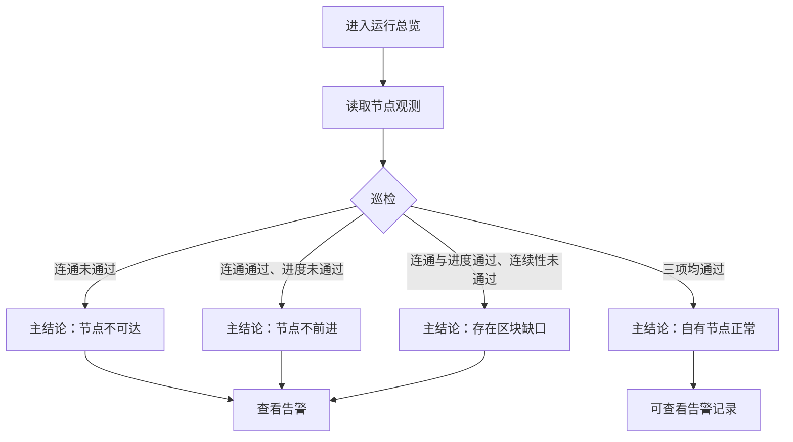
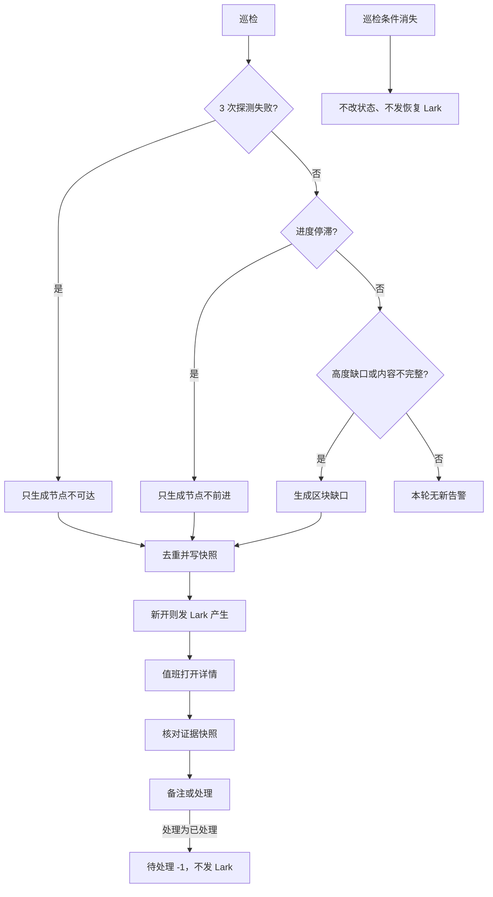
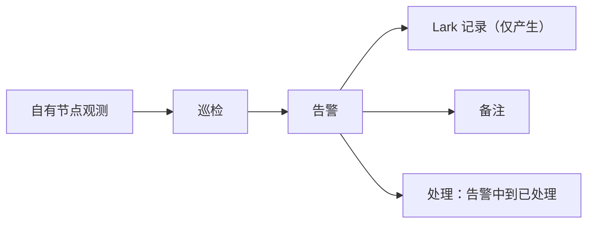

# BIYA DEX Explorer Admin 后台 · 产品需求文档

## 文档说明

| 项目 | 内容 |
| --- | --- |
| 文档版本 | **V1.1.6** |
| 创建日期 | 2026-10-20 |
| 产品经理 | Terry |
| 产品名称 | BIYA DEX Explorer 管理后台 |
| 文档定位 | 定义 DEX 区块浏览器告警值班台：运行总览、告警查看与备注、人工处理结案、Lark 通知记录；不定义节点修复、索引回补、角色权限或交易运营 |
| 核心能力 | 运行总览 → 告警中心（查看 / 备注 / 处理 / Lark） |

---

## 目录

* [1. 本版交付摘要](#1-本版交付摘要)
* [2. 后台框架与通用规则](#2-后台框架与通用规则)
* [3. 运行总览](#3-运行总览)
* [4. 告警中心](#4-告警中心)
* [5. 横切规则](#5-横切规则)
* [6. 异常与提示](#6-异常与提示)
* [7. 产品验收条件汇总](#7-产品验收条件汇总)

---

## 1. 本版交付摘要

### 1.1 产品目标

BiyaDEX 区块浏览器直接向自有节点取数。页面上的高度就是该节点当时承认的执行高度。值班需要回答三件事：问得到节点吗、节点还在往前走吗、问回来的高度是否连续且内容完整。

没有本后台时，异常只出现在前台失败或群消息里，无法留下可核对的证据、备注、人工结案和通知结果。本版解决「能看见、能备注、能处理结案、能确认是否已通知」，不解决「在后台把节点修好」。

**数据前提：** 不存在「查询库落后于这台节点」这一层，也不为此单开告警。

**目标与非目标**

| 目标 | 可观察结果 |
| --- | --- |
| 值班可判断 | 总览给出连通、进度、高度连续性之一的主结论，以及告警中条数 |
| 告警可核对 | 仅 3 类目录可打开详情；证据快照为告警当时字段，足够判断类型 |
| 沟通可留痕 | 备注出现在告警时间线；新开告警有一条 Lark 产生记录 |
| 状态可结案 | 系统只写入「告警中」；值班可将告警中处理为「已处理」，不可改回；巡检不自动改状态 |
| 事实只读 | 后台没有任何改高度、改交易的按钮 |

**非目标：** 节点修复、回补/重放、独立查询菜单、操作记录页、登录页、角色与权限配置、交易运营、EVM/Token/合约、告警关联交易。

**已拍板口径（A1–A4）**

| 编号 | 口径 |
| --- | --- |
| A1 | 不交付登录页。会话有效才能使用后台；失效后不可操作，提示联系管理员重新进入。 |
| A2 | 节点不可达：连续 **3** 次最新高度或健康检查失败/超时。节点不前进建议默认 **T**：有共识轮次时 **30 秒**内轮次不增加；节点暂不提供轮次时，最新区块时间停滞 **5 分钟**。禁止把「两块之间隔了几秒」当成不前进。上线前按真实出块/安静盘再校一次。验收测「停滞→告警中并发送 Lark；节点再推进 **不** 自动改状态」，不把秒数测成唯一通过条件。页面 **不** 展示「T / 不写死秒数」这类实现口径。 |
| A3 | 总览「24h 链上交易数 / 24h 活跃地址」与 **DEX 前台首页同一时间窗口**，本后台不另定义。 |
| A4 | 关闭抽屉或弹窗 **无二次确认**；未提交的备注/原因丢弃；已保存内容保留。 |

### 1.2 核心数据模型

| 层级 | 实体 | 标识 | 核心作用 | 人工可改 |
| --- | --- | --- | --- | --- |
| L1 | 节点观测 | 自有节点 | 可达性、执行高度、共识轮次、最新区块时间 | 不可改 |
| L2 | 告警 | 告警编号 | 3 类目录、状态、证据快照、备注 | 追加备注；将告警中处理为已处理 |
| L2 | Lark 记录 | 告警子记录 | 产生与发送结果 | 系统写 |
| L3 | 区块 | 高度 / 区块哈希 | 顶栏只读核验 | 不可改 |

**生效原则**

- **巡检：** 系统按连通 → 进度 → 连续性的顺序，向自有节点做的一轮检查。
- 巡检只创建「告警中」，**不**写入「已恢复」，**不**因当前三项均通过而自动结案。
- 值班把「告警中」处理为「已处理」后，该条不再计入待处理；**不可**改回告警中。
- 协议执行拒绝、未登记交易类型：前台照常展示，不进告警目录。本期告警不关联具体交易。

### 1.3 本版交付能力

| 优先级 | 能力 |
| --- | --- |
| **P0** | 运行总览只读（高度、轮次、最新块时间、巡检、首页统计观察、待处理告警入口） |
| **P0** | 告警中心：3 类列表、筛选、详情、告警当时快照、备注、将告警中处理为已处理 |
| **P0** | 新开告警按类型发送 Lark（三类模板）；记录发送成功/失败 |
| **P0** | 顶栏按区块高度 / 区块哈希打开只读区块抽屉（可选核对，不是告警结案路径） |

后续（不在本期验收）：交易类型中文映射、地址标签、回补操作台、DEX 只读 API、角色与权限配置。

**本版不做**

| 不做 | 说明 |
| --- | --- |
| 登录页 | 不交付登录/登出；身份来自已有内部会话 |
| 角色与权限 | 不交付成员菜单授权、角色切换、权限配置页 |
| 独立查询菜单 | 区块/交易/地址/数据检查/交易类型/提议者不是侧栏模块 |
| 告警关联交易 | 无「查看关联数据」；不打开交易/地址作为告警关联对象 |
| 改回告警中 | 已处理不可改回告警中 |
| 自动恢复状态 | 无「已恢复」；巡检不因三项均通过而改告警状态 |
| 修复动作 | 无补齐、重处理、回补、分派 |
| 操作记录页 | 备注与处理成功即可，不提供审计查询页 |
| 交易运营 / EVM | 订单、仓位、Vault、合约、Token、NFT、Gas |

---

## 2. 后台框架与通用规则

### 2.1 模块说明

| 项 | 说明 |
| --- | --- |
| **用户** | 已有内部身份的值班人员 |
| **管理模块** | 运行总览、告警中心 |
| **附属** | 顶栏搜索；命中高度或区块哈希时打开区块抽屉 |

### 2.2 页面框架

| 区域 | 内容 | 交互 |
| --- | --- | --- |
| 侧边导航 | 运行总览、告警中心；告警中心可显示「告警中」条数角标 | 筛选不跨模块继承 |
| 顶部栏 | 面包屑、全局搜索、当前成员姓名 | 无登录/登出入口；无独立网络胶囊 |
| 标题区 | 标题、说明、`更新于 {YYYY-MM-DD HH:mm:ss} UTC+8`、刷新 | 无模块级主写按钮 |
| 筛选区 | 条件 | 查询回第一页、恢复默认排序 |
| 列表区 | 表格、条数、分页 | 见下方「数据列表」；切换页保留筛选与当前排序 |
| 抽屉 | 告警详情为主；顶栏命中时可打开区块 | 同时仅一个主抽屉 |
| 弹窗 | 添加备注、处理 | 同时仅一个主弹层；关闭即丢弃未提交内容 |

### 2.3 通用交互规则

| 项 | 规则 |
| --- | --- |
| 数据列表 | 凡表格均须写清排序、默认条数、是否分页。规则见下表 |
| 分页 | 告警中心每页 **10** 条；展示「共 x 条」「时间 UTC+8 · 每页 10 条」「显示 a–b 条，共 x 条」 |
| 时间 | `YYYY-MM-DD HH:mm:ss`，UTC+8 |
| 地址/哈希 | 等宽缩略，悬停全文，可复制 |
| 空值 | `—` |
| 详情 | 字段名弱展示，值为正文；不规定颜色与像素 |

**数据列表（排序与条数）**

| 列表 | 数据范围 | 默认排序 | 可改排序 | 默认条数 | 超出时 |
| --- | --- | --- | --- | --- | --- |
| 运行总览 · 需要关注 | 仅「告警中」 | 最近发生降序 → 首次发生降序 → 告警编号降序 | 否 | 最多 **5** 条 | 第 6 条及以后不在本卡展示；点右上「全部告警 →」进入告警中心查看 |
| 告警中心 | 当前筛选结果（默认全部） | 同上（最近发生降序） | 可点列：首次发生、类别、状态；再点同一列切换升/降序 | 每页 **10** 条，默认第 1 页 | 分页翻看；筛选 / 重置后回第 1 页并恢复默认排序 |
| 详情 · Lark 通知记录 | 该条 `lark` | 发送时间升序（最早在上） | 否 | 全部展示，不分页 | — |
| 详情 · 状态变更 | 该条 `statusChanges` | 写入时间升序 | 否 | 全部展示，不分页 | — |
| 详情 · 备注 | 该条 `notes` | 写入时间升序 | 否 | 全部展示，不分页 | — |

时间相同则比较下一关键字。告警编号按字符串降序（如 `ALT-1003` 在 `ALT-1001` 前）。

**全局搜索**

占位文案：`区块高度 / 区块哈希`

| 输入 | 系统行为 |
| --- | --- |
| 空 | 不搜索 |
| 纯数字且精确命中该高度 | 打开该区块抽屉 |
| 纯数字无精确命中、仅一条前缀建议 | 打开该建议区块 |
| 纯数字无精确命中、多条前缀建议 | Toast：`命中多个结果，请选择建议项。` 点选后再打开 |
| 纯数字无命中 | 打开区块空态，不拼接默认块 |
| 唯一命中区块哈希 | 打开该区块抽屉（可停在当前模块） |
| 多个哈希建议 | Toast：`命中多个结果，请选择建议项。` 点选后再打开 |
| `0x` + 64 位十六进制且命中区块哈希 | 打开该区块 |
| `0x` + 64 位十六进制且未命中区块哈希 | Toast：`未找到该区块哈希。不打开交易详情。` |
| `0x` + 40 位十六进制 | Toast：`不展示地址关联交易，请搜索区块高度。` |
| 其他无结果 | Toast：`未找到该搜索内容，请输入区块高度或区块哈希。` |

建议只匹配区块高度与区块哈希，**不**匹配父哈希。搜索不打开交易、地址或已下线的独立列表页。告警详情不提供「查看关联数据」。

### 2.4 详情展示规则

| 项 | 规则 |
| --- | --- |
| 字段名称 | 弱展示 |
| 字段值 | 正文 |
| 空值 | 展示 `—` |
| 地址/哈希 | 等宽缩略，悬停全文，可复制 |

**复制**

| 结果 | 文案 |
| --- | --- |
| 成功 | `已复制完整内容。` |
| 环境无法复制 | `当前浏览器无法自动复制，请在详情中选择完整内容。` |

### 2.5 全局页面状态

| 场景 | 触发 | 展示 | 可操作 | 是否保留输入 |
| --- | --- | --- | --- | --- |
| 加载中 | 进入模块、切换筛选、刷新 | 标题说明 `正在读取节点数据` + 占位 | 不可对未加载行操作、不可重复提交 | 是 |
| 正常 | 加载成功 | 筛选 + 内容 | 可查看、备注、处理 | — |
| 空数据 | 无记录 | 标题 `暂无数据`；说明 `当前没有可展示记录。` | 可改筛选 | — |
| 筛选无结果 | 有数据但无匹配 | `无匹配记录`；`请调整筛选条件后重新查询。` | 可重置 | 筛选条件保留 |
| 网络错误 | 超时/失败 | `查询服务暂时不可用`；`网络请求失败，请重试。当前筛选条件将保留。` | 重试 | 筛选条件保留 |
| 会话失效 | 身份无效 | `会话已失效`；`联系管理员重新进入。` 导航、搜索、刷新、抽屉均不可用 | 重新进入后台 | — |
| 提交中 | 保存备注/处理 | 主按钮不可再点 | 不可重复提交 | 是 |
| 提交成功 | 校验与保存成功 | Toast，关闭弹窗，刷新当前详情或列表 | 继续查看 | 已保存内容保留 |
| 提交失败 | 校验或保存失败 | 弹窗内错误或 Toast | 改后重试 | 输入保留 |

### 2.6 顶栏区块抽屉

只读核对某一高度，不作为日常查询菜单，也不是告警结案路径。

| 项 | 说明 |
| --- | --- |
| **触发** | 顶栏搜索区块高度或区块哈希 |
| **约束** | 侧栏无区块菜单；查无结果不拼接默认对象；无块内交易、无交易/地址抽屉、无前后区块翻页 |

Tab：区块概览 / 数据来源。

**区块概览**

| 字段 | 说明 |
| --- | --- |
| 区块高度 | 整数 |
| 查询状态 | 仅 **可查询** / **区块缺口** |
| 区块哈希 | 等宽缩略，悬停全文，可复制 |
| 父区块哈希 | 同上，不打开其他抽屉 |
| 区块时间 · UTC+8 | `YYYY-MM-DD HH:mm:ss` |
| 链上交易数 | 笔数 |
| 提议者 | 等宽缩略，悬停全文，可复制，不打开提议者抽屉 |

缺口时底栏可「查看告警」，无横幅提示。

**数据来源**

| 字段 | 展示 |
| --- | --- |
| 数据来源 | 自有节点 · 直连查询 |
| 查询方式 | 按区块高度向节点取整块 |
| 原始数据引用 | `node/blocks/{高度}` |
| 查询状态 | 可查询 / 区块缺口 |
| 数据保护 | 节点原始数据不可在本后台编辑 |

未找到对象：标题 `未找到该区块`；说明 `当前查询不到该区块，不展示默认区块。`

关闭无确认。复制见 2.4。

### 2.7 产品验收条件

| 条件 | 预期结果 |
| --- | --- |
| 侧栏 | 仅运行总览、告警中心 |
| 搜索占位 | `区块高度 / 区块哈希` |
| 搜索精确命中的高度 | 打开区块概览；无块内交易 Tab、无前后翻页 |
| 搜索纯数字多条前缀 | `命中多个结果，请选择建议项。` |
| 搜索不存在的高度 | 标题 `未找到该区块`；`当前查询不到该区块，不展示默认区块。`，不展示另一条默认块 |
| 搜索建议 | 不匹配父哈希 |
| 区块查询状态 | 仅可查询 / 区块缺口 |
| 搜索 `0x`+64 未命中区块哈希 | `未找到该区块哈希。不打开交易详情。` |
| 搜索 `0x`+40 | `不展示地址关联交易，请搜索区块高度。` |
| 告警详情 | 无「查看关联数据」；证据在详情快照 |
| 分页 | 每页 10 条 |
| 关闭弹窗/抽屉 | 无二次确认；未提交丢弃 |
| 登录 | 无登录/登出 |
| 角色与权限 | 无该菜单与配置页 |

---

## 3. 运行总览

### 3.1 用户目标

判断自有节点当前主结论，并进入告警中心。

### 3.2 模块说明

| 项 | 说明 |
| --- | --- |
| **触发** | 进入「运行总览」；后台落地页 |
| **核心能力** | 只读健康摘要、首页统计观察、待处理告警入口 |
| **约束** | 不能改高度、改阈值、把节点观测改成正常 |

### 3.3 流程步骤

系统按 **连通 → 进度 → 连续性** 的顺序检查；本页主结论只展示最先未通过的一项，展示在「节点巡检状态」卡片。



| 步骤 | 操作 | 系统 | 结果 |
| --- | --- | --- | --- |
| 1 | 进入 | 拉观测与告警中条数 | 巡检状态 + 指标 |
| 2 | 阅读 | 按连通 → 进度 → 连续性给出一条主结论 | 正式环境不同时作为主结论展示三类 |
| 3 | 点查看告警 | 进入告警中心 | 可继续筛选 |

产品规则以互斥为准。演示同时列出 3 类样本 **不作为验收**。

### 3.4 指标口径

**主结论（节点巡检状态）**

| 结论 | 条件 |
| --- | --- |
| 自有节点正常 | 连通、进度、连续性均通过 |
| 节点不可达 | 连通未通过 |
| 节点不前进 | 连通通过且进度未通过 |
| 存在区块缺口 | 连通与进度通过且连续性未通过 |

主结论来自 **当前巡检**，与告警列表里是否已人工「已处理」无关。当前巡检三项均通过但告警仍为「告警中」时，主结论可以为「自有节点正常」，待处理条数仍计入未结案告警。进入告警中心走巡检卡片或「需要关注」。

**指标卡**

每张卡 = 主值 + 一行脚注。脚注随当前巡检变化，**不**单独告警。

| 指标 | 条件 | 主值 | 脚注 |
| --- | --- | --- | --- |
| 节点最新高度 | 连通通过 | 自有节点执行高度 | `自有节点返回的执行高度` |
| 节点最新高度 | 连通未通过 | `—` | `探测失败，高度未知` |
| 共识轮次 | 连通通过且进度通过 | 节点内部进度 | `进度推进中` |
| 共识轮次 | 连通通过且进度未通过 | 节点内部进度 | `进度已停滞` |
| 共识轮次 | 连通未通过 | `—` | `无法读取` |
| 最新区块时间 | 连通通过 | `YYYY-MM-DD HH:mm:ss`，UTC+8 | `UTC+8 · 有交易时高度才递增` |
| 最新区块时间 | 连通未通过 | `—` | `节点不可达` |
| 待处理告警 | 告警中 ≥ 1 | 告警中条数 | `请到告警中心查看、备注或处理` |
| 待处理告警 | 告警中 = 0 | `0` | `当前无告警中记录` |

无交易时高度可不增；进度仍看轮次或最新块时间。建议默认 T 见 A2，页面不展示 T。

**巡检**

| 顺序 | 检查 | 通过 | 未通过 |
| --- | --- | --- | --- |
| 1 | 连通检查 | 连续 **3** 次最新高度或健康检查均得到有效应答 | 3 次均失败或超时 |
| 2 | 进度检查 | 轮次增加；无轮次时最新块时间未超过建议默认 T（有轮次 30 秒 / 无轮次 5 分钟） | 轮次与最新块时间均停滞 |
| 3 | 连续性检查 | 可核对范围内高度连续且内容完整 | 缺高度或内容不完整 |

**巡检卡片展示**

| 检查 | 列说明 | 通过 | 未通过 | 本轮未执行 |
| --- | --- | --- | --- | --- |
| 连通检查 | 连续 3 次请求最新高度或健康检查。 | 主值 `可达`；状态 `探测成功` | 主值 `不可达`；状态 `连续失败或超时` | — |
| 进度检查 | 优先看共识轮次是否增加；没有轮次时看最新区块时间。 | 主值 `推进中`；状态 `无交易时高度可不增` | 主值 `已停滞`；状态 `轮次与区块时间未推进` | 连通未通过时主值 `—`，状态 `本轮未检查` |
| 连续性检查 | 按高度能查到的区块是否连续、内容是否完整。 | 主值 `连续`；状态 `无缺口` | 主值 `有缺口`；状态 `高度 {缺失高度} 缺失` | 连通或进度未通过时主值 `—`，状态 `本轮未检查` |

**可核对范围：** 仍可按高度或哈希向节点问到详情。

连通检查未通过则本轮不展示「因进度或连续性产生的新主结论」，后两步展示为未检查。判定细则见 [4.4](#44-告警目录与判定)。

**首页数据（只读）**

卡片名「浏览器首页数据」。字段：总交易数、24h 链上交易数、地址总数、24h 活跃地址。24h 窗口与 DEX 前台首页相同。累计总量与近 1 万条浏览窗口分开。这些数字 **不** 单独告警，不展示「正常 / 观察中」徽章，地址总数旁不附 24h 新增。不做 TPS 折线图；TPS 不单独告警，也不在本卡展示。本卡与右侧「节点与查询状态」同一行、同高。

**节点与查询状态** 仅两行，不重复巡检三步。卡片右上：`最近检查 {YYYY-MM-DD HH:mm:ss} UTC+8`。

| 行 | 副文 | 通过 | 未通过 |
| --- | --- | --- | --- |
| 自有节点连通 | 浏览器直连节点请求最新高度 | 耗时 + 徽章 `正常` | `超时` + 徽章 `异常` |
| 区块查询 | 按高度或哈希向节点取整块 | 耗时 + 徽章 `正常` | `超时` + 徽章 `异常` |

**需要关注：** 入口 `全部告警 →`。列：告警、影响对象、处理状态、操作（查看处理）。只含「告警中」，按最近发生降序，最多展示 **5** 条。第 6 条及以后不出现在本卡，须点「全部告警 →」进入告警中心查看。无则空态：`当前没有待处理告警`。角标与待处理告警数字仍为全部告警中条数，不受 5 条截断影响。

### 3.5 交互规则

| 场景 | 触发 | 前置 | 反馈 | 防重 | 二次确认 | 关闭后 |
| --- | --- | --- | --- | --- | --- | --- |
| 进入总览 | 导航 | 会话有效 | 加载后展示主结论 | — | 无 | — |
| 查看告警 | 巡检卡片或需要关注 | 会话有效 | 进入告警中心 | — | 无 | — |

### 3.6 数据管理

节点可达、节点前进、缺口是否仍存在、高度/轮次/最新块时间由巡检写入，人工不可改。首页统计来自与前台相同的节点查询结果。告警状态不随巡检自动改写。

### 3.7 产品验收条件

| 条件 | 预期结果 |
| --- | --- |
| 打开运行总览且节点 3 次探测失败 | 主结论为节点不可达；高度 / 轮次 / 时间为 `—`；脚注分别为 `探测失败，高度未知` / `无法读取` / `节点不可达`；进度与连续性为 `—` / `本轮未检查`；可点查看告警 |
| 节点可达但进度判定为停滞 | 主结论为节点不前进（正式环境不以缺口为主结论）；共识轮次脚注 `进度已停滞`；连续性为 `—` / `本轮未检查` |
| 连通与进度通过且存在可核对缺口 | 主结论为存在区块缺口 |
| 连通、进度、连续性均通过 | 主结论为自有节点正常；底栏按钮为查看告警记录 |
| 告警中有 6 条 | 「需要关注」最多展示 5 条；第 6 条只在告警中心列表可见；角标与待处理数字为 6 |
| 当前巡检三项均通过但对应告警仍为告警中 | 主结论可为自有节点正常；待处理仍计入该条 |
| 会话失效 | 不可继续操作，提示 `联系管理员重新进入。` |

---

## 4. 告警中心

### 4.1 用户目标

查看本期 3 类告警，核对应证据快照，写备注，将告警中处理为已处理，确认 Lark 记录。

### 4.2 模块说明

| 项 | 说明 |
| --- | --- |
| **触发** | 告警中心菜单或总览跳转 |
| **有** | 列表、筛选、详情（含告警当时快照）、备注、处理 |
| **无** | 分派、后台重发 Lark 修复、回补、自动「已恢复」、查看关联数据、改回告警中 |

### 4.3 流程步骤



| 步骤 | 操作 | 系统 | 结果 |
| --- | --- | --- | --- |
| 1 | 进入 | 加载列表，默认全部 | 可见目录内告警 |
| 2 | 按告警类别或告警状态筛选 | 过滤，回第一页，恢复默认排序（最近发生降序） | 每页 10 条 |
| 3 | 查看 | 打开详情抽屉 | 只读主信息 + 告警当时快照 |
| 4 | 添加备注 | 校验后追加 | Toast 成功；不同步 Lark |
| 5 | 处理 | 仅告警中；校验后改为已处理 | Toast 成功；不同步 Lark；不可改回 |
| 6 | — | 巡检条件消失 | 状态保持原值；不发恢复通知 |

### 4.4 告警目录与判定

本期仅 3 条。本节为判定 **唯一正文出处**。

| 序号 | 名称 | 作用范围 | 判定 | 后台 | 系统 |
| --- | --- | --- | --- | --- | --- |
| 1 | 节点不可达 | 整节点 | 连续 **3** 次请求最新高度或健康检查全部失败或超时 | 查看、备注、处理 | Lark 产生 |
| 2 | 节点不前进 | 整节点 | 已连通；窗口内轮次不增加。无轮次时用「当前时间 − 最新块时间 ≥ T」。建议默认：有轮次 **30 秒**，无轮次 **5 分钟**；两块间隔几秒不是不前进 | 查看、备注、处理 | Lark 产生 |
| 3 | 区块缺口 | 某一高度 | 可向节点查询的窗口内高度不连续；或该高度动作与结果条数不一致 | 查看、备注、处理 | Lark 产生 |

**互斥**

```text
1. 节点不可达 → 只报这一条，本轮停止
2. 否则节点不前进 → 只报这一条，本轮不扫缺口
3. 否则扫可查询窗口 → 区块缺口
```

| 判定顺序 | 本轮抑制 | 并存 |
| --- | --- | --- |
| 1 节点不可达 | 其余 2 条 | 否 |
| 2 节点不前进 | 缺口 | 否 |
| 3 区块缺口 | 无 | 不同高度区间可并存；同一连续空洞合并一条 |

**生成缺口前：** 须绑定高度或起止区间，且该高度当前仍可向节点查询。按高度已不可查：不新开；已有告警在详情标注「超出可核对范围」，**状态仍为告警中**（除非值班已处理为已处理）。

**去重**

| 情况 | 系统行为 |
| --- | --- |
| 同类同对象且当前为告警中 | 更新最近发生与快照，不新开，不重复发 Lark |
| 同类同对象且当前为已处理，本轮条件仍成立 | 新开一条告警中，并发送 Lark 产生 |
| 巡检条件消失 | 不改状态，不发 Lark |

**不进目录：** 查询服务不可用、数据同步延迟、未知类型、首页统计不一致、协议拒绝、某提议者不出块、两块间隔几秒、每秒交易数（TPS）偏低。动作与结果不成对并入缺口「内容不完整」。

### 4.5 列表与筛选

无 Tab。不提供「全部告警 / 告警中」页签，也不提供告警关键字。从运行总览「全部告警 →」进入时打开本页，筛选为默认（类别、状态均为全部）。

**筛选：** 仅告警类别（3 类）、告警状态（告警中 / 已处理）。两项均为下拉，空值为「全部」。

**列：** 告警编号 / 内容、类别、首次发生、Lark、状态、操作（详情；告警中另有处理；备注）

Lark 列展示最近一条：已通知 / 通知失败。无记录时 `未发送`。

已处理行不展示「处理」。

**排序**

| 项 | 规则 |
| --- | --- |
| 默认 | 最近发生降序 → 首次发生降序 → 告警编号降序 |
| 可点列 | 首次发生、类别、状态。第一次点击该列为降序，再点切换升序 |
| 不可点列 | 告警编号 / 内容、Lark、操作 |
| 恢复默认 | 查询、重置 |

列表不展示「最近发生」列，默认仍按该字段排，保证刚更新快照的告警中排在前面。

**分页**

| 项 | 规则 |
| --- | --- |
| 每页 | **10** 条 |
| 默认页 | 第 1 页 |
| 表头 | `共 x 条`；`时间 UTC+8 · 每页 10 条` |
| 表尾 | `显示 a–b 条，共 x 条`；上一页 / 页码 / 下一页 |
| 筛选或重置 | 回到第 1 页 |
| 切换页 | 保留当前筛选与排序 |

### 4.6 状态

系统写入的状态 **只有「告警中」**。无「已恢复」。值班仅可将「告警中」处理为「已处理」，**不可改回**。

| 状态 | 谁写入 | 含义 | 值班 |
| --- | --- | --- | --- |
| 告警中 | 巡检创建 | 未结案，计入待处理与角标 | 查看、备注、处理 |
| 已处理 | 仅值班 | 人工结案，不计入待处理 | 查看、备注 |

「超出可核对范围」是详情说明，不是状态。

### 4.7 详情

从列表标题、操作列「详情」或总览「需要关注」的「查看处理」打开**告警详情抽屉**。同时只开一个主抽屉。抽屉数据来自**这一条告警记录**，不回写节点、不改运行总览当前值。

通用展示遵循 [2.4](#24-详情展示规则)：字段名弱展示，值为正文；标量空值一律 `—`；时间统一 `YYYY-MM-DD HH:mm:ss`、UTC+8。值班在详情里能改的只有备注和处理，见 [4.8](#48-交互规则)。

#### 抽屉壳

| 位置 | 内容 | 数据来源 | 显示逻辑 |
| --- | --- | --- | --- |
| 抽屉标题 | `告警详情 · {告警编号}` | 该条 `id` | 编号等宽。找不到该条则不打开抽屉 |
| 底部左侧 | `证据为告警当时快照` | 固定文案 | 始终展示 |
| 底部「处理」 | 打开处理弹窗 | — | **仅**当前状态为告警中时出现；已处理隐藏 |
| 底部「添加备注」 | 打开备注弹窗 | — | 告警中、已处理都出现 |
| 底部「关闭」 | 关闭抽屉 | — | 始终出现 |

无「查看关联数据」，不从详情跳到区块 / 交易 / 地址抽屉。

#### 基本信息

标题在网格上方单独成行，其余字段两列网格；「影响对象」「详情」整行。

| 字段 | 数据来源 | 谁写入 | 显示逻辑 | 空值 | 可复制 | 可改 |
| --- | --- | --- | --- | --- | --- | --- |
| 标题 | 巡检创建告警时按类别生成 | 系统 | 节点不可达 → `节点不可达`；节点不前进 → `节点不前进`；区块缺口 → `区块缺口：{高度或起止}`，连续空洞写 `区块缺口：{起}-{止}` | 不允许空；异常时仍展示系统生成句 | 否 | 否 |
| 状态 | 该条 `status` | 系统创建为告警中；此后仅值班处理为已处理 | 徽章：告警中 / 已处理。与列表、待处理角标同一字段 | 不允许空 | 否 | 仅经处理弹窗，见 4.8 |
| 类别 | 该条 `category` | 系统，与 [4.4](#44-告警目录与判定) 三选一 | 原文：`节点不可达` / `节点不前进` / `区块缺口`。与标题类别一致 | 不允许空 | 否 | 否 |
| Lark 群 | 配置常量 | 配置 | 固定 `BIYA-DEX Explorer 告警`。与是否已发出无关 | 不允许空 | 否 | 否 |
| 首次发生 · UTC+8 | 该条 `first` | 系统，本条记录创建时刻 | 创建后不再改。去重更新快照时也不改 | 不允许空 | 否 | 否 |
| 最近发生 · UTC+8 | 该条 `last` | 系统 | 新开时等于首次发生。同类同对象仍为告警中、本轮条件仍成立时，更新为本轮巡检时刻 | 不允许空 | 否 | 否 |
| 影响对象 | 该条 `ref` | 系统 | 不可达、不前进：`自有节点`。缺口：缺失或不完整的高度，等宽；连续空洞为 `起-止`。整行 | 不允许空 | 是，复制全文 | 否 |
| 详情 | 该条 `detail` | 系统，按类别套句 | 一句话说明判定结果，可含错误码原文。整行。不是值班备注 | 不允许空 | 否 | 否 |

详情句由系统生成，示例口径（验收看结构，不核样例数字）：

| 类别 | 详情生成规则 |
| --- | --- |
| 节点不可达 | `连续 3 次向自有节点请求最新高度均超时（{错误码}）。` |
| 节点不前进 | `节点可达，但共识轮次与最新区块时间均未推进。` |
| 区块缺口 | `高度不连续：{H-1} 与 {H+1} 可查，{H} 按高度查询不到完整块。`；内容不完整则写动作/结果不一致 |

#### 证据快照 · 告警当时

分组标题：`证据快照 · 告警当时`。分组说明（固定）：`以下为产生告警时的节点观测，不是运行总览的当前值。`

快照在**本条告警首次创建或去重更新**时写入，打开详情只读这一份。运行总览刷新、节点后来恢复、值班处理，都**不**改已写入的快照。空字段显示 `—`，不省略列（类型专有行除外）。

**三类都展示的快照字段**

| 字段 | 数据来源 | 节点不可达 | 节点不前进 | 区块缺口 | 显示逻辑 |
| --- | --- | --- | --- | --- | --- |
| 错误码 / 探测结果 | 快照 `error`，否则 `summary` | 要 | 要 | 要 | 优先展示错误码原文（等宽），如 `NODE_TIMEOUT`、`PROGRESS_STALL`、`HEIGHT_GAP`。无错误码则展示探测摘要。两者都无则 `—` |
| 节点高度 | 快照 `nodeHeight` | `—`（探测失败，当时读不到） | 告警当时节点返回的执行高度，千分位 | 告警当时节点执行高度（窗口顶端），千分位 | 数字等宽。`null` / 缺省 → `—` |
| 共识轮次 | 快照 `nodeRound` | `—` | 告警当时轮次，千分位 | 当时有轮次则展示 | 节点无轮次协议时 `—` |
| 最新区块时间 | 快照 `lastBlockTime` | `—` | 告警当时最新块时间，UTC+8 | 当时可读则展示 | 格式同基本信息时间。`null` → `—` |

**按类别增行（没有该类则整行不渲染）**

| 字段 | 出现条件 | 数据来源 | 显示逻辑 |
| --- | --- | --- | --- |
| 连续探测 | 类别 = 节点不可达 | 判定规则，不是快照里的变量 | 固定文案 `3 次失败或超时`。其它类别不出现此行 |
| 动作数 / 结果数 | 类别 = 区块缺口 | 快照 `actionCount` / `resultCount` | `{动作数} / {结果数}`。缺块未读到体时两侧都是 `—`，显示 `— / —`。动作与结果不一致时展示两个具体整数 |
| 核对说明 | 类别 = 区块缺口，且**打开详情当下**按影响对象高度向节点取整块仍失败或不完整 | **打开时现查**，不是快照 | 固定 `该高度当前按节点查询不到完整块。` 整行。现查已能取到完整块则**不出现此行**（快照仍保留告警当时的缺口证据） |
| 超出可核对范围 | 类别 = 区块缺口，且该高度已不在可核对窗口（节点仍在，但按高度已问不到） | 打开时用当前可核对范围判断 | 固定 `超出可核对范围`。这是说明，**不是**状态，不把告警中改成已处理。与「核对说明」可同时出现 |

错误码取值（写入快照，详情原文展示）：

| 错误码 | 对应类别 | 含义 |
| --- | --- | --- |
| `NODE_TIMEOUT` | 节点不可达 | 连续 3 次最新高度或健康检查失败或超时 |
| `PROGRESS_STALL` | 节点不前进 | 已连通，窗口内轮次与最新块时间均未推进 |
| `HEIGHT_GAP` | 区块缺口 | 可核对窗口内缺高度，或该高度动作与结果条数不一致 |

**不进入告警详情（三类都不展示）**

区块哈希、父区块哈希、提议者、交易列表、交易哈希、地址、首页统计、TPS。缺口只核「该高度在不在、块内容全不全」。

#### Lark 通知记录

分组标题：`Lark 通知记录`。记录来自该条告警的 `lark` 数组，只追加。发送规则见 [4.9](#49-lark-消息模板)：仅新开「告警中」发一条事件「产生」；去重更新快照、备注、处理、巡检条件消失都不追加。

无记录时展示：`尚未发送`。有记录时表格，按发送时间正序，最早在上。

| 列 | 数据来源 | 显示逻辑 |
| --- | --- | --- |
| 时间 | 该次发送尝试时刻 | UTC+8，`YYYY-MM-DD HH:mm:ss` |
| 事件 | 发送类型 | 本期只有 `产生` |
| 群 | 发送时的群名 | 与基本信息「Lark 群」相同，`BIYA-DEX Explorer 告警` |
| 状态 | 通道回执 | 成功 → 徽章 `已通知`；失败 → 徽章 `通知失败`。失败**不**改告警状态，后台**无**重发按钮 |
| 摘要 | 快照 `summary`，否则详情前 80 字 | 一行摘要。空则 `—` |

表格下方：该条若带消息正文，用等宽预格式全文展示（与 4.9 模板一致）。最近一条状态为失败时，另给固定说明：`发送失败不影响告警本身，由通道侧排查，后台不重发修复。备注与处理不同步 Lark。`

#### 状态变更

分组标题：`状态变更`。来自该条 `statusChanges`，只追加。系统创建告警中**不**写本列表。巡检三项通过**不**写本列表、不改状态。

无记录时：`尚无人工状态变更。巡检三项通过也不会自动结案。`

有记录时时间线，正序，每条：

| 片段 | 数据来源 | 显示逻辑 |
| --- | --- | --- |
| 原状态 → 新状态 | `from` / `to` | 本期只有 `告警中 → 已处理` |
| 原因 | 处理弹窗「处理说明」 | 去首尾空白后原文，≥ 3 字 |
| 时间 | 提交处理的时刻 | UTC+8 |
| 填写人 | 提交时的当前成员姓名 | 如 `林晨` |

#### 备注

分组标题：`备注`。来自该条 `notes`，只追加。默认**不同步** Lark。告警中、已处理都可继续追加。

无记录时：`暂无备注`。

有记录时时间线，正序（最早在上），每条：

| 片段 | 数据来源 | 显示逻辑 |
| --- | --- | --- |
| 内容 | 备注弹窗正文 | 去首尾空白后原文，≥ 3 字 |
| 时间 | 保存时刻 | UTC+8 |
| 填写人 | 保存时的当前成员姓名 | 与状态变更同一套身份 |

### 4.8 交互规则

**添加备注**

| 字段Key | 中文名 | 组件 | 必填 | 默认 | 字数 | 校验 | 来源 |
| --- | --- | --- | --- | --- | --- | --- | --- |
| note | 备注 | 多行文本 | 是 | 空 | 去首尾空白后 ≥ 3 | 不足则阻断 | 当前成员输入 |

占位：`记录排查进展、群内沟通或外部修复情况`

| 场景 | 触发 | 前置 | 反馈 | 防重 | 二次确认 | 关闭后 |
| --- | --- | --- | --- | --- | --- | --- |
| 打开备注 | 添加备注 | 会话有效 | 弹窗 | — | 无 | — |
| 校验失败 | 保存 | 字数 < 3 | 弹窗：`请填写至少 3 个字符的备注。` | 可再点保存 | 无 | 输入保留 |
| 保存成功 | 保存 | 通过校验 | Toast：`备注已保存。` 关闭弹窗，详情时间线多一条 | 提交中不可再点 | 无 | 已保存保留 |
| 取消 | 取消或关闭 | — | 关闭弹窗 | — | 无 | 未提交丢弃 |

写入：当前成员姓名、当前时间 UTC+8。只追加。

**处理**

无状态下拉。固定将当前「告警中」改为「已处理」。

| 字段Key | 中文名 | 组件 | 必填 | 默认 | 字数 | 校验 | 来源 |
| --- | --- | --- | --- | --- | --- | --- | --- |
| statusReason | 处理说明 | 多行文本 | 是 | 空 | 去首尾空白后 ≥ 3 | 不足则阻断 | 当前成员输入 |

占位：`说明结案依据`

弹窗说明：处理不同步到 Lark。处理后不可改回告警中。巡检三项通过也不会自动改状态。

| 场景 | 触发 | 前置 | 反馈 | 防重 | 二次确认 | 关闭后 |
| --- | --- | --- | --- | --- | --- | --- |
| 打开处理 | 列表或详情「处理」 | 当前为告警中 | 弹窗，展示 告警中 → 已处理 | — | 无 | — |
| 已处理再点 | 处理 | 当前已是已处理 | Toast：`该告警已处理。` 不打开弹窗 | — | 无 | — |
| 原因过短 | 确认处理 | 字数 < 3 | 弹窗：`请填写至少 3 个字符的原因。` | 可再保存 | 无 | 输入保留 |
| 非告警中提交 | 确认处理 | 状态不是告警中 | 弹窗：`只能将告警中改为已处理。` | — | 无 | — |
| 保存成功 | 确认处理 | 告警中且原因通过 | Toast：`告警已处理。` 关闭弹窗，刷新列表与详情 | 提交中不可再点 | 无 | 已保存保留 |
| 取消 | 取消或关闭 | — | 关闭弹窗 | — | 无 | 未提交丢弃 |

写入：当前成员姓名、当前时间 UTC+8、原状态「告警中」、新状态「已处理」、原因。只追加状态变更记录。不发送 Lark。

### 4.9 Lark 消息模板

群：`BIYA-DEX Explorer 告警`。仅在 **新开告警中** 时发送，事件类型为「产生」。同类同对象仍为告警中时只更新快照，不重发。人工处理、备注、巡检条件消失均不发。

**公共字段**

| 行 | 说明 |
| --- | --- |
| 标题 | `【{告警名称}】{一句话}` |
| 告警编号 | 如 `ALT-1001` |
| 影响对象 | 自有节点，或缺口对应高度/区间 |
| 首次发生 | `YYYY-MM-DD HH:mm:ss`，UTC+8 |
| 结尾 | `请到 Explorer Admin 告警中心查看证据并备注。` |

正文按类型套用下列模板。花括号为运行时替换；示例数字仅供对照，验收看结构与字段是否齐全，不核对这些样例数值。

**节点不可达**

```text
【节点不可达】自有节点连续 3 次探测失败
告警编号：{告警编号}
影响对象：自有节点
首次发生：{首次发生}
探测结果：失败 / 超时
最近高度：—
共识轮次：—
请到 Explorer Admin 告警中心查看证据并备注。
```

示例：

```text
【节点不可达】自有节点连续 3 次探测失败
告警编号：ALT-1001
影响对象：自有节点
首次发生：2026-10-16 14:28:12
探测结果：失败 / 超时
最近高度：—
共识轮次：—
请到 Explorer Admin 告警中心查看证据并备注。
```

**节点不前进**

```text
【节点不前进】节点可达，但进度未推进
告警编号：{告警编号}
影响对象：自有节点
首次发生：{首次发生}
节点高度：{执行高度}
共识轮次：{轮次，无则 —}
最新区块时间：{最新区块时间}
请到 Explorer Admin 告警中心查看证据并备注。
```

示例：

```text
【节点不前进】节点可达，但进度未推进
告警编号：ALT-1002
影响对象：自有节点
首次发生：2026-10-16 14:30:01
节点高度：10293847
共识轮次：5021840
最新区块时间：2026-10-16 14:02:48
请到 Explorer Admin 告警中心查看证据并备注。
```

**区块缺口**

```text
【区块缺口】高度不连续或内容不完整
告警编号：{告警编号}
影响对象：区块 {高度或起止区间}
缺失/不完整高度：{高度或起止区间}
首次发生：{首次发生}
请到 Explorer Admin 告警中心查看证据并备注。
```

示例：

```text
【区块缺口】高度不连续或内容不完整
告警编号：ALT-1003
影响对象：区块 10293840
缺失/不完整高度：10293840
首次发生：2026-10-16 14:32:10
请到 Explorer Admin 告警中心查看证据并备注。
```

连续空洞合并为一条时，影响对象与缺失高度写起止，例如 `10293840–10293842`。

### 4.10 数据管理

告警编号、标题、类别、详情、对象、首次/最近发生、快照由系统写。状态由系统创建为告警中，此后仅值班可处理为已处理，不可改回。备注、状态变更、Lark 只追加。

### 4.11 产品验收条件

| 条件 | 预期结果 |
| --- | --- |
| 进入告警中心 | 无 Tab、无告警关键字；筛选仅告警类别与告警状态；告警中有「处理」；已处理无「处理」；无补齐、分派、已恢复、查看关联数据 |
| 连续 3 次探测失败 | 存在节点不可达且为告警中；本轮不以不前进或缺口为主告警 |
| 连通但进度停滞 | 存在节点不前进；本轮不因同一根因新开缺口 |
| 可核对窗口缺某一高度 | 存在区块缺口，标题含高度；详情快照含该高度与核对字段 |
| 该高度已不可向节点查询 | 不新开缺口；已有记录详情标注超出可核对范围，状态仍为告警中 |
| 详情快照 | 按类型展示告警当时字段；无区块哈希、提议者、交易列表 |
| 备注 2 个字符保存 | 提示 `请填写至少 3 个字符的备注。` 不写入 |
| 备注 ≥3 字符保存 | `备注已保存。` 时间线可见；Lark 列表不因此多一条 |
| 告警中处理为已处理并填原因 | `告警已处理。` 待处理与角标 -1；不新写 Lark；不可改回 |
| 已处理再点处理 | `该告警已处理。` 不打开弹窗 |
| 处理说明 2 字 | `请填写至少 3 个字符的原因。` 不写入 |
| Lark 通道失败 | 记录通知失败；告警仍为告警中 |
| 连通、进度或连续性重新通过 | 对应告警 **仍为告警中**（若未被人工已处理）；无恢复 Lark |
| 已处理后再满足同类同对象条件 | 新开一条告警中，并发送 Lark 产生 |
| 新开三类告警 | Lark 正文分别符合 4.9 对应模板字段 |

---

## 5. 横切规则

### 5.1 实体关系



缺口的高度写在告警快照与影响对象上，不经由交易或地址关联。

### 5.2 状态联动

判定见 [4.4](#44-告警目录与判定)。此处只写状态变化。

| 变化 | 影响 |
| --- | --- |
| 连通检查未通过 | 只新开或刷新节点不可达（告警中） |
| 进度检查未通过 | 只新开或刷新节点不前进（告警中） |
| 连续性检查未通过 | 缺口告警；连续空洞合并 |
| 同类同对象已是告警中 | 更新最近发生，不新开，不重发 Lark |
| 同类同对象已是已处理且条件仍成立 | 新开告警中 + Lark 产生 |
| 3 次探测再成功 | 不改告警状态，不发恢复 Lark |
| 轮次或最新块时间恢复推进 | 不改告警状态，不发恢复 Lark |
| 缺失高度完整可查 | 不改告警状态，不发恢复 Lark |
| 对象高度已不可查 | 已有缺口详情标注超出可核对范围；不新开；状态不变 |
| 值班处理为已处理 | 待处理与角标 -1；不发 Lark；不可改回 |

**用语**

| 用语 | 含义 |
| --- | --- |
| 巡检 | 系统按连通 → 进度 → 连续性向节点做的一轮检查 |
| 连通检查 | 巡检第 1 步：能否问到节点 |
| 进度检查 | 巡检第 2 步：节点是否还在往前走 |
| 连续性检查 | 巡检第 3 步：可核对范围内高度是否连续、内容是否完整 |
| 停滞阈值 T | 判定节点不前进的时间窗口。建议默认：有轮次 30 秒，无轮次 5 分钟；上线前按安静盘再校。页面不展示该词 |
| 区块高度 | 有交易才递增的执行高度 |
| 共识轮次 | 无交易也可推进 |
| 动作 / 执行结果 | 请求 / 链上返回 |
| 可核对范围 | 仍可按高度或哈希问到详情 |
| 近 1 万条 | 前台列表窗口，不是缺口 |
| 告警中 | 系统创建的未结案状态 |
| 已处理 | 值班人工结案，不可改回 |
| 处理 | 将告警中改为已处理 |

### 5.3 前台生效

| 后台 | 前台 |
| --- | --- |
| 不可达 | 首页与查询失败/超时 |
| 不前进 | 最新高度或时间长时间不更新（按停滞阈值 T，不按几秒） |
| 缺口 | 按高度详情失败或块内不完整 |
| 24h 数字 | 同一时间窗口 |
| 协议拒绝 | 详情展示原因，不告警 |
| 告警已处理 | 前台展示不因后台结案而改变 |

### 5.4 审计

群：`BIYA-DEX Explorer 告警`。新开时按 4.9 模板发送。失败只记结果，不改告警状态，后台不重试修复通道。备注与处理不同步。

| 操作 | 记录 |
| --- | --- |
| 添加备注 | 填写人、时间、内容 |
| 处理 | 填写人、时间、原状态、新状态、原因 |
| Lark 产生 | 时间、群、成功/失败、摘要 |

本版不提供操作记录查询页。

### 5.5 时间与精度

时间与日期筛选 UTC+8。高度与轮次为整数，禁止用轮次当区块号告警。禁止后台修改已确认区块、交易、地址。

**上线后已有数据**

首次上线允许告警列表为空。上线后由巡检写入的告警、备注、状态变更、Lark 只追加，不因发版清空。历史若曾有「已恢复」，上线后不再新写该状态；存量如何迁移不在本期定义。

---

## 6. 异常与提示

### 6.1 通用

| 触发 | 文案 | 用户下一步 |
| --- | --- | --- |
| 备注 < 3 字符 | `请填写至少 3 个字符的备注。` | 补全后保存 |
| 原因 < 3 字符 | `请填写至少 3 个字符的原因。` | 补全后保存 |
| 备注保存成功 | `备注已保存。` | 继续查看 |
| 处理成功 | `告警已处理。` | 继续查看 |
| 已处理再点处理 | `该告警已处理。` | — |
| 非告警中提交处理 | `只能将告警中改为已处理。` | — |
| 搜索多命中 | `命中多个结果，请选择建议项。` | 点选建议 |
| 64 位哈希未命中区块 | `未找到该区块哈希。不打开交易详情。` | 改搜高度或放弃 |
| 40 位地址 | `不展示地址关联交易，请搜索区块高度。` | 改搜高度 |
| 搜索无结果 | `未找到该搜索内容，请输入区块高度或区块哈希。` | 改正或放弃 |
| 复制成功 | `已复制完整内容。` | — |
| 无法复制 | `当前浏览器无法自动复制，请在详情中选择完整内容。` | 手动选择 |
| 列表/总览失败 | `查询服务暂时不可用`；`网络请求失败，请重试。当前筛选条件将保留。` | 点重试 |
| 空数据 | `暂无数据`；`当前没有可展示记录。` | — |
| 筛选无匹配 | `无匹配记录`；`请调整筛选条件后重新查询。` | 清除筛选 |
| 提交中再点 | 无新提示，忽略 | 等待 |
| 会话失效 | `会话已失效`；`联系管理员重新进入。` | 重新进入 |

### 6.2 表单

备注字数、处理说明：提示文案与下一步见 6.1。保存成功见 `备注已保存。` / `告警已处理。`

### 6.3 业务

搜索无结果、64/40 位输入、多命中、Lark 通知失败、会话失效、列表加载失败：提示文案与下一步见 6.1。

---

## 7. 产品验收条件汇总

与第 2–4 章各节验收条件相同，供提测一次核对。细则仍以各章为准。演示同时展示 3 类告警、停滞阈值 T 的具体秒数，均 **不作为** 正式验收。

| 模块 | 条件 | 预期结果 |
| --- | --- | --- |
| 总览 | 3 次探测失败 | 主结论节点不可达；高度 / 轮次 / 时间为 `—`；进度与连续性 `本轮未检查` |
| 总览 | 可达但进度停滞 | 主结论节点不前进；共识轮次脚注 `进度已停滞`；连续性 `本轮未检查` |
| 总览 | 连通与进度通过且有缺口 | 主结论存在区块缺口 |
| 总览 | 连通、进度、连续性均通过 | 主结论自有节点正常；按钮查看告警记录 |
| 总览 | 告警中 6 条 | 需要关注最多 5 条；第 6 条只在告警中心列表；角标为 6 |
| 告警 | 进入告警中心 | 默认最近发生降序、每页 10 条、第 1 页 |
| 总览 | 当前巡检三项均通过但告警仍告警中 | 主结论可正常；待处理仍计入 |
| 告警 | 进入告警中心 | 无 Tab、无告警关键字；筛选仅类别与状态；告警中有处理；已处理无处理；无已恢复、无查看关联数据 |
| 告警 | 3 次探测失败 | 不可达为告警中；本轮不以另两类为主 |
| 告警 | 进度停滞 | 不前进为告警中；本轮不新开缺口 |
| 告警 | 可核对缺高度 | 缺口标题含高度；详情快照含该高度与核对字段 |
| 告警 | 高度已不可查 | 不新开；详情标超出可核对范围；状态仍告警中 |
| 告警 | 详情快照 | 告警当时字段按类型展示；无交易列表 |
| 告警 | 备注 2 字 | `请填写至少 3 个字符的备注。` |
| 告警 | 备注 ≥3 字 | `备注已保存。` 且不新写 Lark |
| 告警 | 处理为已处理 | `告警已处理。` 待处理 -1；不新写 Lark；不可改回 |
| 告警 | 已处理再点处理 | `该告警已处理。` |
| 告警 | 处理说明 2 字 | `请填写至少 3 个字符的原因。` |
| 告警 | Lark 失败 | 通知失败；告警仍告警中 |
| 告警 | 巡检条件消失 | 状态不变；无恢复 Lark |
| 告警 | 已处理后再命中 | 新开告警中 + Lark 产生 |
| 告警 | 三类新开 | Lark 分别符合 4.9 模板 |
| 搜索 | 占位 | `区块高度 / 区块哈希` |
| 搜索 | 精确命中高度 | 打开该区块；无块内交易、无前后翻页 |
| 搜索 | 纯数字多条前缀 | `命中多个结果，请选择建议项。` |
| 搜索 | 不存在高度 | 标题 `未找到该区块`；`当前查询不到该区块，不展示默认区块。` |
| 搜索 | 建议不匹配父哈希 | 父哈希不进入搜索建议 |
| 搜索 | 区块查询状态 | 仅可查询 / 区块缺口 |
| 搜索 | `0x`+64 未命中区块 | `未找到该区块哈希。不打开交易详情。` |
| 搜索 | `0x`+40 | `不展示地址关联交易，请搜索区块高度。` |
| 共用 | 侧栏 | 仅运行总览、告警中心 |
| 共用 | 告警目录 | 仅三类 |
| 共用 | 告警状态 | 仅告警中、已处理；不可改回 |
| 共用 | 分页 | 每页 10 条 |
| 共用 | 关闭弹窗/抽屉 | 无二次确认；未提交丢弃 |
| 共用 | 登录 | 无登录/登出 |
| 共用 | 角色与权限 | 无该菜单与配置页 |
| 共用 | 操作记录 | 无审计列表菜单 |
| 共用 | 修复 | 无补齐、重处理、分派 |
| 共用 | 已有数据 | 告警、备注、状态变更发版后只追加不清空 |
| 共用 | 会话失效 | 不可操作；`联系管理员重新进入。` |

---

## 更新记录

| 版本 | 日期 | 更新内容 | 更新人 |
| --- | --- | --- | --- |
| V1.0.0 | 2026-10-22 | 初稿，对齐原型范围 | Terry |