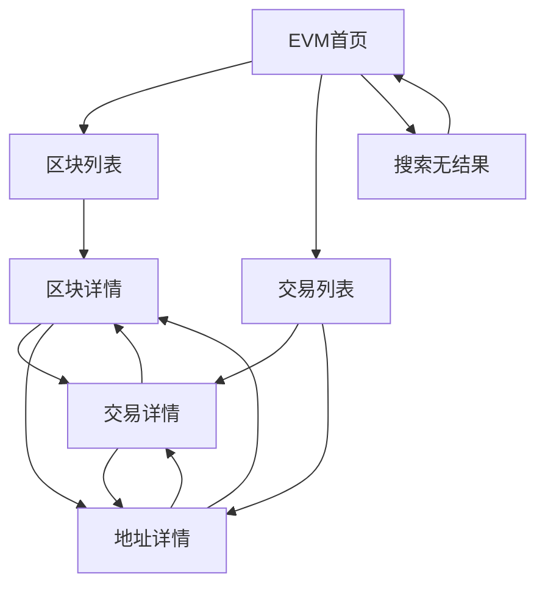

# BiyaEVM 区块浏览器产品需求文档

> 产品经理：Terry｜文档版本：V1.0.1｜文档状态：正式需求｜日期：2026-10-26

## 文档说明

| 项目 | 内容 |
| --- | --- |
| 需求名称 | BiyaEVM 区块浏览器 P0 |
| 需求等级 | L3 复杂需求 |
| 核心目标 | 为 Biya EVM 提供公开、只读、可检索的交易、区块和地址查询能力，使用户能打开并读懂一笔普通交易 |
| 目标用户 | 链上用户、合约交互方、运营与客服、安全研究人员、生态开发者 |
| 交互基线 | [BiyaEVMscan.html](https://terryxu923.github.io/biya-dex-docs/BiyaEVMscan.html#home?mode=evm) 的 EVM 模式 |
| 公开原型 | https://terryxu923.github.io/biya-dex-docs/BiyaEVMscan.html#home?mode=evm |
| 公开 PRD | https://terryxu923.github.io/biya-dex-docs/biya-evm-explorer-prd.html?v=4bc8afb |
| 范围底稿 | [EVM浏览器迭代版本表.md](./迭代计划/EVM浏览器迭代版本表.md) 的 V1.0；列表与详情字段以当前原型及 BlockScout L1 默认展示为准 |
| 编写规范 | [产品需求文档编写规范](../../PRD规范/产品需求文档编写规范.md) |
| 需求范围 | 仅 BiyaEVM 区块浏览器；不包含 BiyaDEX 区块浏览器需求 |
| 一句话概述 | 用户无需登录即可搜索并打开 Biya EVM 的交易、区块和地址，核验状态、类型、双方、金额、Gas、费用、燃烧、Nonce 和输入数据 |

**文档定位**

本文把 EVM 原型转化为生产可交付的 P0 产品要求。原型中的模拟数据仅用于表达页面和交互，不构成数据值、刷新频率或链上事实；生产版本必须展示 Biya EVM 的真实索引数据。

本文是产品、设计、研发、测试和 AI 交付参与者共同使用的业务真相源。本文说明用户可见行为、业务规则和验收边界，不规定数据库、接口路径、索引器内部结构或前端框架。

字段口径、交易三态、接收方三种形态、待确认时空值，以行业 EVM 浏览器（BlockScout）的公开查询语义为准，再落到 Biya 中文界面。

**撰写语言**

正文和用户可见文案以中文为主。哈希、地址前缀、Gas 单位、交易类型等链上原始标识保留必要英文，并在有确定业务含义时补充中文，例如 `Gwei（Gas 价格单位）`、`EIP-1559（交易类型）`。

---

## 目录

- [1. 本期交付摘要](#1-本期交付摘要)
- [2. 产品概述](#2-产品概述)
- [3. 功能列表与优先级](#3-功能列表与优先级)
- [4. 功能详细说明](#4-功能详细说明)
  - [4.1 全局导航、模式与搜索](#41-全局导航模式与搜索)
  - [4.2 EVM 首页](#42-evm-首页)
  - [4.3 区块列表](#43-区块列表)
  - [4.4 区块详情](#44-区块详情)
  - [4.5 交易列表](#45-交易列表)
  - [4.6 交易详情](#46-交易详情)
  - [4.7 地址详情](#47-地址详情)
- [5. 横切业务规则与异常处理](#5-横切业务规则与异常处理)
- [6. 更新记录](#6-更新记录)

---

## 1. 本期交付摘要

### 1.1 交付结果

本期交付一套 Biya EVM 公共数据查询产品，形成以下查询闭环：

用户可以从首页了解网络概况和最新活动，从区块或交易列表进入详情，再通过区块、交易和地址之间的链接交叉核验。所有详情页均支持直接打开和分享，不依赖从首页逐级进入。

### 1.2 P0 核心能力

| 模块 | P0 交付能力 |
| --- | --- |
| 全局能力 | 仅 BiyaChain 显示 EVM / DEX 切换；EVM 下导航为交易列表与区块列表；全局搜索；深链；复制 |
| 首页 | 产品介绍（可展开收起）、5 项网络统计、最新区块 10 条、最新交易 10 条 |
| 区块 | 区块列表（8 列叠格）、区块概览（含大小、奖励、燃烧、小费）、块内交易、前后区块 |
| 交易 | 交易列表（7 列叠格，含类型）、交易详情（基础信息、参与方、资产与费用含 Gas 费用三档与燃烧、其他） |
| 地址 | 地址、是否合约、原生币余额、交易数、累计已用 Gas、余额更新于区块、合约创建者与创建交易、相关交易列表 |
| 公共状态 | 加载、空数据、无结果、无效参数、网络错误、重试 |

### 1.3 明确不在本期范围

| 不在范围的能力 | 本期用户可见行为 |
| --- | --- |
| DEX 区块浏览器页面和业务规则 | 本文不定义；切换至 DEX 后由独立需求负责 |
| 版本表首页交易的方法、区块、交易费 | 首页最新交易按原型排版，不作为本期首页验收 |
| 版本表首页区块的 Gas 使用量 | 首页最新区块按原型排版，不作为本期首页验收 |
| 代币、NFT、代币转移、代币余额 | EVM 导航不展示相关入口；深链不得打开此类页面 |
| 合约源码、验证、读取合约 | 合约地址与普通地址使用同一详情页；合约额外展示创建者与创建交易，不提供源码、验证或读取 |
| 内部交易、日志、状态变化 | 交易、区块、地址详情不展示对应页签 |
| BiyaCore 与 EVM 划转、外部网络跨链 | 交易详情不展示划转或跨链区域 |
| 通过钱包写合约 | 不提供签名或写操作入口 |
| API 文档、API 密钥、套餐与用量 | 不进入文档页；首页页脚若保留入口，点击后停留在 EVM 首页 |
| 登录、关注、私有标签、自定义 ABI | 公共查链不要求登录，P0 不展示账户入口 |
| 多语言 | P0 仅提供中文用户界面 |
| 外链网络的 EVM 页面 | 本期只验收 Biya EVM；切到其他网络后的页面不在本文展开 |
| 区块链写操作 | 不签名、不广播交易、不修改链上状态 |

---

## 2. 产品概述

### 2.1 背景与当前问题

Biya EVM 是面向流动性与做市场景的 EVM 兼容执行环境。用户在钱包或应用中提交普通转账、合约交互或创建合约后，需要一个独立于交易终端的公共查询入口，用于确认交易是否上链、状态是否成功、Gas 与费用是多少、对方地址是普通账户还是合约。

当前 HTML 原型已经表达了 EVM 首页、搜索、交易、区块和地址的页面关系，但数据为前端模拟。若直接按原型实现，不同交付角色可能对真实数据、待确认/失败空值、搜索未命中行为产生不同理解。

本需求将原型中的有效查询链路固化为生产 P0，并明确：

1. 页面展示 Biya EVM 的真实索引结果，不使用模拟值冒充链上事实。
2. 用户能核验一笔普通交易的哈希、区块、时间、双方、状态、类型、金额、Gas、费用、燃烧、Nonce 和输入数据。
3. 待确认、失败、创建合约、交互合约必须给出与成功转账不同的可见结果。
4. 无数据、查无结果、参数无效和网络错误必须给出不同反馈。
5. EVM 与 DEX 的产品边界保持清晰，EVM 不复用 DEX 的交易类型筛选，也不展示代币与合约源码。

### 2.2 产品目标

| 目标 | 可观察结果 |
| --- | --- |
| 提供 EVM 网络概览 | 用户进入首页可查看产品介绍、5 项指标及最新区块、最新交易 |
| 提供链上事实查询 | 用户可按交易哈希、地址、区块高度或区块哈希打开对应详情 |
| 提供可读的普通交易 | 交易详情展示状态、类型、双方、金额、Gas、费用、燃烧、Nonce 和输入数据 |
| 支持交叉核验 | 区块、交易和地址之间可双向跳转，关联字段保持一致 |
| 支持分享和复现 | 用户复制详情页链接后，在新会话中可打开相同 EVM 页面和相同查询对象 |
| 明确失败原因 | 查询失败时区分“无结果”“参数无效”和“网络错误” |

### 2.3 非目标

- 不通过浏览器完成转账、授权、合约写入或资金操作。
- 不在本需求中定义 DEX 页面、DEX 字段或 DEX 筛选。
- 不把所有链上原始数据无差别展示；P0 只展示本文字段表规定的业务字段。
- 不承诺浏览器查询接口对外开放。
- 不以原型中的固定总量、固定时间和固定地址作为生产数据。
- 不把索引系统内部设计写入本 PRD。

### 2.4 目标用户与场景

| 用户角色 | 典型场景 | 需要完成的目标 |
| --- | --- | --- |
| 链上用户 | 钱包转账后核验是否上链 | 通过交易哈希找到交易，查看状态、区块、金额和对方地址 |
| 合约交互方 | 与合约交互后核验执行结果 | 确认状态为成功或失败；失败时看到回滚原因；接收方显示为交互合约 |
| 运营与客服 | 处理“交易未找到”“一直待确认”等反馈 | 通过深链复现查询，识别查无结果、待确认或网络错误 |
| 安全研究人员 | 调查异常交易或地址行为 | 在区块、交易和地址之间交叉核验公开数据 |
| 生态开发者 | 理解 Biya EVM 的公开链上活动 | 使用浏览器查链；P0 不提供浏览器 API 文档 |

所有 P0 页面均为公开只读页面，不因角色不同改变数据可见范围，也不要求登录。

### 2.5 术语与统一口径

| 术语 | 定义 |
| --- | --- |
| Biya EVM | 与 BiyaCore 协同的 EVM 兼容执行环境；本需求只索引该执行环境上的链上数据 |
| BiyaEVM 区块浏览器 | 本需求定义的 Biya EVM 公共只读查询产品 |
| 原生币 | Biya EVM 用于支付交易费和原生转账的币种，界面符号为 `BYB` |
| 交易 | 用户提交到 Biya EVM 的一笔顶层交易，不是内部调用，也不是代币事件 |
| 交易哈希 | 交易的唯一标识，格式为 `0x` 加 64 位十六进制 |
| 地址 | 账户或合约的链上标识，格式为 `0x` 加 40 位十六进制 |
| 区块高度 | 区块在 Biya EVM 上的唯一连续编号 |
| 区块哈希 | 区块的唯一标识，格式为 `0x` 加 64 位十六进制 |
| 出块地址 | 产出该区块的地址；首页最新区块展示为“出块者” |
| 发送方 | 发起该笔交易的地址 |
| 接收方 | 普通转账的目标地址 |
| 交互合约 | 接收方是已有合约地址时的界面名称 |
| 新建合约地址 | 创建合约交易产生的新合约地址 |
| 待确认 | 交易已被广播、尚未被区块收录 |
| 成功 | 交易已被区块收录且执行成功 |
| 失败 | 交易已被区块收录且执行失败 |
| 方法 | 交易调用的函数名；无法解码时展示方法选择器 |
| 类型 | 交易主类型，P0 仅三种：合约创建、合约调用、原生币转账 |
| 交易费 | 用户为该笔交易支付的原生币费用 |
| Gas 费用 | 交易详情中的三档单价，单位 Gwei：Base（基础费用）、Max（用户最高费用）、Max priority（用户小费上限） |
| 燃烧费用 | 因基础费用被销毁的原生币；单笔等于该块基础费用乘以该笔已用 Gas；区块级为该块合计 |
| 区块奖励 | 出块者因产出该块获得的原生币奖励 |
| 大小 | 区块体的字节数 |
| 基础费用 | 该块每单位 Gas 的网络基础费用 |
| 小费 / Priority fee | 该块内用户付给出块者的优先打包小费合计；为 0 时区块详情不展示 |
| 累计已用 Gas | 该地址作为发送方历史上消耗的 Gas 合计 |
| 余额更新于区块 | 该地址原生币余额最近一次发生变化时所在的区块高度 |
| 创建者 | 部署该合约的地址；仅合约地址展示，并同时给出创建交易 |
| 区块手续费 | 首页最新区块使用的汇总费用，等于该块已用 Gas 乘以基础费用，以原生币展示 |
| 最新 | 在可公开查询的数据中，按区块高度或交易收录顺序倒序后的第一条 |
| 深链 | 包含 EVM 模式和查询对象、可直接打开目标页面的链接 |
| 查无结果 | 查询参数格式有效，但当前公开索引范围内不存在对应数据 |
| 参数无效 | 输入不符合交易哈希、地址、区块高度或区块哈希的格式规则 |

**产品关系说明**：在网络选择层，只有 BiyaChain（界面显示 `BIYA Mainnet`）同时提供 EVM 和 DEX 两套浏览模式，因此仅选择 BiyaChain 时显示 EVM / DEX 切换。其他网络的页面不在本文验收。本文只定义进入 EVM 后的可见行为。

### 2.6 页面地图

| 页面 | 标准入口 | 主要任务 |
| --- | --- | --- |
| EVM 首页 | 选择 EVM 模式后的首页 | 查看介绍、统计和最新数据 |
| 区块列表 | 导航「区块链 — 区块列表」 | 浏览最近区块 |
| 区块详情 | 按区块高度或区块哈希打开 | 查看区块概览和块内交易 |
| 交易列表 | 导航「区块链 — 交易列表」 | 浏览最近已上链交易 |
| 交易详情 | 按交易哈希打开 | 核验单笔普通交易 |
| 地址详情 | 按地址打开 | 查看是否合约、余额、累计 Gas、合约创建者（如有）和相关交易 |
| 搜索无结果 | 搜索未命中且格式不能直达详情 | 回显关键词，提示未找到 |

分享链接必须能直接打开同一业务页面和同一查询对象。若研发调整路径实现，不得改变这一产品结果。

---

## 3. 功能列表与优先级

| 功能模块 | 功能点 | 优先级 | 说明 |
| --- | --- | --- | --- |
| 全局 | EVM / DEX 模式边界 | P0 | 仅 BiyaChain 显示切换；EVM 页选中 EVM |
| 全局 | 网络边界 | P0 | 本期只验收 Biya EVM |
| 全局 | 搜索与深链 | P0 | 前缀建议；完整值直达详情；未命中进入搜索无结果页并保留关键词 |
| 全局 | 复制与长文本 | P0 | 哈希和地址可查看全文并复制 |
| 首页 | 产品介绍 | P0 | 默认可展开、收起 |
| 首页 | 网络统计 | P0 | 5 项指标 |
| 首页 | 最新区块与最新交易 | P0 | 各展示最近 10 条，字段跟原型 |
| 区块 | 区块列表 | P0 | 8 列叠格：区块（高度+时间）、大小、出块地址、交易数、已用 Gas、区块奖励、燃烧费用、基础费用 |
| 区块 | 区块详情 | P0 | 概览（含大小、奖励、燃烧、小费）、前后区块、块内交易 |
| 交易 | 交易列表 | P0 | 7 列叠格：交易、类型、方法、区块、从/到、数量、交易费；分页、从新到旧 |
| 交易 | 交易详情 | P0 | 基础信息、参与方、资产与费用（含 Gas 费用三档与燃烧）、其他 |
| 地址 | 地址详情 | P0 | 是否合约、余额、交易数、累计已用 Gas、余额更新于区块、合约创建者与创建交易、相关交易 |
| 公共状态 | 加载、空数据、无结果、无效参数、网络错误和重试 | P0 | 所有数据页面适用 |

---

## 4. 功能详细说明

## 4.1 全局导航、模式与搜索

**用户目标**

用户从任意 EVM 页面都能识别当前为 Biya EVM，进入区块或交易主路径，搜索目标对象，并分享当前查询状态。

### 4.1.1 流程步骤

| 步骤 | 用户操作 | 系统行为 | 可见结果 |
| --- | --- | --- | --- |
| 1 | 在 BiyaChain 选择 EVM | 进入 EVM 模式 | 进入 EVM 首页，EVM 处于选中 |
| 2 | 打开带 EVM 模式和对象标识的深链 | 解析页面和对象 | 直接进入对应列表或详情 |
| 3 | 展开“区块链”菜单 | 展示“交易列表”“区块列表” | 用户可进入两类列表 |
| 4 | 在全局搜索框输入内容 | 按前缀规则即时检索当前链可匹配对象 | 下拉展示建议；无命中时下拉内显示空态 |
| 5 | 提交完整且存在的交易哈希、地址、高度或区块哈希 | 打开对应详情 | 进入交易、地址或区块详情 |
| 6 | 提交格式有效但不存在的对象，或无法识别的文本 | 进入搜索无结果页 | 回显用户关键词 |
| 7 | 点击地址、哈希或区块链接 | 保留 EVM 上下文并打开关联页 | 目标页仍处于 EVM 模式 |
| 8 | 点击 DEX | 退出 EVM，进入 DEX 浏览器 | 其后行为由 DEX 需求负责 |

EVM 导航不展示代币、合约详情、API 文档。开发者菜单仅 DEX 模式可见。

### 4.1.2 搜索识别规则

全局搜索以**从左往右的前缀匹配**提供建议。检索范围是当前 Biya EVM 可公开查询的交易哈希、地址、区块高度和区块哈希。占位文案为“搜索交易哈希 / 地址 / 区块高度 / 区块哈希”。

**输入即检索**

| 输入 | 匹配对象 | 匹配规则 | 展示 |
| --- | --- | --- | --- |
| 去除首尾空格后为空 | 无 | 不检索 | 收起下拉，不显示错误 |
| 仅十进制数字 | 区块高度 | 完整高度字符串以输入为前缀 | 区块建议 |
| `0x` 加十六进制 | 交易哈希、区块哈希、地址 | 完整值以输入为前缀，不区分大小写 | 按命中分类展示 |
| 任意非空文本 | 以上对象均无前缀命中 | 不适用 | 下拉内显示空态，停留当前页 |

建议规则：

1. 每一类最多展示 10 条，分类计数按实际展示条数，不超过 10。
2. 同时命中多类时，下拉用分类区分“交易”“区块”“地址”，只显示有结果的分类。
3. 默认选中第一类有结果的分类，优先顺序为交易、区块、地址。
4. 命中前缀在建议项中高亮。
5. 精确完整值排在同类建议最前；区块高度在同等条件下从高到低。
6. 无命中时下拉标题为“无搜索结果”，说明为“未在当前链找到相关结果，请确认搜索内容”。输入过程不离开当前页。
7. P0 不支持代币、NFT、合约名、内部交易或自然语言搜索。

**提交（回车或搜索按钮）**

| 提交内容 | 系统行为 | 可见结果 |
| --- | --- | --- |
| 空 | 不跳转 | 收起下拉，保持当前页 |
| 完整交易哈希且索引中存在该交易 | 打开该交易详情 | 进入交易详情 |
| 完整 64 位十六进制，交易不存在但区块哈希存在 | 打开该区块详情 | 进入区块详情 |
| 完整 64 位十六进制，交易与区块哈希均不存在 | 进入搜索无结果页 | 回显该哈希，不当成一笔交易打开 |
| 完整地址（`0x` 加 40 位十六进制） | 打开该地址详情 | 无交易地址仍打开并显示空状态 |
| 纯数字区块高度 | 打开该高度的区块详情 | 高度不存在则由区块详情给出未找到 |
| 前缀命中恰好 1 条，且不是上述完整格式 | 打开该对象详情 | 进入对应详情 |
| 前缀命中多于 1 条，且不是完整哈希或完整地址 | 不跳转 | 保持建议下拉，由用户点选 |
| 其他无命中 | 进入搜索无结果页 | 回显关键词 |

点选建议项后打开对应 EVM 详情，并关闭下拉。

**搜索无结果页**

| 界面字段 | 数据来源 | 展示规则 | 空值/异常 | 校验/交互 |
| --- | --- | --- | --- | --- |
| 说明文案 | 产品文案 | 有关键词时：“未找到与当前关键词匹配的交易、地址或区块，请确认搜索内容” | 无关键词时用通用未找到说明 | 只读 |
| 关键词 | 用户提交内容 | 原样回显 | 无关键词时不展示该行 | 只读，不可当作新搜索自动重跑 |

### 4.1.3 页面状态矩阵

| 场景 | 触发条件 | 页面展示 | 用户可操作 | 是否保留输入 |
| --- | --- | --- | --- | --- |
| BiyaChain EVM 默认态 | 选择 BiyaChain 且进入 EVM | 显示 EVM / DEX 切换，EVM 选中；导航为交易列表、区块列表 | 搜索、进入列表、切换 DEX | 是 |
| BiyaChain DEX 状态 | 用户点击 DEX | 退出 EVM 页面 | 使用 DEX 已有能力 | 不适用 |
| 其他网络 | 用户切换到其他网络 | 不在本文验收 | 切换网络 | 不适用 |
| 搜索建议 | 输入非空且有前缀命中 | 搜索框下方展示分类建议 | 点选、切换分类、继续输入、提交 | 是 |
| 搜索下拉无命中 | 输入非空且无前缀命中 | 下拉显示“无搜索结果”，当前页不变 | 修改搜索内容或提交 | 是 |
| 搜索直达 | 提交命中唯一完整对象 | 关闭下拉并打开对应详情 | 查看详情或返回 | 是 |
| 搜索无结果页 | 提交后无法直达详情 | 独立无结果页，回显关键词 | 修改搜索、返回首页 | 是 |
| 查无结果 | 打开的详情对象格式有效但不存在 | 目标详情页显示对应无结果状态 | 返回或重新搜索 | 是 |

### 4.1.4 字段说明

| 界面字段 | 数据来源 | 展示规则 | 空值/异常 | 校验/交互 |
| --- | --- | --- | --- | --- |
| 品牌名 | 产品配置 | `BIYA Explorer` | 不允许为空 | 点击返回当前网络的 EVM 首页 |
| 当前网络 | 网络配置 | BiyaChain 显示 `BIYA Mainnet` | 配置异常时不进入 EVM | 可展开网络列表；切走 BiyaChain 后不在本文验收 |
| EVM / DEX 切换 | 当前网络与页面状态 | 仅 BiyaChain 显示；EVM 页面中 `EVM` 选中 | 其他网络完全隐藏，不保留空白占位 | 点击 DEX 退出 EVM |
| 页面标题 | 当前网络 | BiyaChain 显示 `BiyaChain` | 不允许为空 | 只读 |
| 全局搜索内容 | 用户输入 | 原样保留；检索前去除首尾空格 | 无命中时下拉提示无结果 | 输入即出建议；回车或搜索按钮按提交规则处理 |
| 区块链导航 | 产品配置 | 交易列表、区块列表 | 不允许为空 | 进入对应 EVM 列表 |

### 4.1.5 交互规则

| 场景 | 触发条件 | 反馈形式 | 返回后是否保留 |
| --- | --- | --- | --- |
| 列表进入详情 | 点击区块、哈希或地址 | 当前窗口打开详情 | 浏览器返回后恢复原列表页和页码 |
| 深链打开 | 新会话打开有效 EVM 链接 | 直接还原页面和对象 | 不适用 |
| 复制 | 点击哈希或地址旁复制按钮 | 复制完整值并显示 1.5 秒成功反馈 | 不适用 |
| 查看长文本 | 哈希或地址在列表中被截断 | 悬停或聚焦时展示完整值 | 不适用 |
| 切换至 DEX | 在 BiyaChain 点击 DEX | 进入 DEX 首页 | DEX 行为由 DEX 需求定义 |

### 4.1.6 验收标准

| 序号 | 验收条件 | 预期结果 |
| --- | --- | --- |
| AC-G01 | 用户在 BiyaChain 选择 EVM | 进入 EVM 首页，EVM 显示为当前模式，导航仅含交易列表和区块列表 |
| AC-G02 | 用户在新会话打开任一有效 EVM 详情深链 | 直接打开该对象详情，且页面保持 EVM 模式 |
| AC-G03 | 用户分别提交完整且存在的交易哈希、地址、区块高度 | 分别进入对应交易、地址、区块详情 |
| AC-G04 | 用户提交完整且存在的区块哈希 | 进入对应区块详情 |
| AC-G05 | 用户提交格式正确、索引中不存在的 64 位十六进制 | 进入搜索无结果页并回显该值，不打开交易详情 |
| AC-G06 | 用户提交无法识别的文本 | 进入搜索无结果页并回显关键词 |
| AC-G07 | 用户从列表进入详情后执行浏览器返回 | 恢复进入详情前的列表页和页码 |
| AC-G08 | 用户复制列表中被截断的地址或哈希 | 剪贴板内容为完整值，页面出现复制成功反馈 |
| AC-G09 | 用户选择 BiyaChain 并处于 EVM | 页面显示 EVM / DEX 切换，EVM 处于选中 |
| AC-G10 | 用户输入同时命中交易和地址的前缀 | 下拉出现对应分类，每类最多 10 条，命中前缀高亮 |

---

## 4.2 EVM 首页

**用户目标**

用户进入 EVM 后了解产品定位和网络概况，并从最新区块、最新交易进入详情。

### 4.2.1 产品介绍

首页使用以下产品介绍：

> BiyaEVM 是面向流动性与做市场景构建的 EVM 兼容执行环境，与 BiyaCore 深度协同，融合智能合约的可编程能力与核心交易层的流动性和订单簿能力，支持链上资产交易、流动性管理及自动化做市，打造高效、可组合的链上金融基础设施。

此段为产品宣介文案，不作为性能、流动性或资金路径的验收数据来源。

默认单行省略，右侧按钮为“展开全部”；展开后全文换行展示，按钮变为“收起”。展开或收起不影响统计和列表加载。

### 4.2.2 流程步骤

| 步骤 | 用户操作 | 系统行为 | 可见结果 |
| --- | --- | --- | --- |
| 1 | 进入 EVM 首页 | 加载介绍、统计、最新区块和最新交易 | 统计和两组列表分别进入加载态 |
| 2 | 等待数据返回 | 展示已完成索引的最新数据 | 看到 5 项统计和两组各最多 10 条的列表 |
| 3 | 点击最新区块高度 | 打开对应区块详情 | 可查看概览和块内交易 |
| 4 | 点击最新交易哈希 | 打开对应交易详情 | 可查看完整交易字段 |
| 5 | 点击出块者、发送方或接收方 | 打开对应地址详情 | 可查看该地址活动 |
| 6 | 点击“查看全部区块”或“查看全部交易” | 打开对应列表 | 进入区块列表或交易列表 |

### 4.2.3 展示字段

#### 网络统计

| 界面字段 | 业务含义 | 数据来源 | 展示规则 | 空值/异常 |
| --- | --- | --- | --- | --- |
| BYB 价格 | 原生币对美元的公开报价 | 公开行情或索引侧已接入的报价 | 美元金额；有涨跌时附涨跌幅 | 不可用显示 `--` |
| 市值 | 按公开口径计算的原生币市值 | 公开行情与供应量 | 美元金额 | 不可用显示 `--` |
| 总交易量 | 从创世至当前最高已索引区块，已上链交易笔数 | Biya EVM 公开索引 | 非负整数，可用千分位或缩写 | 不可用显示 `--` |
| 24H 交易量 | 以当前时刻向前滚动 24 小时的已上链交易笔数 | Biya EVM 公开索引 | 非负整数 | 不可用显示 `--` |
| 当前 Gas 价格 | 当前建议的 Gas 价格 | 公开 Gas 统计 | 数值 + `Gwei` | 不可用显示 `--` |

单项不可用只降级该指标，不阻断两组列表。

#### 最新区块

首页最新区块按高度倒序，最多 10 条。字段以原型为准，不验收版本表中的 Gas 使用量。

| 界面字段 | 数据来源 | 展示规则 | 空值/异常 | 交互 |
| --- | --- | --- | --- | --- |
| 区块高度 | 区块数据 | 完整十进制 | 不允许为空 | 点击进区块详情 |
| 时间 | 区块时间 | 相对时间，见 §5.3 | 无时间显示 `--` | 只读 |
| 出块者 | 出块地址 | 列表截断，前缀文案“出块者” | 无出块地址显示 `--` | 点击进地址详情；可复制 |
| 手续费 | 该块已用 Gas × 基础费用，折算为原生币 | 前缀文案“手续费”，单位 `BYB` | 无法计算显示 `--` | 只读 |
| 交易数 | 区块内交易数量 | `N 笔交易` | 0 显示“0 笔交易” | 只读 |

#### 最新交易

首页最新交易按收录顺序倒序，最多 10 条。字段以原型为准，不验收版本表中的方法、区块、交易费。

| 界面字段 | 数据来源 | 展示规则 | 空值/异常 | 交互 |
| --- | --- | --- | --- | --- |
| 交易哈希 | 交易数据 | 列表截断 | 不允许为空 | 点击进交易详情；可复制 |
| 时间 | 交易时间 | 相对时间，见 §5.3 | 无时间显示 `--` | 只读 |
| 发送方 | 交易发送方 | 前缀“发送方”，列表截断 | 不允许为空 | 点击进地址详情；可复制 |
| 接收方 | 普通接收方或创建出的合约 | 前缀“接收方”，列表截断 | 创建合约展示新建合约地址；缺失显示 `--` | 点击进地址详情；可复制 |
| 金额 | 原生币转账数量 | 右侧展示，单位 `BYB` | 0 显示 `0 BYB` | 只读 |

待确认交易可以出现在首页最新交易中。首页不单独展示“待确认”文案；区块字段不出现在本列。

### 4.2.4 页面状态矩阵

| 场景 | 触发条件 | 页面展示 | 用户可操作 | 是否保留已有数据 |
| --- | --- | --- | --- | --- |
| 首次加载 | 进入首页 | 统计区和两列表分别显示加载占位 | 可使用全局导航和展开介绍 | 不适用 |
| 正常 | 数据返回 | 展示介绍、5 项统计和两组列表 | 查看全部、进入详情 | 是 |
| 部分失败 | 统计或某一列表失败 | 成功区域正常展示；失败区域显示“加载失败，请重试” | 重试失败区域 | 是 |
| 暂无数据 | 网络尚无可公开数据 | 指标为 0 或 `--`；列表显示“暂无区块”或“暂无交易” | 稍后重试 | 不适用 |

### 4.2.5 交互规则

- 介绍展开与收起不影响数据加载。
- 新记录加入后，两组列表仍最多保留 10 条。
- 单个统计值不可用时只降级该字段。
- “查看全部区块”“查看全部交易”必须保持 EVM 模式。
- 首页不展示社交入口，不提供“全部数据”开关。

### 4.2.6 验收标准

| 序号 | 验收条件 | 预期结果 |
| --- | --- | --- |
| AC-H01 | 用户进入数据正常的 EVM 首页 | 展示介绍、5 项统计、最多 10 条最新区块和最多 10 条最新交易 |
| AC-H02 | 用户点击“展开全部”再点击“收起” | 介绍先全文后恢复单行，列表数据不被清空 |
| AC-H03 | 最新区块每一行 | 可见高度、时间、出块者、手续费、笔数；不见 Gas 使用量 |
| AC-H04 | 最新交易每一行 | 可见哈希、时间、发送方、接收方、金额；不见方法、区块、交易费 |
| AC-H05 | 用户点击高度、哈希、出块者或双方地址 | 分别进入对应 EVM 详情 |
| AC-H06 | 用户点击两处“查看全部” | 分别进入 EVM 区块列表和 EVM 交易列表 |
| AC-H07 | 某一统计值不可用 | 该值显示 `--`，其他指标和列表仍可查看 |
| AC-H08 | 创建合约出现在最新交易 | 接收方可点进新建合约地址 |

---

## 4.3 区块列表

**用户目标**

用户按从新到旧浏览 Biya EVM 区块，了解时间、大小、出块地址、交易数、已用 Gas、奖励、燃烧和基础费用，并进入详情。

### 4.3.1 流程步骤

| 步骤 | 用户操作 | 系统行为 | 可见结果 |
| --- | --- | --- | --- |
| 1 | 打开区块列表 | 按高度倒序加载第 1 页 | 每页 20 条，8 列叠格 |
| 2 | 点击高度 | 打开区块详情 | 进入概览 |
| 3 | 点击出块地址 | 打开地址详情 | 进入该地址 |
| 4 | 点击大于 0 的交易数 | 打开该区块详情并定位到块内交易 | 进入该块 |
| 5 | 翻页 | 加载对应页 | 页码和区间更新 |

### 4.3.2 展示字段

列表为 8 列叠格，列顺序固定如下。

| 界面字段 | 业务含义 | 数据来源 | 展示规则 | 空值/异常 | 校验/交互 |
| --- | --- | --- | --- | --- | --- |
| 区块 | 高度与出块时间 | 区块数据 | 同一格上行完整高度（可千分位），下行相对时间，见 §5.3 | 高度不允许为空；无时间显示 `--` | 高度点击进区块详情 |
| 大小 | 区块体字节数 | 区块数据 | 非负整数，列表不写单位 | 不可用显示 `--` | 只读 |
| 出块地址 | 产出该块的地址 | 区块数据 | 列表截断 | 不可用显示 `--` | 点击进地址详情；可复制 |
| 交易数 | 该块收录的顶层交易数 | 区块数据 | 非负整数 | 0 显示 0 | 大于 0 时点击进该区块详情；为 0 时不可点 |
| 已用 Gas | 该块实际消耗及占上限比例 | 区块数据 | 同一格上行整数（可千分位），下行使用比例，一位小数加 `%` | 不可用显示 `--`；无法计算比例时不展示下行 | 只读 |
| 区块奖励 | 出块者获得的原生币奖励 | 区块数据 | 金额 + `BYB` | 0 显示 `0 BYB` | 只读 |
| 燃烧费用 | 该块因基础费用被销毁的原生币 | 区块数据 | 同一格上行金额 + `BYB`，下行燃烧占该块交易费的比例 | 0 显示 `0 BYB`；无法计算比例时不展示下行 | 只读 |
| 基础费用 | 该块每单位 Gas 的网络基础费用 | 区块数据 | 数值 + `Gwei` | 无基础费用显示 `--` | 只读 |

同一高度在列表与详情中的出块地址、交易数、已用 Gas、大小、区块奖励、燃烧费用和基础费用必须一致。首页最新区块仍按 §4.2.3 排版，不验收本表新增列。

### 4.3.3 业务规则

- 默认按区块高度从高到低。
- 每页 20 条，见 §5.4。
- P0 不做区块类型筛选，也不做列表页高度搜索框。
- 列表 8 列始终占格；燃烧为 0 时本列仍显示 `0 BYB`。

### 4.3.4 页面状态矩阵

| 场景 | 触发条件 | 页面展示 | 用户可操作 |
| --- | --- | --- | --- |
| 加载中 | 首次打开或翻页 | 表格区加载占位 | 返回首页 |
| 正常 | 有区块 | 20 条/页及分页 | 进详情、翻页 |
| 暂无数据 | 链上尚无区块 | “暂无区块数据” | 返回、重试 |
| 网络错误 | 查询失败 | “区块列表加载失败，请重试” | 重试 |

### 4.3.5 验收标准

| 序号 | 验收条件 | 预期结果 |
| --- | --- | --- |
| AC-BL01 | 用户打开区块列表 | 倒序展示 8 列：区块（高度+时间）、大小、出块地址、交易数、已用 Gas、区块奖励、燃烧费用、基础费用 |
| AC-BL02 | 用户点击某一高度 | 打开该高度的区块详情 |
| AC-BL03 | 同一高度在列表与详情 | 出块地址、交易数、已用 Gas、大小、区块奖励、燃烧费用、基础费用一致 |
| AC-BL04 | 用户翻到第 2 页再返回 | 恢复第 2 页 |
| AC-BL05 | 某一行交易数为 0 | 交易数显示 0 且该格不可点 |

---

## 4.4 区块详情

**用户目标**

用户核验某一区块的身份、大小、出块信息、奖励、燃烧和块内交易，并能跳到相邻区块。

### 4.4.1 流程步骤

| 步骤 | 用户操作 | 系统行为 | 可见结果 |
| --- | --- | --- | --- |
| 1 | 按高度或区块哈希打开 | 查询该区块 | 概览进入加载态 |
| 2 | 数据返回 | 展示概览和块内交易 | 用户可交叉核验 |
| 3 | 点击父区块哈希或上一区块 | 打开父区块 | 高度减 1 |
| 4 | 点击下一区块 | 打开下一区块 | 高度加 1；已是最高已索引块时不可点 |
| 5 | 点击块内某一交易 | 打开交易详情 | 交易所属区块等于当前高度 |

### 4.4.2 区块概览字段

字段顺序与原型一致。不展示额外数据。

| 界面字段 | 业务含义 | 数据来源 | 展示规则 | 空值/异常 | 校验/交互 |
| --- | --- | --- | --- | --- | --- |
| 区块高度 | 区块编号 | 区块数据 | 完整十进制 | 不允许为空 | 只读；标题同步展示 |
| 大小 | 区块体字节数 | 区块数据 | 整数 + `字节` | 不可用显示 `--` | 只读 |
| 时间 | 出块时间 | 区块数据 | 相对时间、本地时间、UTC，见 §5.3 | 不可用显示 `--` | 只读 |
| 交易数 | 块内顶层交易数 | 区块数据 | 非负整数 | 0 显示 0 | 可锚点到下方交易表 |
| 出块地址 | 产出该块的地址 | 区块数据 | 完整地址 | 不可用显示 `--` | 点击进地址详情；可复制 |
| 区块奖励 | 出块者获得的原生币奖励 | 区块数据 | 金额 + `BYB`；有报价附美元 | 0 显示 `0 BYB` | 只读 |
| 已用 Gas | 该块实际消耗 | 区块数据 | 整数（可千分位），括号附使用比例，一位小数 | 不可用显示 `--`；无法计算比例时不附比例 | 只读 |
| Gas 上限 | 该块 Gas 上限 | 区块数据 | 整数（可千分位） | 不允许为空 | 只读 |
| 基础费用 | 该块每单位 Gas 的网络基础费用 | 区块数据 | 原生币金额，并附 `Gwei` | 无基础费用显示 `--` | 只读 |
| 燃烧费用 | 该块因基础费用被销毁的原生币 | 区块数据 | 金额 + `BYB`；有报价附美元；可再附占该块交易费的比例 | 结果为 0 或不存在时不展示该行 | 只读 |
| 小费 / Priority fee | 该块内用户付给出块者的优先打包小费合计 | 区块数据 | 金额 + `BYB` | 为 0 或不存在时不展示该行 | 只读 |
| 区块哈希 | 区块唯一标识 | 区块数据 | 完整值 | 不允许为空 | 可复制 |
| 父区块哈希 | 父区块标识 | 区块数据 | 完整值 | 创世块无父区块时显示 `--` | 点击进父区块详情；可复制 |

燃烧费用 = 该块基础费用 × 该块已用 Gas。列表在燃烧为 0 时仍占格显示 `0 BYB`；详情为 0 则不画该行。

### 4.4.3 块内交易

字段与交易列表相同，见 §4.5.2。查询该区块的全部顶层交易，不适用全链 10,000 条上限。条数应等于概览中的交易数。

### 4.4.4 页面状态矩阵

| 场景 | 触发条件 | 页面展示 | 用户可操作 |
| --- | --- | --- | --- |
| 加载中 | 格式有效的高度或哈希首次打开 | 概览加载占位 | 返回列表 |
| 正常 | 找到区块 | 概览 + 块内交易 | 跳转交易、地址、相邻区块 |
| 空块 | 区块存在但无交易 | 概览正常，“该区块暂无交易” | 返回、看相邻块 |
| 查无结果 | 格式有效但不存在 | “未找到该区块” | 返回列表、重新搜索 |
| 参数无效 | 高度或哈希格式不符合规则 | “区块高度格式无效”或“区块哈希格式无效” | 修改搜索、返回 |
| 网络错误 | 查询失败 | “区块详情加载失败，请重试” | 重试 |

不得用另一个存在的区块顶替未找到的高度。

### 4.4.5 验收标准

| 序号 | 验收条件 | 预期结果 |
| --- | --- | --- |
| AC-BD01 | 用户打开存在且燃烧、小费均非 0 的区块 | 展示 §4.4.2 全部字段，已用 Gas 与 Gas 上限分行 |
| AC-BD02 | 用户点击父区块哈希 | 打开高度减 1 的区块 |
| AC-BD03 | 用户点击出块地址 | 打开该地址详情 |
| AC-BD04 | 块内交易某一行的哈希 | 打开后所属区块等于当前高度 |
| AC-BD05 | 块内交易数为 0 | 概览交易数为 0，表格提示暂无交易 |
| AC-BD06 | 用户打开不存在的高度 | 显示“未找到该区块”，不展示其他区块数据 |
| AC-BD07 | 燃烧费用为 0 | 概览不出现「燃烧费用」行 |
| AC-BD08 | 小费为 0 | 概览不出现「小费 / Priority fee」行 |

---

## 4.5 交易列表

**用户目标**

用户按从新到旧浏览普通交易，查看类型、方法、区块、双方、金额和交易费，并进入详情。

块内交易、地址相关交易与本表使用同一套列结构。

### 4.5.1 流程步骤

| 步骤 | 用户操作 | 系统行为 | 可见结果 |
| --- | --- | --- | --- |
| 1 | 打开交易列表 | 按收录顺序倒序加载第 1 页 | 每页 10 条，7 列叠格 |
| 2 | 点击哈希 | 打开交易详情 | 进入详情 |
| 3 | 点击区块 | 打开区块详情 | 进入该块 |
| 4 | 点击发送方或接收方 | 打开地址详情 | 进入该地址 |
| 5 | 翻页 | 加载对应页 | 页码更新 |

### 4.5.2 展示字段

列表为 7 列叠格，列顺序固定如下。首页最新交易仍按 §4.2.3 排版，不验收本表新增列。

| 界面字段 | 业务含义 | 数据来源 | 展示规则 | 空值/异常 | 校验/交互 |
| --- | --- | --- | --- | --- | --- |
| 交易 | 交易哈希与收录时间 | 交易数据 | 同一格上行截断哈希，下行相对时间，见 §5.3 | 哈希不允许为空；无时间显示 `--` | 哈希点击进交易详情；可复制 |
| 类型 | 交易主类型 | 交易数据 | 徽章文案三选一：`合约创建` / `合约调用` / `原生币转账`。创建合约为「合约创建」；目标为已有合约为「合约调用」；其余为「原生币转账」 | 不允许为空 | 只读。成功不出状态点；失败在类型格内出「失败」；待确认出「待确认」 |
| 方法 | 调用的函数 | 交易数据 | 函数名；无法解码时展示选择器 | 无方法显示 `--` | 只读 |
| 区块 | 所属高度 | 交易数据 | 完整高度 | 待确认显示“待确认”，不可点击 | 已上链时点击进区块详情 |
| 从 / 到 | 发送方在上、接收方在下 | 交易数据 | 两侧列表截断；创建合约时到侧前缀「新建合约」并展示新地址 | 发送方不允许为空；到侧缺失显示 `--` | 可复制。点击进对应地址详情。出现在地址详情时，与当前页地址相同的一侧展示为纯文本，不可跳转 |
| 数量 | 该笔原生币转账数量 | 交易数据 | 同一格上行金额 + `BYB`，下行有报价时附美元 | 0 显示 `0 BYB`；报价不可用时不展示下行 | 只读 |
| 交易费 | 用户支付的费用 | 交易数据 | 同一格上行金额 + `BYB`，下行有报价时附美元 | 不可用显示 `--`；报价不可用时不展示下行 | 只读 |

P0 不验收代币转移、Blob 等其他类型徽章。

### 4.5.3 业务规则

- 默认从新到旧。
- 每页 10 条，见 §5.4。
- P0 不做交易类型、方法、地址组合筛选，也不做 Validated / Pending 分页签。
- 待确认交易可以出现在列表中，区块列显示“待确认”，类型格出「待确认」。

### 4.5.4 页面状态矩阵

| 场景 | 触发条件 | 页面展示 | 用户可操作 |
| --- | --- | --- | --- |
| 加载中 | 首次打开或翻页 | 表格区加载占位 | 返回 |
| 正常 | 有交易 | 10 条/页及分页 | 进详情、翻页 |
| 暂无数据 | 尚无交易 | “暂无交易数据” | 返回、重试 |
| 网络错误 | 查询失败 | “交易列表加载失败，请重试” | 重试 |

### 4.5.5 验收标准

| 序号 | 验收条件 | 预期结果 |
| --- | --- | --- |
| AC-TL01 | 用户打开交易列表 | 展示 7 列叠格（交易、类型、方法、区块、从/到、数量、交易费），每页 10 条 |
| AC-TL02 | 用户点击哈希、区块、发送方或接收方 | 分别进入对应详情 |
| AC-TL03 | 列表中存在待确认交易 | 区块列显示“待确认”且该格不可点；类型格出「待确认」 |
| AC-TL04 | 创建合约行 | 类型为「合约创建」；到侧为新建合约地址且可点 |
| AC-TL05 | 同一交易在列表与详情 | 哈希、类型、方法、区块、双方、金额、交易费一致 |
| AC-TL06 | 成功交易 | 类型格只有类型徽章，不出状态点 |
| AC-TL07 | 失败交易 | 类型格同时出「失败」 |

---

## 4.6 交易详情

**用户目标**

用户通过交易哈希核验一笔普通交易是否上链、执行是否成功，以及双方、金额、Gas、费用、燃烧、Nonce 和输入数据。界面字段名与 EVM 原型交易详情保持一致。

标题只有「交易详情」，不在标题旁放置状态或方法。状态、方法在详情表中各占一行。这是相对行业浏览器「状态与方法同一行」的产品决定，验收以本表为准。

### 4.6.1 流程步骤

| 步骤 | 用户操作 | 系统行为 | 可见结果 |
| --- | --- | --- | --- |
| 1 | 输入交易哈希或从列表进入 | 校验并查询 | 页面进入加载态 |
| 2 | 数据返回 | 展示详情四段 | 用户可读懂该笔交易 |
| 3 | 点击区块 | 打开所属区块 | 可在块内交易中核验 |
| 4 | 点击发送方或接收方 | 打开地址详情 | 可查看该地址其他交易 |
| 5 | 切换输入数据编码 | 在十六进制与 UTF-8 间切换 | 复制始终复制原始十六进制 |
| 6 | 点击复制 | 复制完整哈希、地址或输入数据 | 出现成功反馈 |

### 4.6.2 基础信息

| 界面字段 | 业务含义 | 数据来源 | 展示规则 | 空值/异常 | 校验/交互 |
| --- | --- | --- | --- | --- | --- |
| 交易哈希 | 交易唯一标识 | 交易数据 | 完整值 | 不允许为空 | 可复制 |
| 状态 | 执行结果 | 交易数据 | `成功` / `待确认` / `失败`，独立一行 | 不允许为空 | 只读 |
| 回滚原因 | 失败时的链上回滚信息 | 交易数据 | 仅失败时展示在状态下方 | 成功、待确认不展示；失败但无原因时不编造 | 只读 |
| 方法 | 调用的函数 | 交易数据 | 函数名或选择器，独立一行，不与状态同行 | 无方法显示 `--` | 只读 |
| 区块 | 所属区块及确认数 | 交易数据、区块数据 | 高度可点；确认数文案为“N 个区块确认” | 待确认显示“待确认”，不展示确认数 | 已上链时点击进区块详情 |
| 时间 | 被区块收录的时间 | 交易数据 | 相对时间、本地时间、UTC；已确认时可附确认耗时 | 待确认无收录时间显示 `--` | 只读 |

状态口径与行业 EVM 浏览器一致：已收录且成功、已广播未收录、已收录且失败。不得把未知哈希渲染成一笔成功交易。

### 4.6.3 参与方

| 界面字段 | 业务含义 | 数据来源 | 展示规则 | 空值/异常 | 校验/交互 |
| --- | --- | --- | --- | --- | --- |
| 发送方 | 发起地址 | 交易数据 | 完整地址 | 不允许为空 | 可复制；点击进地址详情 |
| 接收方 | 普通转账目标 | 交易数据 | 标签为“接收方”，完整地址 | 不允许为空 | 可复制；点击进地址详情 |
| 交互合约 | 目标为已有合约 | 交易数据 | 标签改为“交互合约”，完整地址 | 同接收方 | 可复制；点击进地址详情 |
| 新建合约地址 | 创建合约产生的地址 | 交易数据 | 标签改为“新建合约地址” | 交易已创建但地址尚未返回时显示 `--` | 可复制；有地址时可进地址详情 |

三种形态互斥，同一笔交易只显示其中一种目标标签。

### 4.6.4 资产与费用

| 界面字段 | 业务含义 | 数据来源 | 展示规则 | 空值/异常 | 校验/交互 |
| --- | --- | --- | --- | --- | --- |
| 原生币转账数量 | 该笔交易转移的原生币 | 交易数据 | 金额 + `BYB`；有价格时附美元 | 0 显示 `0 BYB` | 只读 |
| 交易费 | 用户支付的费用 | 交易数据 | 金额 + `BYB`；有价格时附美元 | 待确认或不可用显示 `--` | 只读 |
| Gas 价格 | 交易设定的 Gas 价格 | 交易数据 | 原生币金额，并附 `Gwei` | 不可用显示 `--` | 只读 |
| 已用 Gas / Gas 上限 | 实际消耗与用户设定上限 | 交易数据 | 合成一行：`已用 / 上限`，括号附使用比例，一位小数 | 待确认时已用与比例为 `--`，上限仍展示 | 只读 |
| Gas 费用（Gwei） | 基础费用与用户设定的最高费用、小费上限 | 区块数据、交易数据 | 同一行三档：`Base`、`Max`、`Max priority`，单位 Gwei。已上链时 Base 取该块基础费用；待确认取当时网络基础费用。Max 为用户设定最高费用，Max priority 为用户设定小费上限 | 三档皆不可用时不展示该行 | 只读 |
| 燃烧费用 | 该笔因基础费用被销毁的原生币 | 区块数据、交易数据 | 金额 + `BYB`；有价格时附美元。等于该块基础费用 × 本笔已用 Gas | 待确认或结果为 0 时不展示该行 | 只读 |

美元估值使用与首页 BYB 价格同一口径；价格不可用时只隐藏美元，不隐藏原生币金额。P0 不含 Blob 燃烧。

### 4.6.5 其他

| 界面字段 | 业务含义 | 数据来源 | 展示规则 | 空值/异常 | 校验/交互 |
| --- | --- | --- | --- | --- | --- |
| 交易类型 | 交易信封类型 | 交易数据 | 数字类型；类型 2 附“EIP-1559”。默认展开，不折叠 | 待确认或未知显示 `--` | 只读 |
| Nonce | 发送方交易序号 | 交易数据 | 非负整数。默认展开 | 不可用显示 `--` | 只读 |
| 在区块中的序号 | 该交易在块内的位置 | 交易数据 | 非负整数。默认展开 | 待确认显示 `--` | 只读 |
| 输入数据 | 原始调用数据 | 交易数据 | 默认十六进制；可切换 UTF-8 | 无数据展示空十六进制；UTF-8 无法解码时提示无法以 UTF-8 显示 | 可复制原始十六进制；切换编码不改变复制内容 |

P0 不展示原始交易 JSON、代币转移、内部交易、日志、状态变化。

### 4.6.6 页面状态矩阵

| 场景 | 触发条件 | 页面展示 | 用户可操作 |
| --- | --- | --- | --- |
| 加载中 | 有效格式哈希首次打开 | 详情区加载占位，不遮挡整页 | 返回 |
| 成功 | 已上链且执行成功 | 状态为成功，四段字段齐全；燃烧非 0 时可见燃烧费用 | 跳转区块、地址、复制、切换编码 |
| 待确认 | 已广播未入块 | 状态为待确认；区块为待确认；已用 Gas、序号、确认耗时为 `--`；不展示燃烧费用 | 复制、查看发送方、稍后刷新 |
| 失败 | 已上链且执行失败 | 状态为失败；有回滚原因则展示 | 跳转、复制 |
| 交互合约 | 接收方为合约 | 目标标签为交互合约 | 进入该合约地址页（仍是地址详情） |
| 创建合约 | 创建新合约 | 目标标签为新建合约地址 | 进入新地址 |
| 查无结果 | 格式有效但无交易 | “未找到该交易” | 返回列表、重新搜索 |
| 参数无效 | 不是合法交易哈希 | “交易哈希格式无效” | 修改搜索、返回 |
| 网络错误 | 查询失败 | “交易详情加载失败，请重试” | 重试 |

不得为未知哈希生成模拟详情。

### 4.6.7 验收标准

| 序号 | 验收条件 | 预期结果 |
| --- | --- | --- |
| AC-TD01 | 用户打开一笔成功且燃烧非 0 的普通转账 | 可见哈希、成功、方法、区块与确认数、三种时间、发送方、接收方、金额与美元、交易费、Gas 价格双单位、已用 Gas / Gas 上限一行及比例、Gas 费用三档、燃烧费用、类型、Nonce、序号、输入数据。标题旁无状态、方法 |
| AC-TD02 | 用户打开待确认交易 | 状态和区块均为“待确认”；已用 Gas 为 `--`；不出现燃烧费用行 |
| AC-TD03 | 用户打开失败交易 | 状态为失败；有回滚原因时原文展示 |
| AC-TD04 | 用户打开合约交互交易 | 目标标签为“交互合约”，地址可点 |
| AC-TD05 | 用户打开创建合约交易 | 目标标签为“新建合约地址”，地址可点 |
| AC-TD06 | 用户将输入数据切到 UTF-8 再复制 | 页面显示 UTF-8；剪贴板仍为原始十六进制 |
| AC-TD07 | 用户打开不存在的合法哈希 | “未找到该交易”，不出现另一笔交易的数据 |
| AC-TD08 | 正常详情页 | 不出现代币转移、内部交易、日志、状态、原始 JSON |
| AC-TD09 | 燃烧费用为 0 的已上链交易 | 不出现「燃烧费用」行 |

---

## 4.7 地址详情

**用户目标**

用户查看某一地址是普通账户还是合约、持有多少原生币、累计消耗了多少 Gas、发生过哪些普通交易；合约还可核验创建者与创建交易。

### 4.7.1 流程步骤

| 步骤 | 用户操作 | 系统行为 | 可见结果 |
| --- | --- | --- | --- |
| 1 | 按地址打开 | 查询地址与相关交易 | 头部和列表进入加载态 |
| 2 | 数据返回 | 展示信息表和交易表 | 交易数等于可列出的相关交易总数 |
| 3 | 点击某一交易 | 打开交易详情 | 该交易的发送方或接收方包含当前地址 |
| 4 | 点击创建者或创建交易 | 打开对应地址或交易 | 仅合约且两项齐全时可见 |
| 5 | 翻页 | 加载对应页 | 页码更新 |

合约地址与普通地址使用同一页面。不展示合约名称、是否已验证、源码、读取合约。

### 4.7.2 头部与信息表

头部展示完整地址，类型文案为「普通地址」或「合约」。主体为信息表，字段顺序如下。

| 界面字段 | 业务含义 | 数据来源 | 展示规则 | 空值/异常 | 校验/交互 |
| --- | --- | --- | --- | --- | --- |
| 地址 | 当前查询对象 | 地址数据 | 完整值；类型文案为“普通地址”或“合约” | 不允许为空 | 可复制 |
| 原生币余额 | 当前索引到的余额 | 地址数据 | 金额 + `BYB`；有价格时附美元 | 0 显示 `0 BYB` | 只读 |
| 交易数 | 该地址作为发送方或接收方（含创建出的合约）的顶层交易数 | 地址计数 | 非负整数，等于下列表可查询总数 | 0 显示 0 | 可锚点到下方交易表 |
| 已用 Gas | 该地址作为发送方累计消耗的 Gas | 地址计数 | 整数，可用千分位 | 为 0 或不存在时不展示该行 | 只读 |
| 余额更新于区块 | 余额最近一次变化所在高度 | 地址数据 | 完整高度 | 无更新高度时不展示该行 | 点击进该区块详情 |
| 是否合约 | 该地址是否有合约代码 | 地址数据 | `是` 或 `否` | 不允许为空 | 只读 |
| 创建者 | 部署该合约的地址 | 地址数据 | 完整创建者地址，后接文案「于交易」和创建交易哈希（列表截断） | 普通地址不展示。合约缺少创建者或创建交易时不展示该行 | 创建者点击进地址详情；创建交易点击进交易详情；均可复制 |

### 4.7.3 相关交易

字段与交易列表相同，见 §4.5.2。默认从新到旧，每页 20 条。创建合约时，该新地址作为接收方出现在本列表。与当前页地址相同的一侧展示为纯文本，可复制、不可跳转。

P0 不展示代币转移、代币余额、内部交易、日志、划转、跨链页签。

### 4.7.4 页面状态矩阵

| 场景 | 触发条件 | 页面展示 | 用户可操作 |
| --- | --- | --- | --- |
| 加载中 | 格式有效地址首次打开 | 头部和列表加载占位 | 返回 |
| 正常有交易 | 地址存在且有交易 | 信息表 + 交易表 | 进交易、翻页、复制 |
| 无交易 | 格式有效但无交易 | 信息表正常，“该地址暂无交易” | 复制、返回 |
| 参数无效 | 不是合法地址 | “地址格式无效” | 修改搜索 |
| 网络错误 | 查询失败 | “地址详情加载失败，请重试” | 重试 |

任意合法地址均可打开，不得因为索引中尚无记录而改写成另一个示例地址。

### 4.7.5 验收标准

| 序号 | 验收条件 | 预期结果 |
| --- | --- | --- |
| AC-AD01 | 用户打开有交易、累计 Gas 非 0 的普通地址 | 是否合约为否；可见余额、交易数、已用 Gas、余额更新于区块和交易列表；不见创建者 |
| AC-AD02 | 用户打开有创建者与创建交易的合约地址 | 是否合约为是；可见创建者与创建交易；仍是同一套交易列表，无源码和读取合约 |
| AC-AD03 | 交易数与列表 | 交易数等于该地址可查询的相关交易总数 |
| AC-AD04 | 用户打开无交易的合法地址 | 显示“该地址暂无交易”，不展示模拟交易 |
| AC-AD05 | 用户点击列表中的哈希 | 打开交易详情，且当前地址出现在发送方或接收方 |
| AC-AD06 | 用户打开格式无效的地址 | “地址格式无效”，不回退到默认地址 |
| AC-AD07 | 相关交易表中当前地址一侧 | 可复制、不可跳转 |
| AC-AD08 | 累计已用 Gas 为 0 | 信息不出现「已用 Gas」行 |

---

## 5. 横切业务规则与异常处理

## 5.1 数据真实性与一致性

1. 所有生产数值、区块、交易和地址活动均以 Biya EVM 已确认链上数据为事实来源，由公共浏览器展示对应索引结果。
2. 原型中的固定总量、时间、哈希、地址和演示场景不得作为生产默认数据。
3. 同一交易在交易列表、交易详情、区块内交易和地址交易中的哈希、类型、方法、区块、时间、双方、金额和交易费必须一致。
4. 区块详情中的交易数应等于该区块可查询交易总数。同一高度的大小、区块奖励、燃烧费用、基础费用、已用 Gas 在列表与详情中必须一致。
5. 地址详情中的交易数应等于该地址可查询相关交易总数。
6. 首页最新区块的高度不得高于区块列表和详情可查询的最高已索引区块。
7. 无法解码的方法应展示方法选择器，不得改写成其他已知方法名。

## 5.2 原生币、价格与 Gas 单位

- 原生币符号统一为 `BYB`。
- 金额展示不得改变链上最小单位换算结果；小数末尾零可按展示规则去掉，但复制金额类字段时复制展示用完整值。
- 美元估值使用与首页「BYB 价格」同一报价；报价不可用时隐藏美元，保留原生币。
- Gas 价格同时展示原生币金额和 `Gwei`。
- 首页「当前 Gas 价格」只展示 `Gwei`。
- 首页「手续费」与交易详情「交易费」含义不同：前者是区块汇总，后者是单笔交易费用。
- 「Gas 费用（Gwei）」三档只出现在交易详情，不出现在列表和首页。
- 单笔燃烧费用 = 该块基础费用 × 该笔已用 Gas；区块燃烧费用 = 该块基础费用 × 该块已用 Gas。待确认或结果为 0 时，详情不展示燃烧行；区块列表燃烧为 0 时仍占格显示 `0 BYB`。

## 5.3 时间口径

| 场景 | 口径 |
| --- | --- |
| 相对时间 | 首页最新列表、交易列表、区块列表使用。距当前不足 60 秒显示 `N 秒前`；不足 60 分钟显示 `N 分钟前`；不足 24 小时显示 `N 小时前`；其余显示 `N 天前` |
| 详情绝对时间 | 交易详情、区块详情同时给出相对时间、本地时间（UTC+8，`YYYY-MM-DD HH:mm:ss`）和 UTC |
| 确认耗时 | 仅已确认交易展示，文案表达从广播到入块的耗时 |
| 24 小时指标 | 以当前时刻向前滚动 24 小时，不按自然日 |
| 时间缺失 | 展示 `--`，不得使用浏览器当前时间补值 |

P0 默认时区固定为 UTC+8（北京时间）。同一交易在所有页面必须使用相同时间值。

## 5.4 分页与可浏览范围

| 规则 | 统一口径 |
| --- | --- |
| 首页最新区块 / 最新交易 | 各最多 10 条 |
| 区块列表每页 | 20 条 |
| 交易列表每页 | 10 条 |
| 地址相关交易每页 | 20 条 |
| 块内交易 | 该区块全部顶层交易；超过一页时每页 20 条 |
| 默认页 | 第 1 页 |
| 排序 | 从新到旧 |
| 区块列表可浏览上限 | 按高度倒序的最近 10,000 个区块 |
| 交易列表可浏览上限 | 按收录顺序倒序的最近 10,000 条全链交易 |
| 地址交易可浏览上限 | 该地址最近 10,000 条相关交易 |
| 链上总量 | 可大于 10,000，与可浏览上限分开显示 |
| 页码过小 / 过大 | 分别按第 1 页 / 实际末页展示 |

“最近 10,000 条”是前台可浏览边界，不代表事实来源只保留 10,000 条。用户正在查看的非首页不因新区块自动换页。

## 5.5 查询与深链状态

- 所有详情深链必须包含 EVM 模式和唯一查询对象（交易哈希、区块高度或区块哈希、地址）。
- 区块列表、交易列表、地址交易深链保留页码。
- 无效参数按各页面错误规则处理。
- 地址和哈希匹配不区分英文字母大小写。
- 搜索去除首尾空格，不改动中间字符。
- 用户从列表进入详情再返回时，应恢复进入前页码。
- 分享链接不得包含登录凭据或个人标识。
- EVM 与 DEX 不得共用同一页的筛选和列表数据。

## 5.6 加载、错误、空态与重试

| 状态 | 触发条件 | 统一反馈 | 后续动作 |
| --- | --- | --- | --- |
| 加载中 | 首次查询、切页 | 对应内容区显示加载状态 | 等待；保留导航 |
| 暂无数据 | 网络或有效地址没有对应数据 | “暂无区块数据”“暂无交易数据”或“该地址暂无交易” | 返回、重新搜索、稍后重试 |
| 参数无效 | 输入格式不符合规则 | “交易哈希格式无效”“地址格式无效”“区块高度格式无效”或“区块哈希格式无效” | 修改输入、返回列表 |
| 查无结果 | 格式有效但对象不存在 | “未找到该区块”或“未找到该交易” | 返回列表、重新搜索 |
| 搜索无结果页 | 提交后无法直达详情 | 独立页回显关键词 | 修改搜索 |
| 网络错误 | 请求失败、断网或超时 | “{页面对象}加载失败，请重试” | 重试、返回 |

错误态不得用另一条有效数据替代。详情页的加载、无结果、格式无效和网络错误展示在内容区，不使用遮挡整页的浮层。

## 5.7 长文本与复制

- 区块哈希、交易哈希和地址在空间不足的列表中允许截断。
- 详情页优先展示完整值；换行不得改变实际字符。
- 被截断内容必须支持鼠标悬停和键盘聚焦查看全文。
- 复制始终复制完整原始值，不复制省略号。
- 输入数据无论当前显示十六进制还是 UTF-8，复制的都是原始十六进制。
- 复制成功反馈持续 1.5 秒；复制失败显示“复制失败，请手动复制”。

## 5.8 权限与安全边界

- 所有 P0 查询页面公开可访问，不要求登录。
- 浏览器不提供任何链上写操作或签名请求。
- 页面展示链上公开地址和交易，不附加非公开个人身份信息。
- 链接和错误信息不得展示访问令牌、Cookie 或账户凭据。
- 代币、合约源码、API 文档不在 P0 交付；对应入口在 EVM 下不可到达。

## 5.9 无障碍与设备适配

- 搜索框、分页、复制、重试、展开收起均可通过键盘操作。
- 当前模式、不可用按钮和错误信息具有可被辅助技术识别的状态。
- 桌面端和移动端均不得隐藏完成主查询所必需的字段或操作。
- 窄屏可使用横向滚动承载表格，但不得改变字段含义和数据顺序。

---

## 6. 更新记录

| 版本 | 日期 | 说明 |
| --- | --- | --- |
| V1.0.1 | 2026-10-26 | 交互基线改为 `BiyaEVMscan V1.0.html`。按当前原型与 BlockScout L1 默认展示补字段：交易三张表改为 7 列叠格并增加类型；区块列表改为 8 列；区块详情补大小、奖励、燃烧、小费，已用 Gas 与上限分行；交易详情补 Gas 费用三档与燃烧，已用/上限合成一行，状态与方法继续分行；地址改为信息表并补累计已用 Gas、余额更新于区块、合约创建者与创建交易。改掉 §1.3、§4.4.2 中与现原型相反的范围句。首页字段保持不变。版本表是否同步改，另议 |
| V1.0.0 | 2026-10-20 | 首版。范围对齐版本表 V1.0；交互对齐 EVM 原型；字段空值与交易三态对齐 BlockScout 公开查询语义 |
