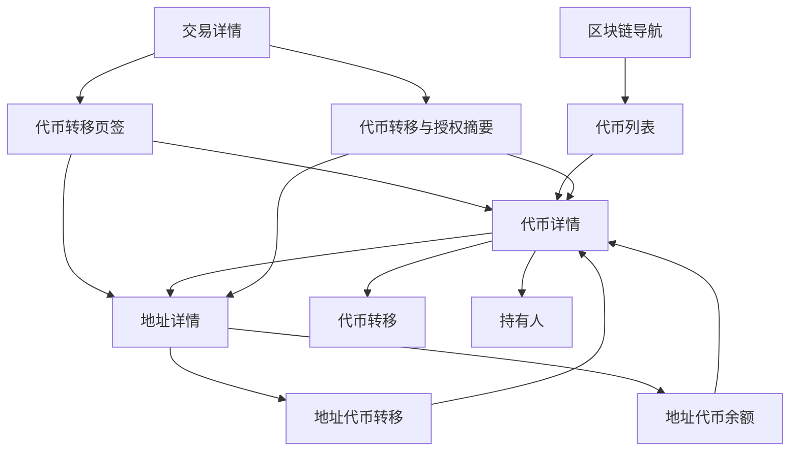

# BiyaEVM 区块浏览器产品需求文档

> 产品经理：Terry｜文档版本：V1.1.0｜文档状态：正式需求｜日期：2026-10-27

## 文档说明

| 项目 | 内容 |
| --- | --- |
| 需求名称 | BiyaEVM 区块浏览器 V1.1.0 |
| 需求等级 | L3 复杂需求 |
| 核心目标 | 使用户能看懂一笔交易里的 ERC-20 代币转移与授权，并浏览代币列表、代币详情、地址代币转移与余额 |
| 目标用户 | 链上用户、合约交互方、运营与客服、安全研究人员、生态开发者 |
| 交互基线 | [V1.1-EVM浏览器原型.html](./V1.1-EVM浏览器原型.html) |
| 公开原型 | https://terryxu923.github.io/biya-dex-docs/BiyaEVMscan-v1.1.html |
| 公开 PRD | https://terryxu923.github.io/biya-dex-docs/biya-evm-explorer-prd-v1.1.html |
| 依赖需求 | [BiyaEVM区块浏览器_PRD_V1.0.md](../V1.0-原型/BiyaEVM区块浏览器_PRD_V1.0.md) V1.0.0 正式需求。宿主页面（首页、区块、交易列表、交易详情四段、地址信息表与相关交易、全局搜索）以 V1.0.0 为准，本文不重写、不验收 |
| 范围底稿 | [EVM浏览器迭代版本表.md](../迭代计划/EVM浏览器迭代版本表.md) 的 V1.1 行。版本表原文不改。开发与测试以本文字段表为准 |
| 编写规范 | [产品需求文档编写规范](../../../PRD规范/产品需求文档编写规范.md) |
| 需求范围 | 仅 V1.1.0 增量。不含 V1.0.0 已交付字段与验收，不含 BiyaDEX 区块浏览器 |
| 一句话概述 | 用户在已有普通交易查询之上，无需登录即可核验 ERC-20 Transfer、授权、余额与持有人 |

**文档定位**

本文只定义 V1.1.0 相对 V1.0.0 的增量。V1.0.0 正式需求仍然有效，读者验收普通交易、区块、首页和搜索时使用那份文档。

本文是产品、设计、研发、测试和 AI 交付参与者共同使用的 V1.1.0 业务真相源。本文说明用户可见行为、业务规则和验收边界，不规定数据库、接口路径、索引器内部结构或前端框架。

原型中的模拟数据仅用于表达页面和交互，不构成数据值、刷新频率、行情或链上事实。生产版本必须展示 Biya EVM 的真实索引数据。

字段口径、待确认与空组、数量换算以行业 EVM 浏览器（BlockScout）的公开查询语义为准，再落到 Biya 中文界面。交易级授权（Approval）是相对 BlockScout 代币转移资源的产品增量，依据版本表 V1.1 与已确认原型。

已确认界面与版本表措辞冲突时，以已确认原型为准，版本表原文不改，见 Q-V11-01。

**撰写语言**

正文和用户可见文案以中文为主。哈希、地址前缀、代币标准等链上原始标识保留必要英文，并在有确定业务含义时补充中文。

**原型已知未覆盖（验收以本文）**

- 原型样例仍展示代币美元；生产无行情时按 BR-T11-04 处理。
- HTML 内遗留的 DEX 代币页、登录、页内筛选不进入本期范围。

---

## 目录

- [1. 本期交付摘要](#1-本期交付摘要)
- [2. 产品概述](#2-产品概述)
- [3. 功能列表与优先级](#3-功能列表与优先级)
- [4. 功能详细说明](#4-功能详细说明)
  - [4.1 导航与搜索边界](#41-导航与搜索边界)
  - [4.2 交易详情：代币转移摘要与页签](#42-交易详情代币转移摘要与页签)
  - [4.3 地址详情：代币转移与代币余额](#43-地址详情代币转移与代币余额)
  - [4.4 代币列表](#44-代币列表)
  - [4.5 代币详情](#45-代币详情)
- [5. 横切业务规则与异常处理](#5-横切业务规则与异常处理)
- [6. 更新记录](#6-更新记录)
- [7. 待定事项](#7-待定事项)

---

## 1. 本期交付摘要

### 1.1 交付结果

本期在 V1.0.0 已交付的普通交易查询上，增加 ERC-20 查询闭环：

用户可以从交易详情核验 Transfer 与授权，从地址查看相关转移与余额，从代币列表进入代币详情查看概览、转移和持有人。代币详情支持直接打开和分享。

### 1.2 V1.1.0 核心能力

| 模块 | 交付能力 |
| --- | --- |
| 全局 | 区块链导航增加「代币列表」。搜索范围不扩展到代币名称或符号 |
| 交易详情 | 参与方之后、原生币转账数量之前展示 Transfer / 授权摘要；新增「代币转移」页签，Transfer 与授权同一张表 |
| 地址详情 | 新增「代币转移」页签（仅 Transfer，从/到双方）和「代币」页签（余额） |
| 代币 | 代币列表；代币详情（概览、代币转移、持有人） |
| 公共状态 | 交易详情补齐 ERC-20 相关状态；代币页补齐加载、空数据、未找到、格式无效、网络错误 |

### 1.3 明确不在本期范围

| 不在范围的能力 | 本期用户可见行为 |
| --- | --- |
| V1.0.0 已交付的首页、区块列表、区块详情、交易列表、交易详情四段、地址信息表与相关交易、全局搜索规则 | 本文不重写、不列入本期验收；继续以 V1.0.0 正式需求为准 |
| DEX 区块浏览器页面和业务规则 | 本文不定义 |
| NFT 及 ERC-721 / ERC-1155 | 不展示 NFT 转移、持有或详情 |
| 代币铸造、销毁、新建代币独立分组 | 详情摘要只展示 Transfer 与授权；铸造/销毁若以 Transfer 形态出现则按 Transfer 展示 |
| 按代币名称或符号搜索 | 搜索范围仍为交易哈希、地址、区块高度、区块哈希 |
| 完整代币合约地址直达代币详情 | 提交完整 40 位地址仍打开地址详情；从代币列表或名称进入代币详情 |
| 合约源码、验证、读取合约 | 代币合约打开地址详情时沿用 V1.0.0 地址页，不提供源码、验证或读取 |
| 内部交易、日志、状态变化 | 交易、地址、代币详情不展示对应页签 |
| 地址代币转移中的授权 | 授权只出现在交易详情摘要与交易「代币转移」页签 |
| 地址 identicon | 从/到只展示地址文本 |
| 通过钱包写合约、授权或转账 | 不提供签名或写操作入口 |
| 登录、关注、私有标签、自定义 ABI | 公共查链不要求登录 |
| 多语言 | 仅提供中文用户界面 |
| 外链网络的 EVM 页面 | 本期只验收 Biya EVM |

### 1.4 存量与在途

本期为公共只读查询增量，无登录用户、无在途订单。链上已发生的历史 ERC-20 事件，在索引完成后按本文规则展示。待确认交易按待确认规则展示，入块后改为已确认口径。不迁移、不改写链上事实。V1.0.0 已上线页面继续有效，本期只在既有交易详情、地址详情上增加页签与摘要，并新增代币列表、代币详情。

---

## 2. 产品概述

### 2.1 背景与当前问题

V1.0.0 已固化普通交易、区块和地址查询。用户在钱包里完成 ERC-20 转账或授权后，仍无法在浏览器里核验代币双方、数量和额度。V1.1 原型已经表达代币列表、代币详情、交易摘要与页签、地址代币页签，数据仍为前端模拟。

本需求将上述增量固化为生产要求，并明确：

1. 页面展示 Biya EVM 的真实索引结果，不使用模拟值冒充链上事实。
2. 用户能核验一笔交易中的 ERC-20 Transfer 与授权。
3. 待确认交易在详情不出现代币摘要；代币转移页签提示待确认，与「暂无转移」区分。
4. 无 Transfer 时详情不出现「代币转移」行；无授权时不出现「授权」行。
5. 无数据、查无结果、参数无效和网络错误必须给出不同反馈。
6. ERC-20 页面只在 EVM 下可达。

### 2.2 产品目标

| 目标 | 可观察结果 |
| --- | --- |
| 提供可读的 ERC-20 活动 | 用户能在交易、地址和代币页核验 Transfer、授权、余额和持有人 |
| 支持交叉核验 | 同一笔 Transfer 在交易摘要、交易页签、地址代币转移、代币详情转移中口径一致 |
| 支持分享和复现 | 用户复制代币详情或带页签的交易/地址深链后，在新会话中打开相同对象 |
| 明确失败原因 | 代币相关查询失败时区分“无结果”“参数无效”和“网络错误” |

### 2.3 非目标

- 不通过浏览器完成转账、授权、合约写入或资金操作。
- 不在本需求中定义或重验收 V1.0.0 页面字段。
- 不在本需求中定义 DEX 页面、DEX 字段或 DEX 筛选。
- 不把所有链上原始数据无差别展示；只展示本文字段表规定的业务字段。
- 不承诺浏览器查询接口对外开放。
- 不以原型中的固定总量、固定时间和固定地址作为生产数据。
- 不把索引系统内部设计写入本 PRD。

### 2.4 目标用户与场景

| 用户角色 | 典型场景 | 需要完成的目标 |
| --- | --- | --- |
| 链上用户 | 钱包完成 ERC-20 转账后核验 | 打开交易，看到代币双方和数量 |
| 合约交互方 | 授权后核验额度 | 区分有限额授权与无限授权 |
| 运营与客服 | 处理“转了代币但详情看不到” | 区分待确认、无事件、失败交易仍可查事件 |
| 安全研究人员 | 调查地址代币流向 | 在地址转移、代币持有人和交易页之间交叉核验 |
| 生态开发者 | 浏览已索引 ERC-20 | 从代币列表进入详情查看供应、转移和持有人 |

所有页面均为公开只读页面，不因角色不同改变数据可见范围，也不要求登录。

### 2.5 术语与统一口径

下列术语只定义本期新增对象。交易三态、接收方三种形态、原生币、Gas 等沿用 V1.0.0，本文不重定义。

| 术语 | 定义 |
| --- | --- |
| ERC-20 | 符合 ERC-20 接口的同质代币合约 |
| 代币转移 / Transfer | 由 ERC-20 `Transfer` 事件解析出的代币转出与转入记录，不是顶层交易本身 |
| 授权 / Approval | 由 ERC-20 `Approval` 事件解析出的授权记录：授权方、被授权方、代币、额度。相对 BlockScout 代币转移资源的产品增量 |
| 无限授权 | 授权额度等于或视为 ERC-20 最大无符号整数时，界面展示「无限」，不附美元 |
| 代币合约 | 发行该 ERC-20 的合约地址 |
| 精度 | 代币合约声明的小数位数；人类可读数量 = 链上整数 ÷ 10^精度 |
| 代币转移摘要 | 交易详情中插在参与方之后、原生币转账数量之前的 Transfer / 授权短句 |
| 流通市值 | 代币价格 × 流通供应量；无价格时不可用 |
| 持有人数 | 该代币余额大于 0 的地址数 |
| 转移次数 | 该代币已索引的 Transfer 次数，不含授权 |

**产品关系说明**：ERC-20 页面只在 BiyaChain 的 EVM 模式下可达。进入 DEX 后的行为由独立需求负责。本文只定义进入 EVM 后的 V1.1.0 可见行为。

### 2.6 页面地图

| 页面或区域 | 标准入口 | 主要任务 |
| --- | --- | --- |
| 交易详情 · 代币转移摘要 | 打开已确认交易详情 | 在参与方与原生币之间核验 Transfer / 授权短句 |
| 交易详情 · 代币转移页签 | 交易详情内切换页签 | 查看该笔 Transfer 与授权全表 |
| 地址详情 · 代币转移 | 地址详情内切换页签 | 查看该地址相关 ERC-20 Transfer |
| 地址详情 · 代币 | 地址详情内切换页签 | 查看该地址 ERC-20 余额 |
| 代币列表 | 导航「区块链 — 代币列表」 | 浏览 ERC-20 代币 |
| 代币详情 | 按代币合约打开，或从名称进入 | 查看代币概览、转移和持有人 |

分享链接必须能直接打开同一业务页面、同一查询对象和同一页签。若研发调整路径实现，不得改变这一产品结果。

---

## 3. 功能列表与优先级

| 功能模块 | 功能点 | 优先级 | 说明 |
| --- | --- | --- | --- |
| 全局 | 导航增加代币列表 | P1 | 「区块链」菜单在交易列表、区块列表之外增加代币列表 |
| 全局 | 搜索不按代币名称 | P1 | 范围不扩展；完整代币合约地址仍打开地址详情 |
| 交易 | 交易详情 · 代币转移摘要 | P1 | 参与方之后、原生币之前；Transfer 与授权分组；空组不占行 |
| 交易 | 交易详情 · 代币转移页签 | P1 | Transfer 与授权同一张表 |
| 地址 | 代币转移 | P1 | 该地址作为转出或接收方的 ERC-20 Transfer；从/到双方；当前侧不跳转 |
| 地址 | 代币余额 | P1 | ERC-20 名称、符号、合约、持有数量 |
| 代币 | 代币列表 | P1 | ERC-20 列表 |
| 代币 | 代币详情 | P1 | 概览、转移、持有人 |
| 公共状态 | ERC-20 相关加载、空数据、待确认、未找到、无效参数、网络错误 | P1 | 本期新增表面适用 |

---

## 4. 功能详细说明

## 4.1 导航与搜索边界

**相对 V1.0.0 的变化**

区块链导航增加「代币列表」。搜索识别规则、建议条数、无结果页沿用 V1.0.0，本期不重写。本期明确：不按代币名称或符号出建议，也不因命中代币合约而改为打开代币详情。

### 4.1.1 流程步骤

| 步骤 | 用户操作 | 系统行为 | 可见结果 |
| --- | --- | --- | --- |
| 1 | 展开“区块链”菜单 | 展示“交易列表”“区块列表”“代币列表” | 用户可进入代币列表 |
| 2 | 点击「代币列表」 | 打开代币列表并保持 EVM | 见 §4.4 |
| 3 | 在全局搜索框输入代币名称或符号 | 不按名称或符号检索代币 | 无对应建议；提交后按 V1.0.0 无结果规则处理 |
| 4 | 提交完整 40 位地址，且该地址是代币合约 | 打开地址详情 | 不直达代币详情 |

### 4.1.2 字段说明

| 界面字段 | 业务含义 | 数据来源 | 展示规则 | 空值/异常 | 校验/交互 |
| --- | --- | --- | --- | --- | --- |
| 区块链导航 · 代币列表 | 进入 ERC-20 列表的入口 | 产品配置 | 与交易列表、区块列表并列 | 不允许缺失 | 点击进入 EVM 代币列表 |

### 4.1.3 验收标准

| 序号 | 验收条件 | 预期结果 |
| --- | --- | --- |
| AC-NV01 | 用户在 BiyaChain 的 EVM 下展开区块链菜单 | 可见交易列表、区块列表、代币列表；点击代币列表进入 §4.4 |
| AC-NV02 | 用户输入某已索引代币的名称或符号并提交 | 不打开代币详情；不出现按名称命中的建议 |
| AC-NV03 | 用户提交某已索引 ERC-20 的完整合约地址 | 打开地址详情，是否合约为是；用户可通过代币页签或代币列表再进代币详情 |

---

## 4.2 交易详情：代币转移摘要与页签

**用户目标**

用户在已能读懂普通交易的基础上，核验该笔交易里的 ERC-20 Transfer 与授权。

**相对 V1.0.0 的变化**

- 页签由仅「详情」变为「详情」和「代币转移」。默认打开详情。
- 页签计数 = 该笔可查询的 Transfer 条数 + 授权条数。待确认交易计数为 0。
- 详情表在参与方之后、原生币转账数量之前插入摘要。
- 交易主体加载中或网络错误时，页签仍可见。格式无效或未找到时无页签。
- 基础信息、参与方、资产与费用、其他字段沿用 V1.0.0，本文不重写。

标题仍只有「交易详情」。状态、方法继续在详情表中各占一行，沿用 V1.0.0。

### 4.2.1 流程步骤

| 步骤 | 用户操作 | 系统行为 | 可见结果 |
| --- | --- | --- | --- |
| 1 | 打开交易详情 | 查询交易；已上链时查询 Transfer 与授权 | 加载中页签可见 |
| 2 | 数据返回 | 按规则插入摘要 | 有事件则在参与方与原生币之间看到摘要 |
| 3 | 点击摘要中的地址 | 打开地址详情 | 可查看该地址代币页签 |
| 4 | 点击摘要中的代币符号或页签中的代币名称 | 打开代币详情 | 进入该 ERC-20 |
| 5 | 打开「代币转移」页签 | 列出该笔 Transfer 与授权 | 与摘要口径一致 |
| 6 | 摘要超出 10 条时点击「查看全部」 | 进入代币转移页签 | 可分页查看全部 |

### 4.2.2 代币转移摘要

位置：插在参与方之后、原生币转账数量之前。Transfer 组标签为「代币转移」，授权组标签为「授权」。有 Transfer 才出现「代币转移」行；有授权才出现「授权」行；授权紧跟代币转移。待确认交易两组都不出现。见 BR-T11-01、BR-T11-02。

单条摘要文案：`转出地址 → 转入地址 for 数量 [代币图标] 符号`。有代币报价时附美元；无行情时隐藏美元。无限授权为 `for 无限 [图标] 符号`，不附美元。BR-T11-03、BR-T11-04。

| 界面字段 | 业务含义 | 数据来源 | 展示规则 | 空值/异常 | 校验/交互 |
| --- | --- | --- | --- | --- | --- |
| 代币转移 | 该笔已解析的 ERC-20 Transfer | 交易收据中的 `Transfer` 事件 | 每条一行摘要。详情内嵌最多 10 条；超出时在组内给出「查看全部」，进入代币转移页签 | 无 Transfer 时整行不出现，不占空行 | 地址可进地址详情；代币图标与符号可进代币详情。发送方/接收方不加 identicon |
| 授权 | 该笔已解析的 ERC-20 Approval | 交易收据中的 `Approval` 事件 | 每条一行摘要；转出侧为授权方，转入侧为被授权方。有限额展示人类可读额度；无限展示「无限」。内嵌最多 10 条，超出同样「查看全部」 | 无授权时整行不出现 | 同代币转移 |

代币图标：有公开图标则展示圆形图标；无图标时用符号首字母色标。BR-T11-05。

铸造或销毁若以 `Transfer` 事件出现，按 Transfer 展示，不另开分组。

### 4.2.3 代币转移页签

Transfer 与授权共用一张表，不拆第二张授权表。列顺序固定如下。待确认交易不查询、不列出转移，页签内容为待确认提示「该交易待确认」。已上链且无事件时表格提示「该交易暂无 ERC-20 转移」。见 BR-T11-02、BR-T11-06、BR-T11-10。

| 界面字段 | 业务含义 | 数据来源 | 展示规则 | 空值/异常 | 校验/交互 |
| --- | --- | --- | --- | --- | --- |
| 代币 | 名称、符号、合约、类型、事件种类 | 代币元数据与事件 | 圆形图标 + 名称(符号)；下列合约地址；徽章 `ERC-20` 与 `Transfer` 或 `授权` | 元数据缺失时符号用 `--`，合约地址仍展示 | 名称进代币详情；合约地址进地址详情（是否合约=是）；可复制合约地址 |
| 从 / 到 | Transfer 为转出/转入；授权为授权方/被授权方 | 事件 | 上从下到 | 不允许为空 | 点击进地址详情；可复制 |
| 数量 | Transfer 数量或授权额度 | 事件整数 ÷ 10^精度 | 人类可读数量 + 符号；有报价时下行附美元 | 0 显示 `0` + 符号；无限授权本格为「无限」，不附美元；无行情时不附美元 | 只读 |
| 方法 | 触发该事件的交易方法 | 交易数据 | 函数名或选择器 | 无方法显示 `--` | 只读 |
| 区块 | 事件所在高度 | 交易数据 | 完整高度 | 待确认本页签不出表 | 点击进区块详情 |

页签自身加载中：保留页签，表格区骨架。页签自身失败：「代币转移加载失败，请重试」。交易主体失败见 §4.2.4。

### 4.2.4 页面状态矩阵

| 场景 | 触发条件 | 页面展示 | 用户可操作 |
| --- | --- | --- | --- |
| 加载中 | 有效格式哈希首次打开 | 页签可见，「详情」选中；详情区字段骨架 | 返回、切换页签 |
| 成功无转移 | 已上链成功且无 Transfer、无授权 | 参与方之后直接原生币转账数量；页签表空 | 跳转、复制、切换页签 |
| 单笔 Transfer | 恰好 1 条 Transfer | 参与方后出现「代币转移」一条摘要 | 进地址、进代币 |
| 多笔 Transfer | 多于 1 条 Transfer | 「代币转移」多条摘要；超过 10 条给出查看全部 | 进页签查看全部 |
| 有限额授权 | 仅有限额 Approval | 「授权」摘要为 `for 数量 符号` | 进地址、进代币 |
| 无限授权 | 额度视为最大整数 | 「授权」摘要为 `for 无限 符号`，无美元 | 只读额度 |
| 转移 + 授权 | 同时有 Transfer 与 Approval | 先「代币转移」后「授权」，再原生币 | 两组均可点 |
| 待确认无转移 | 已广播未入块 | 详情无摘要、无待确认条；页签提示「该交易待确认」 | 复制、稍后刷新 |
| 失败无事件 | 已上链失败且无 Transfer、无授权 | 详情无摘要；页签「该交易暂无 ERC-20 转移」 | 跳转、复制 |
| 失败有事件 | 已上链失败但仍解析到 Transfer 或授权 | 按有事件规则展示摘要与页签 | 核验事件 |
| 查无结果 | 格式有效但无交易 | “未找到该交易”，无页签 | 返回列表、重新搜索 |
| 参数无效 | 不是合法交易哈希 | “交易哈希格式无效”，无页签 | 修改搜索、返回 |
| 网络错误 | 交易主体查询失败 | 页签可见；详情区“交易详情加载失败，请重试” | 重试 |
| 代币转移页签加载中 | 交易已返回、页签数据未返回 | 「代币转移」选中，表格骨架 | 切回详情 |
| 代币转移页签网络错误 | 页签查询失败 | 「代币转移加载失败，请重试」 | 重试 |

不得为未知哈希生成模拟详情。不得把待确认写成「暂无 ERC-20 转移」。

### 4.2.5 验收标准

| 序号 | 验收条件 | 预期结果 |
| --- | --- | --- |
| AC-TT01 | 用户打开含 1 笔 USDT Transfer 的成功交易 | 参与方之后、原生币之前出现「代币转移」；文案含 `for`、数量、USDT 图标与符号 |
| AC-TT02 | 用户打开含多笔 Transfer 的交易 | 「代币转移」多条摘要，条数与页签 Transfer 行数一致 |
| AC-TT03 | 用户打开有限额授权交易 | 无「代币转移」行；「授权」为有限额数量；页签该行徽章为「授权」 |
| AC-TT04 | 用户打开无限授权交易 | 摘要与页签数量均为「无限」，无美元 |
| AC-TT05 | 用户打开同时含 Transfer 与授权的交易 | 先转移后授权，再原生币；页签同一张表两行 |
| AC-TT06 | 用户打开待确认交易的代币转移页签 | 提示「该交易待确认」，不出空表「暂无 ERC-20 转移」 |
| AC-TT07 | 用户打开失败且无事件的交易页签 | 「该交易暂无 ERC-20 转移」 |
| AC-TT08 | 交易主体加载中 | 页签可见，详情为骨架 |
| AC-TT09 | 交易主体网络错误 | 页签可见，文案为「交易详情加载失败，请重试」 |
| AC-TT10 | 用户打开 Transfer 超过 10 条的已确认交易 | 详情摘要最多 10 条，组内出现「查看全部」；代币转移页签可分页查看全部 |
| AC-TT11 | 无 ERC-20 事件的正常详情 | 不出现「代币转移」「授权」行；不出现内部交易、日志、状态、原始 JSON |

---

## 4.3 地址详情：代币转移与代币余额

**用户目标**

用户查看某一地址作为转出或接收方的 ERC-20 Transfer，以及当前持有的 ERC-20 余额。

**相对 V1.0.0 的变化**

- 页签由仅「交易」变为「交易」「代币转移」「代币」。默认仍打开交易。
- 代币转移计数 = 该地址作为转出或接收方的 ERC-20 Transfer 条数，不含授权。
- 代币计数 = 持有余额大于 0 的 ERC-20 种数。
- 头部信息表与相关交易沿用 V1.0.0，本文不重写。

授权不出现在地址代币转移页签。BR-T11-07。

### 4.3.1 流程步骤

| 步骤 | 用户操作 | 系统行为 | 可见结果 |
| --- | --- | --- | --- |
| 1 | 打开地址详情 | 查询地址；可切到代币页签 | 默认交易页签，计数可见 |
| 2 | 打开代币转移 | 列出该地址相关 ERC-20 Transfer | 从/到含当前地址；当前侧不可跳转 |
| 3 | 打开代币 | 列出 ERC-20 余额 | 可进代币详情 |
| 4 | 点击转移行中的交易哈希 | 打开交易详情 | 可在该笔交易中核验同一 Transfer |
| 5 | 翻页 | 加载对应页 | 页码更新 |

### 4.3.2 代币转移

列出该地址作为转出或接收方的 ERC-20 Transfer。不含授权。默认从新到旧，每页 20 条。版本表写「对方地址」；界面按已确认原型展示从/到双方，当前页地址一侧为纯文本。见 Q-V11-01。

| 界面字段 | 业务含义 | 数据来源 | 展示规则 | 空值/异常 | 校验/交互 |
| --- | --- | --- | --- | --- | --- |
| 代币 | 名称、符号、类型 | 代币元数据 | 图标 + 名称(符号)；本表隐藏合约地址行 | 元数据缺失时名称 `--` | 名称进代币详情 |
| 交易 | 所属交易与时间 | 事件、交易数据 | 上行截断哈希，下行相对时间与区块高度 | 不允许为空 | 哈希进交易详情；区块进区块详情；可复制哈希 |
| 方法 | 触发方法 | 交易数据 | 函数名或选择器 | `--` | 只读 |
| 从 / 到 | 转出在上、转入在下 | 事件 | 两侧截断 | 不允许为空 | 当前页地址一侧纯文本可复制、不可跳转；另一侧进地址详情 |
| 数量 | Transfer 数量 | 事件整数 ÷ 10^精度 | 数量 + 符号 | 0 显示 `0` + 符号；本表不附美元 | 只读 |

无记录时：「该地址暂无 ERC-20 转移」。

### 4.3.3 代币余额

列出该地址持有数量大于 0 的 ERC-20。无记录时：「该地址暂无 ERC-20 余额」。

| 界面字段 | 业务含义 | 数据来源 | 展示规则 | 空值/异常 | 校验/交互 |
| --- | --- | --- | --- | --- | --- |
| 代币 | 名称、符号、类型 | 代币元数据 | 图标 + 名称(符号) | 不允许为空 | 名称进代币详情 |
| 合约地址 | 代币合约 | 代币元数据 | 列表截断 | 不允许为空 | 进该地址详情（是否合约=是）；可复制 |
| 持有数量 | 当前余额 | 地址代币余额 | 数量 + 符号 | 0 的代币不出现在本表 | 只读 |
| 美元估值 | 持有数量 × 代币价格 | 代币行情 | 有行情时展示美元 | 无行情显示 `--`，不阻断持有数量 | 只读 |

### 4.3.4 页面状态矩阵

| 场景 | 触发条件 | 页面展示 | 用户可操作 |
| --- | --- | --- | --- |
| 有 ERC-20 转移 | 该地址出现在 Transfer 的从或到 | 代币转移表有行 | 进交易、进代币 |
| 无 ERC-20 转移 | 无相关 Transfer | “该地址暂无 ERC-20 转移” | 返回 |
| 有余额 | 至少一种 ERC-20 余额大于 0 | 代币表有行 | 进代币详情 |
| 无余额 | 无大于 0 的 ERC-20 | “该地址暂无 ERC-20 余额” | 返回 |
| 代币转移加载中 | 打开代币转移且数据未返回 | 表格骨架 | 切回交易 |
| 代币转移网络错误 | 页签查询失败 | “代币转移加载失败，请重试” | 重试 |
| 代币余额加载中 | 打开代币且数据未返回 | 表格骨架 | 切回交易 |
| 代币余额网络错误 | 页签查询失败 | “代币余额加载失败，请重试” | 重试 |

地址主体的加载、格式无效、网络错误沿用 V1.0.0。任意合法地址均可打开代币页签，不得因为尚无 ERC-20 记录而改写成另一个示例地址。

### 4.3.5 验收标准

| 序号 | 验收条件 | 预期结果 |
| --- | --- | --- |
| AC-AT01 | 用户打开有 ERC-20 转移的地址的代币转移页签 | 表含代币、交易、方法、从/到、数量；当前地址一侧不可跳转 |
| AC-AT02 | 用户打开无 ERC-20 转移的合法地址 | “该地址暂无 ERC-20 转移” |
| AC-AT03 | 用户打开有余额的地址的代币页签 | 可见代币、合约、持有数量；无行情时美元为 `--` |
| AC-AT04 | 地址代币转移页签出现授权行 | 失败：本页签不含授权 |

---

## 4.4 代币列表

**用户目标**

用户浏览 Biya EVM 上已索引的 ERC-20，比较精度、价格、市值、持有人和转移次数，并进入代币详情。

### 4.4.1 流程步骤

| 步骤 | 用户操作 | 系统行为 | 可见结果 |
| --- | --- | --- | --- |
| 1 | 从导航打开代币列表 | 加载 ERC-20 列表 | 第 1 页 |
| 2 | 点击代币名称 | 打开代币详情 | 进入概览 |
| 3 | 点击持有人数 | 打开该代币持有人页签 | 进入持有人 |
| 4 | 点击转移次数 | 打开该代币转移页签 | 进入转移 |
| 5 | 翻页 | 加载对应页 | 页码更新 |

本期不做列头排序、页面内名称筛选。默认顺序：有流通市值的在前且市值从高到低；无市值的排后，同类按转移次数从高到低。该顺序为对齐行业 EVM 浏览器列表默认的推断，见 Q-V11-02。

### 4.4.2 展示字段

| 界面字段 | 业务含义 | 数据来源 | 展示规则 | 空值/异常 | 校验/交互 |
| --- | --- | --- | --- | --- | --- |
| # | 当前页行号 | 列表位置 | 当前页从 1 计到本页条数，不跨页累计 | 不允许为空 | 只读 |
| 代币 | 名称、符号、合约、类型 | 代币元数据 | 图标 + 名称(符号)；下列合约；徽章 `ERC-20` | 不允许为空 | 名称进代币详情；合约进地址详情；可复制合约 |
| 精度 | 小数位数 | 代币合约 | 非负整数 | 不可用显示 `--` | 只读 |
| 价格 | 对美元报价 | 代币行情 | 美元金额 | 无行情显示 `--` | 只读 |
| 流通市值 | 价格 × 流通供应量 | 行情与供应量 | 美元金额 | 无价格或无流通供应显示 `--` | 只读 |
| 持有人数 | 余额大于 0 的地址数 | 代币计数 | 非负整数 | 0 显示 0 | 点击进该代币持有人页签 |
| 转移次数 | 已索引 Transfer 次数 | 代币计数 | 非负整数 | 0 显示 0 | 点击进该代币转移页签 |

### 4.4.3 页面状态矩阵

| 场景 | 触发条件 | 页面展示 | 用户可操作 |
| --- | --- | --- | --- |
| 加载中 | 首次打开或翻页 | 表格骨架 | 返回 |
| 正常 | 有 ERC-20 | 每页 20 条 | 进详情、翻页 |
| 暂无数据 | 尚无 ERC-20 | “暂无 ERC-20 代币” | 返回、重试 |
| 网络错误 | 查询失败 | “代币列表加载失败，请重试” | 重试 |

### 4.4.4 验收标准

| 序号 | 验收条件 | 预期结果 |
| --- | --- | --- |
| AC-TK01 | 用户打开有数据的代币列表 | 7 列：#、代币、精度、价格、流通市值、持有人数、转移次数 |
| AC-TK02 | 用户点击名称 | 打开对应代币详情 |
| AC-TK03 | 无行情 | 价格与流通市值为 `--`，列表其余列正常 |
| AC-TK04 | 尚无代币 | “暂无 ERC-20 代币” |

---

## 4.5 代币详情

**用户目标**

用户核验某一 ERC-20 的合约、精度、供应、持有人和转移记录。

页签为「详情」「代币转移」「持有人」。默认打开详情。转移计数、持有人计数分别等于对应列表可查询总数。本期不提供代币页内的源码、字节码或读取合约。

### 4.5.1 流程步骤

| 步骤 | 用户操作 | 系统行为 | 可见结果 |
| --- | --- | --- | --- |
| 1 | 从列表或名称打开 | 查询代币 | 标题为名称 (符号)，类型徽章 ERC-20 |
| 2 | 点击合约地址 | 打开地址详情 | 是否合约为是 |
| 3 | 点击持有人数或持有人页签 | 列出持有地址 | 可进地址 |
| 4 | 点击转移次数或代币转移页签 | 列出 Transfer | 可进交易 |
| 5 | 翻页 | 加载对应页 | 页码更新 |

### 4.5.2 概览字段

| 界面字段 | 业务含义 | 数据来源 | 展示规则 | 空值/异常 | 校验/交互 |
| --- | --- | --- | --- | --- | --- |
| 名称 | 代币全称 | 代币元数据 | 原文 | 不允许为空 | 只读；标题同步 |
| 符号 | 代币符号 | 代币元数据 | 原文 | 不允许为空 | 只读；标题同步 |
| 合约地址 | 代币合约 | 代币元数据 | 完整地址 | 不允许为空 | 进地址详情；可复制 |
| 类型 | 代币标准 | 代币元数据 | `ERC-20` | 不允许为空 | 只读 |
| 精度 | 小数位数 | 代币合约 | 非负整数 | `--` | 只读 |
| 价格 | 对美元报价 | 代币行情 | 美元金额 | 无行情显示 `--` | 只读 |
| 流通供应量 | 流通中的代币数量 | 代币数据 | 数量 + 符号 | 不可用显示 `--` | 只读 |
| 总供应量 | 已发行总量 | 代币数据 | 数量 + 符号 | 不可用显示 `--` | 只读 |
| 持有人数 | 余额大于 0 的地址数 | 代币计数 | 非负整数 | 0 显示 0 | 进入持有人页签 |
| 转移次数 | 已索引 Transfer 次数 | 代币计数 | 非负整数 | 0 显示 0 | 进入代币转移页签 |

### 4.5.3 代币转移

仅 Transfer，不含授权。每页 20 条，从新到旧。

| 界面字段 | 业务含义 | 数据来源 | 展示规则 | 空值/异常 | 校验/交互 |
| --- | --- | --- | --- | --- | --- |
| 交易 | 所属交易与时间 | 事件、交易数据 | 上行截断哈希，下行相对时间与区块 | 不允许为空 | 哈希进交易详情；区块进区块详情 |
| 方法 | 触发方法 | 交易数据 | 函数名或选择器 | `--` | 只读 |
| 从 / 到 | 转出、转入 | 事件 | 上从下到 | 不允许为空 | 进地址详情；可复制 |
| 数量 | Transfer 数量 | 事件整数 ÷ 10^精度 | 数量 + 符号；有行情时附美元 | 无行情不附美元 | 只读 |

无记录：「该代币暂无转移」。

### 4.5.4 持有人

按持有数量从高到低。每页 20 条。占比分母为总供应量。BR-T11-08。

| 界面字段 | 业务含义 | 数据来源 | 展示规则 | 空值/异常 | 校验/交互 |
| --- | --- | --- | --- | --- | --- |
| 持有地址 | 持有该代币的地址 | 代币余额 | 列表截断 | 不允许为空 | 进地址详情；可复制 |
| 持有数量 | 该地址余额 | 代币余额 | 数量 + 符号 | 0 不出现 | 只读 |
| 占供应量比例 | 持有数量 / 总供应量 | 计算 | 百分数，两位小数；小于 0.01% 显示 `<0.01%` | 总供应量为 0 或不可用时显示 `--` | 只读 |

无记录：「该代币暂无持有人」。

### 4.5.5 页面状态矩阵

| 场景 | 触发条件 | 页面展示 | 用户可操作 |
| --- | --- | --- | --- |
| 加载中 | 格式有效的代币合约首次打开 | 详情骨架 | 返回列表 |
| 正常 | 找到 ERC-20 | 概览 + 页签 | 切页签、跳转 |
| 无价格 | 无代币行情 | 价格 `--`；流通市值在列表为 `--` | 仍可看供应与转移 |
| 无转移 | 尚无 Transfer | “该代币暂无转移” | 看概览、持有人 |
| 无持有人 | 无余额大于 0 的地址 | “该代币暂无持有人” | 看概览 |
| 未找到 | 格式有效但不是已索引 ERC-20 | “未找到该代币” | 返回列表 |
| 地址格式无效 | 不是合法地址 | “代币地址格式无效” | 修改搜索 |
| 网络错误 | 查询失败 | “代币详情加载失败，请重试” | 重试或返回列表 |

### 4.5.6 验收标准

| 序号 | 验收条件 | 预期结果 |
| --- | --- | --- |
| AC-TDK01 | 用户打开有价格的 ERC-20 | 可见名称、符号、合约、类型、精度、价格、流通供应、总供应、持有人数、转移次数 |
| AC-TDK02 | 用户打开无价格代币 | 价格为 `--`，数量类字段仍在 |
| AC-TDK03 | 用户点击合约地址 | 打开地址详情，是否合约为是 |
| AC-TDK04 | 用户打开未索引的合法地址作为代币 | “未找到该代币” |
| AC-TDK05 | 用户打开格式无效的代币地址 | “代币地址格式无效” |
| AC-TDK06 | 持有人占比 | 等于持有数量 / 总供应量；总供应不可用时为 `--` |

---

## 5. 横切业务规则与异常处理

原生币费用、交易三态、接收方三种形态、时区 UTC+8、复制成功反馈 1.5 秒、列表截断与复制完整值，沿用 V1.0.0。本节只定义本期 ERC-20 增量。

## 5.1 数据真实性与一致性

1. 所有生产 ERC-20 数值均以 Biya EVM 已确认链上数据为事实来源，由公共浏览器展示对应索引结果。
2. 原型中的固定总量、哈希、地址、代币报价和演示场景不得作为生产默认数据。
3. 同一笔 Transfer 在交易详情摘要、交易代币转移页签、地址代币转移、代币详情转移中的代币、从/到、人类可读数量、所属交易和区块必须一致。
4. 授权只出现在交易详情摘要与交易代币转移页签，不出现在地址代币转移和代币详情转移。
5. 代币详情「转移次数」等于该代币可查询 Transfer 总数；「持有人数」等于余额大于 0 的地址数。地址「代币转移」计数不含授权。交易「代币转移」页签计数 = 该笔 Transfer 条数 + 该笔授权条数。

## 5.2 代币数量、无限授权与美元

- 人类可读数量 = 事件中的整数 ÷ 10^精度。精度不可用时数量显示 `--`，不得按 18 位或其他默认精度换算。BR-T11-03。
- 金额展示不得改变链上最小单位换算结果；小数末尾零可按展示规则去掉。
- 本期暂无代币行情来源：摘要与转移数量上的附注美元整段不展示，保留代币数量；独立字段「价格」「流通市值」「美元估值」显示 `--`。无限授权永不附美元。不得把美元写成 `0`。BR-T11-04。
- 原生币附注美元沿用 V1.0.0，本文不重定义。

**数量与占比算例**

| 场景 | 输入 | 界面结果 |
| --- | --- | --- |
| 有限额 Transfer | 链上整数 `1500000000`，精度 6 | `1,500 USDT` |
| 数量为 0 | 链上整数 `0`，精度 6 | `0 USDT` |
| 精度缺失 | 链上整数已知、精度不可用 | 数量 `--` |
| 有限额授权 | 额度整数 `5000000000`，精度 6 | `5,000 USDT` |
| 无限授权 | 额度等于或视为 ERC-20 最大无符号整数 | `无限`，无美元 |
| 持有人占比 | 持有 `100`，总供应 `10000` | `1.00%` |
| 占比过小 | 持有 `0.5`，总供应 `10000` | `<0.01%` |
| 总供应不可用 | 持有 `100`，总供应为 0 或缺失 | `--` |

## 5.3 时间口径

代币转移列表（交易页签、地址代币转移、代币详情转移）使用相对时间，口径沿用 V1.0.0：不足 60 秒显示 `N 秒前`；不足 60 分钟显示 `N 分钟前`；不足 24 小时显示 `N 小时前`；其余显示 `N 天前`。同一笔 Transfer 在所有页面必须使用相同时间值。时间缺失展示 `--`，不得使用浏览器当前时间补值。

## 5.4 分页与可浏览范围

| 规则 | 统一口径 |
| --- | --- |
| 交易详情摘要 | Transfer、授权各最多内嵌 10 条；超出「查看全部」进页签 |
| 交易代币转移页签每页 | 20 条 |
| 地址代币转移每页 | 20 条 |
| 地址代币余额每页 | 20 条 |
| 代币列表每页 | 20 条 |
| 代币详情转移 / 持有人每页 | 各 20 条 |
| 默认页 | 第 1 页 |
| 排序 | 转移从新到旧；持有人按持有数量从高到低；代币列表见 Q-V11-02 |
| 地址代币转移 / 代币列表 / 代币转移 / 持有人可浏览上限 | 各最近 10,000 条 |
| 链上总量 | 可大于 10,000，与可浏览上限分开显示 |
| 页码过小 / 过大 | 分别按第 1 页 / 实际末页展示 |

“最近 10,000 条”是前台可浏览边界。用户正在查看的列表页不因新区块自动换页。

## 5.5 查询与深链状态

- 代币详情深链必须包含 EVM 模式和唯一代币合约地址。
- 交易详情、地址详情深链保留当前页签（含本期新增页签）。
- 地址代币转移、代币列表、代币转移、持有人深链保留页码。
- 完整 40 位地址打开地址详情，即使该地址是代币合约。
- 用户从列表进入详情再返回时，应恢复进入前页码和页签。
- 分享链接不得包含登录凭据或个人标识。
- ERC-20 页面只在 EVM 下可达。

## 5.6 加载、错误、空态与重试

| 状态 | 触发条件 | 统一反馈 | 后续动作 |
| --- | --- | --- | --- |
| 加载中 | 首次查询、切页、切页签 | 对应内容区显示加载状态 | 等待；保留导航 |
| 暂无数据 | 有效对象没有对应 ERC-20 数据 | “该地址暂无 ERC-20 转移”“该地址暂无 ERC-20 余额”“暂无 ERC-20 代币”“该代币暂无转移”“该代币暂无持有人” | 返回、重新搜索、稍后重试 |
| 参数无效 | 代币地址格式不符合规则 | “代币地址格式无效” | 修改输入、返回列表 |
| 查无结果 | 格式有效但不是已索引 ERC-20 | “未找到该代币” | 返回列表、重新搜索 |
| 待确认无转移 | 交易待确认且打开代币转移页签 | “该交易待确认” | 稍后刷新；不得写成“暂无 ERC-20 转移” |
| 已上链无事件 | 交易已确认且无 Transfer、无授权 | “该交易暂无 ERC-20 转移” | 返回详情 |
| 网络错误 | 请求失败、断网或超时 | “{页面对象}加载失败，请重试” | 重试、返回 |

错误态不得用另一条有效数据替代。交易主体与代币转移页签的加载、失败相互独立，见 §4.2.4。详情页的加载、无结果、格式无效和网络错误展示在内容区，不使用遮挡整页的浮层。

## 5.7 长文本与复制

- 代币合约地址在空间不足的列表中允许截断。
- 详情页优先展示完整值。
- 被截断内容必须支持鼠标悬停和键盘聚焦查看全文。
- 复制始终复制完整原始值，不复制省略号。
- 复制成功反馈持续 1.5 秒；复制失败显示“复制失败，请手动复制”。

## 5.8 权限与安全边界

- 所有本期查询页面公开可访问，不要求登录。
- 浏览器不提供任何链上写操作或签名请求，包括转账和授权。
- 页面展示链上公开地址、交易和 ERC-20 事件，不附加非公开个人身份信息。
- 链接和错误信息不得展示访问令牌、Cookie 或账户凭据。
- NFT、合约源码、读取合约不在本期交付；对应入口在 EVM 下不可到达。
- 本期无管理后台、无运营配置项、无导出。
- 只读查询不产生互斥写操作；同一对象同时打开多个页签不改变链上事实。

## 5.9 无障碍与设备适配

- 页签切换、分页、复制、重试均可通过键盘操作。
- 当前页签、不可用按钮和错误信息具有可被辅助技术识别的状态。
- 桌面端和移动端均不得隐藏完成 ERC-20 核验所必需的字段或操作。
- 窄屏可使用横向滚动承载表格，但不得改变字段含义和数据顺序。

## 5.10 ERC-20 业务规则（BR-T11）

下列规则只定义一次，页面字段表与验收引用编号。

| 编号 | 规则 | 正常结果 | 反例 / 边界 |
| --- | --- | --- | --- |
| BR-T11-01 | 空组不占行 | 无 Transfer 时不出现「代币转移」行；无授权时不出现「授权」行 | 不得为空组渲染空白行或「暂无」占位 |
| BR-T11-02 | 待确认与已上链空表分开 | 待确认：详情无摘要；代币转移页签文案「该交易待确认」。已上链无事件：页签「该交易暂无 ERC-20 转移」 | 不得把待确认写成空表 |
| BR-T11-03 | 数量换算与无限授权 | 人类可读数量 = 链上整数 ÷ 10^精度；无限授权展示「无限」 | 精度缺失不得按 18 位猜测；无限授权不附美元、不展示科学计数法 |
| BR-T11-04 | 无代币行情时的美元 | 附注美元整段隐藏；独立价格 / 流通市值 / 美元估值为 `--` | 不得把美元写成 `0`；不得因无行情隐藏代币数量 |
| BR-T11-05 | 代币图标 | 有公开图标用圆形图标；无图标用符号首字母色标 | 地址两侧不加 identicon |
| BR-T11-06 | 交易页签一张表 | Transfer 与授权同一张表，徽章区分 `Transfer` / `授权` | 不得拆第二张授权表 |
| BR-T11-07 | 地址代币转移范围 | 只含该地址作为转出或接收方的 Transfer；从/到双方；当前页地址一侧纯文本 | 不得出现授权行；不得只展示「对方地址」一列 |
| BR-T11-08 | 持有人占比 | 占比 = 持有数量 / 总供应量；两位小数；小于 0.01% 为 `<0.01%` | 总供应为 0 或缺失时 `--`，不得当 0% |
| BR-T11-09 | 详情摘要条数上限 | Transfer、授权各最多内嵌 10 条；超出组内「查看全部」进页签 | 页签分页查看全部，不受 10 条限制 |
| BR-T11-10 | 失败交易仍查询事件 | 已上链失败交易仍查询 Transfer 与授权 | 无事件按空表，不按待确认处理 |

铸造或销毁若以 `Transfer` 事件出现，按 Transfer 展示，不另开「铸造」「销毁」分组。

---

## 6. 更新记录

| 版本 | 日期 | 说明 |
| --- | --- | --- |
| V1.1.0 | 2026-10-27 | 正式需求。正文只收录 V1.1.0 增量：交易摘要与代币转移页签、地址代币转移与余额、代币列表与代币详情。授权为相对行业浏览器代币转移资源的产品增量。V1.0.0 字段与验收不写入本文。版本表原文不改，Q-V11-01 / Q-V11-02 按确认前默认继续 |
| V1.1.0 | 2026-10-27 | 文档说明：摘要 10 条上限与代币列表分页已由交互基线覆盖，从「已知未覆盖」删除。样例美元与遗留 DEX 页仍验收以本文 |

V1.0.0 变更历史见 [BiyaEVM区块浏览器_PRD_V1.0.md](../V1.0-原型/BiyaEVM区块浏览器_PRD_V1.0.md)。

---

## 7. 待定事项

| 编号 | 问题 | 影响规则/页面/验收 | 业务决定人 | 确认前默认做法 | 受影响范围及上线影响 | 状态与答复依据 |
| --- | --- | --- | --- | --- | --- | --- |
| Q-V11-01 | 版本表地址代币转移写「对方地址」；已确认原型为从/到双方，当前页地址一侧不跳转 | BR-T11-07、§4.3.2、AC-AT01 | 产品 | 按已确认原型：从/到双方，当前侧纯文本 | 仅地址代币转移列结构；不改版本表原文 | 待产品书面确认。会话已确认原型优先，正文按该默认冻结 |
| Q-V11-02 | 代币列表默认排序：行业浏览器多为有市值在前且市值降序，无市值按转移次数；原型为静态样例顺序且无排序控件 | §4.4.1、§5.4 排序 | 产品 | 生产按有流通市值在前、市值从高到低，无市值按转移次数从高到低；本期不做列头排序 | 仅代币列表默认顺序；不阻断列表字段验收 | 待产品确认。推断自行业浏览器列表默认，非产品书面答复 |
