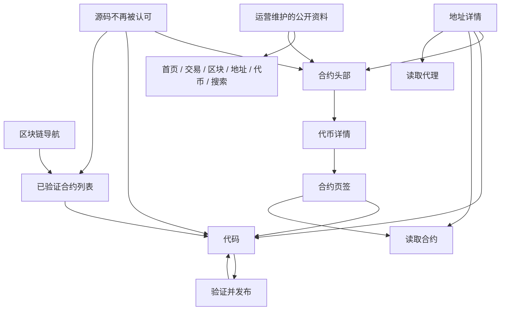
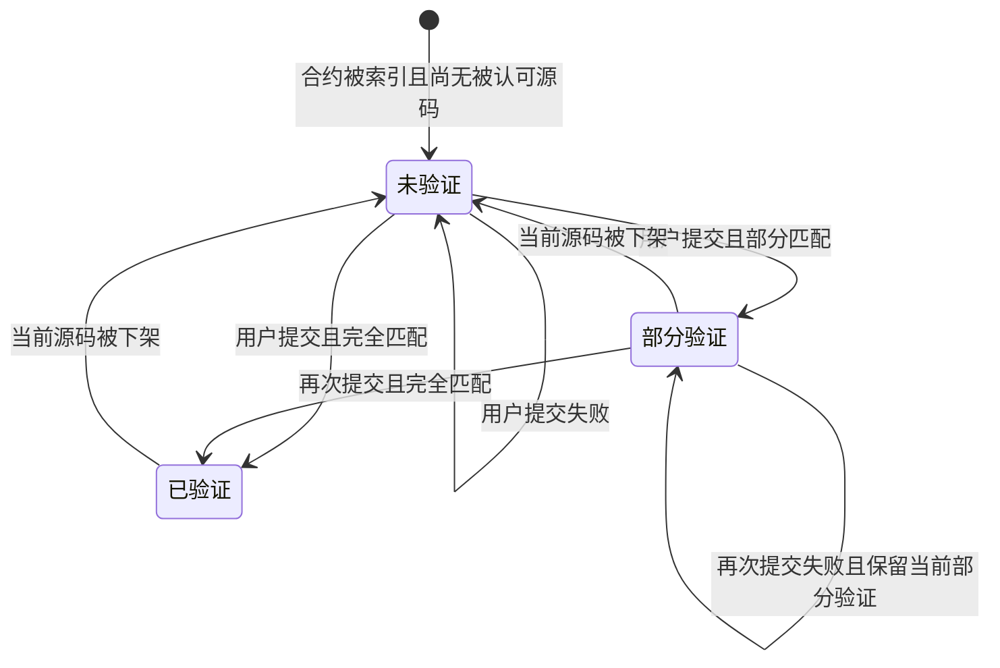

# BiyaEVM 区块浏览器产品需求文档

> 产品经理：Terry｜文档版本：V1.2.0｜文档状态：待产品确认｜日期：2026-10-29

## 文档说明

| 项目 | 内容 |
| --- | --- |
| 需求名称 | BiyaEVM 区块浏览器 V1.2.0 |
| 需求等级 | L3 复杂需求 |
| 核心目标 | 使用户能看懂合约，并在客户端只读消费运营维护的公开身份、诈骗标记、方法可读名与代币展示资料 |
| 目标用户 | 链上用户、合约交互方、运营与客服、安全研究人员、生态开发者 |
| 交互基线 | [V1.2-EVM浏览器原型（包含管理端）.html](./V1.2-EVM浏览器原型（包含管理端）.html) |
| 公开原型 | https://terryxu923.github.io/biya-dex-docs/BiyaEVMscan-v1.2.html |
| 公开 PRD | https://terryxu923.github.io/biya-dex-docs/biya-evm-explorer-prd-v1.2.html |
| 依赖需求 | [BiyaEVM区块浏览器_PRD_V1.0.md](../V1.0-原型/BiyaEVM区块浏览器_PRD_V1.0.md) V1.0.0 正式需求；[BiyaEVM区块浏览器_PRD_V1.1.md](../V1.1-原型/BiyaEVM区块浏览器_PRD_V1.1.md) V1.1.0 正式需求。宿主页面（首页、区块、交易、地址信息表与相关交易、全局搜索、ERC-20 转移与代币页前三个页签）以既有正式需求为准，本文不重写那些字段表；§4.8 只验收运营资料如何叠在这些页面上 |
| 范围底稿 | [EVM浏览器迭代版本表.md](../迭代计划/EVM浏览器迭代版本表.md) 的 V1.2 行。版本表原文不改。开发与测试以本文字段表为准 |
| 编写规范 | [产品需求文档编写规范](../../../PRD规范/产品需求文档编写规范.md) |
| 需求范围 | 仅 V1.2.0 增量。不含 V1.0.0 / V1.1.0 已交付字段与验收，不含 BiyaDEX 区块浏览器，不含管理端写入界面 |
| 一句话概述 | 用户在已有普通交易与 ERC-20 查询之上，无需登录即可识别、验证并只读解析合约，并看到运营维护的公开身份与风险提示 |

**文档定位**

本文只定义 V1.2.0 相对 V1.0.0 与 V1.1.0 的增量。两份正式需求仍然有效，读者验收普通交易、区块、首页、搜索和 ERC-20 时使用那些文档。运营资料如何叠在这些宿主页上，以本文 §4.8 为准。

本文是产品、设计、研发、测试和 AI 交付参与者共同使用的 V1.2.0 业务真相源。本文说明用户可见行为、业务规则和验收边界，不规定数据库、接口路径、索引器内部结构或前端框架。

本文是**客户端**需求。运营资料的写入在管理端完成；本文只定义客户端如何只读消费。不描述管理端表单、审核队列或运营操作步骤。

原型中的模拟数据仅用于表达页面和交互，不构成数据值、刷新频率、行情或链上事实。生产版本必须展示 Biya EVM 的真实索引数据、真实只读调用结果，以及当前生效的运营公开资料。

字段口径、验证三态、只读方法范围、验证回显、地址公开名替换哈希、诈骗提示与方法可读名，以行业 EVM 浏览器（BlockScout）的公开查询语义为准，再落到 Biya 中文界面。下列产品差异是已确认决定，不是源码缺口：不按名称搜索、不渲染资料绿标或认证星、源码下架后用户侧等同未验证、方法库自建。

页签扁平为「代码 / 读取合约 / 读取代理」、ABI 与编译器作为代码内页签、已验证列表含余额 / 交易数 / 许可证，是相对版本表原文的已确认产品增量，版本表原文不改。

已确认界面与版本表措辞冲突时，以已确认原型为准，版本表原文不改。

**证据分层（撰写时）**

| 类型 | 本文如何使用 |
| --- | --- |
| 事实 | BlockScout 公开查询语义（完全匹配 / 部分匹配、验证不登录、名替哈希、代币诈骗提示） |
| 已确认决定 | 会话已关闭的 Explorer / Admin / 运营联动口径；下架后用户侧=未验证；搜索不按名 |
| 推断 | 部分验证下再次提交失败时保留当前部分验证（与「失败不撤销已认可源码」一致） |
| 待定 | 见 §7；当前无未关闭项 |

**撰写语言**

正文和用户可见文案以中文为主。哈希、地址前缀、ABI、Solidity、view / pure 等链上原始标识保留必要英文，并在有确定业务含义时补充中文。

**原型已知未覆盖（验收以本文）**

- 原型样例仍展示代币美元；生产无行情时按 V1.1.0 BR-T11-04 处理。
- HTML 内遗留的 DEX 合约页、登录、页内筛选不进入本期范围。
- 验证表单预填的合约名、源码与标准 JSON 样例仅为演示；生产默认空，仅当从合约地址带入且已索引到合约名时预填名称。
- 只读查询的返回值为前端演示样例；生产必须展示对该合约发起只读调用的真实结果。
- 「失败 · 字节码不一致」「失败 · 编译器版本不匹配」在原型中仅能通过演示场景进入；验证表单提交无法产出这两种失败。
- 提交中主按钮不可重复点为生产规则；本原型无提交中停留，点验证并发布后直接展示回显。
- 有代币覆盖时，原型代币详情多出「链上名称」对照行；生产只改标题与列表中的展示名/符号，不要求单独「链上名称」字段。
- 出块地址的公开名仅样例区块演示；生产凡出块者有生效公开名，区块列表、区块详情与首页最新区块均按 §4.8 显示。
- 原型可用演示开关让诈骗地址出现在搜索建议中；生产按 §4.8.3 隐藏，不向用户提供「显示已标记地址」设置页。

上述条目中，前六条已写入原型演示面板「V1.2 · 演示说明」；后三条为运营资料追加后的演示限制，验收以本文为准。

---

## 目录

- [1. 本期交付摘要](#1-本期交付摘要)
- [2. 产品概述](#2-产品概述)
- [3. 功能列表与优先级](#3-功能列表与优先级)
- [4. 功能详细说明](#4-功能详细说明)
  - [4.1 导航与搜索边界](#41-导航与搜索边界)
  - [4.2 合约头部与页签](#42-合约头部与页签)
  - [4.3 代码](#43-代码)
  - [4.4 读取合约与读取代理](#44-读取合约与读取代理)
  - [4.5 代币详情 · 合约](#45-代币详情--合约)
  - [4.6 已验证合约列表](#46-已验证合约列表)
  - [4.7 验证提交](#47-验证提交)
  - [4.8 运营资料（客户端只读）](#48-运营资料客户端只读)
- [5. 横切业务规则与异常处理](#5-横切业务规则与异常处理)
  - [5.2 验证三态与页签](#52-验证三态与页签)
  - [5.11 运营资料业务规则（BR-OPS）](#511-运营资料业务规则br-ops)
- [6. 更新记录](#6-更新记录)
- [7. 待定事项](#7-待定事项)

---

## 1. 本期交付摘要

### 1.1 交付结果

本期在 V1.0.0 / V1.1.0 已交付的普通交易与 ERC-20 查询上，增加合约识别、验证与只读解析闭环，并让客户端只读消费运营维护的公开资料：

用户可以从地址认出合约及其验证状态，核验源码 / ABI / 字节码，只读调用 view / pure，从已验证列表进入合约代码，提交 Solidity 验证并在表单内看到成功、部分验证或失败原因。代币详情复用同一套代码与读取，不另做合约页面。源码被下架后，该地址按未验证展示，用户可再次提交。有生效公开名、诈骗标记、方法可读名或代币覆盖时，宿主页按 §4.8 叠加显示。

### 1.2 V1.2.0 核心能力

| 模块 | 交付能力 |
| --- | --- |
| 全局 | 区块链导航增加「已验证合约」。搜索范围不扩展到合约名或代币名 |
| 地址 · 合约头部 | 合约名称、验证状态（已验证 / 未验证 / 部分验证）、是否代理、是否代币合约；创建者与部署交易沿用 V1.0.0 |
| 地址 · 代码 | 已验证 / 部分验证展示信息表、源码、编译器、ABI、字节码；未验证以字节码为主并提供验证入口；代理展示类型与实现地址 |
| 地址 · 读取合约 | 按 ABI 列出 view / pure；调用中 / 成功 / 失败分开；无只读方法时空文案 |
| 地址 · 读取代理 | 仅当存在已验证实现时出现；方法来自实现合约 ABI |
| 代币详情 | 新增「合约」页签，复用代码与读取合约 |
| 已验证合约 | 列表：名称、地址、语言 / 编译器、验证时间、余额、交易数、许可证 |
| 合约验证 | Solidity 单文件 / 多文件 / 标准 JSON；成功、部分验证、失败原因在表单内回显；源码下架后等同未验证，可再提交 |
| 运营资料（只读） | 公开名与公开标签、诈骗红条与图标、交易方法可读名、代币展示名/符号/图标；不进搜索；无绿标 |
| 公共状态 | 代码、读取、列表、验证表单补齐加载、空数据、网络错误 |

### 1.3 明确不在本期范围

| 不在范围的能力 | 本期用户可见行为 |
| --- | --- |
| V1.0.0 已交付的首页、区块、交易四段、地址信息表与相关交易、全局搜索规则 | 本文不重写那些字段表；公开名、诈骗、方法名如何叠加见 §4.8 |
| V1.1.0 已交付的 ERC-20 摘要、代币转移、地址代币、代币列表、代币详情前三个页签 | 本文不重写那些字段表；代币详情新增「合约」页签；代币覆盖如何叠加见 §4.8 |
| 管理端写入界面 | 本文不定义运营如何新建、编辑、下架或上传；只定义客户端看到的结果 |
| DEX 区块浏览器页面和业务规则 | 本文不定义 |
| 通过钱包写合约、Write contract / Write proxy | 不提供连接钱包、签名或写操作入口 |
| 自定义 ABI | 不提供 |
| Vyper、Yul、Stylus、Sourcify、Hardhat、Foundry | 验证方式仅三种 Solidity |
| 按合约名或代币名搜索 | 搜索范围仍为交易哈希、地址、区块高度、区块哈希 |
| 已验证列表的筛选、排序控件、计数器、页内搜索 | 仅分页浏览 |
| 复制 calldata、地址输入的 Self、方法手风琴锚点 | 不提供 |
| 库地址、UML、在线 IDE、文件树、审计标、认证标 | 不提供 |
| 内部交易、日志、状态变化 | 不展示对应页签 |
| NFT | 不展示 |
| 登录、关注、私有标签 | 公共查链不要求登录 |
| 多语言 | 仅提供中文用户界面 |
| 外链网络的 EVM 页面 | 本期只验收 Biya EVM |

### 1.4 存量与在途

本期为公共只读查询增量，无登录用户、无在途订单。链上已部署的历史合约，在索引与验证完成后按本文规则展示。已生效的公开名、诈骗标记、方法可读名与代币覆盖，从生效时起按 §4.8 展示，不要求用户补填，不改写链上事实。源码下架只改变「当前是否认可这份源码」，不删除合约地址、交易或代币索引。V1.0.0 / V1.1.0 已上线页面继续有效，本期在既有地址详情、代币详情上增加合约相关页签与头部字段，新增已验证列表与验证提交页，并在宿主页叠加运营资料。

---

## 2. 产品概述

### 2.1 背景与当前问题

V1.0.0 已固化普通交易查询，V1.1.0 已固化 ERC-20 转移与代币页。用户打开合约地址时，仍无法判断是否已验证、无法核验源码，也无法按 ABI 只读读取状态。同时，桥、金库、乱码代币名、诈骗地址仍只显示哈希或链上原文，交易方法常为选择器。V1.2 原型已经表达合约头部、代码、读取、代理读取、代币页合约、已验证列表、Solidity 验证，以及运营资料在客户端的只读叠加，数据仍为前端模拟。

本需求将上述增量固化为生产要求，并明确：

1. 页面展示 Biya EVM 的真实索引结果与真实只读调用结果，不使用模拟值冒充链上事实。
2. 用户能区分已验证、部分验证、未验证；未验证包含从未验证与源码下架后。
3. 未验证以字节码为主，并给出验证入口；已验证仍可查看字节码。
4. 只读调用仅限 view / pure，不连接钱包。
5. 验证提交后留在表单，回显成功、部分验证或失败原因。
6. 无数据、参数无效和网络错误必须给出不同反馈。
7. 合约页面只在 EVM 下可达。
8. 生效中的公开名、诈骗标记、方法可读名与代币覆盖按 §4.8 展示；写入不在本文。

### 2.2 产品目标

| 目标 | 可观察结果 |
| --- | --- |
| 识别合约 | 用户能在地址头部看到名称、验证状态、是否代理、是否代币 |
| 核验源码 | 已验证合约可复制源码、ABI、字节码；未验证可复制字节码并去验证 |
| 只读解析 | 用户能对 view / pure 发起查询，看到调用中、成功返回值或失败原因 |
| 提交验证 | 用户能用三种 Solidity 方式提交，并在表单内看到三种回显 |
| 支持分享和复现 | 用户复制带页签的地址 / 代币 / 列表 / 验证页深链后，在新会话中打开相同对象 |
| 明确失败原因 | 代码、读取、列表、验证配置失败时区分空数据与网络错误 |
| 认出公开身份与风险 | 有生效公开名时引用处显示名字；已标记诈骗时地址/代币页给出警告 |
| 读懂方法与代币名 | 交易方法命中可读名；代币标题使用覆盖后的展示名，无绿标 |

### 2.3 非目标

- 不通过浏览器完成写合约、授权、转账或任何签名。
- 不在本需求中定义或重验收 V1.0.0 / V1.1.0 页面字段；只追加运营资料叠加规则。
- 不在本需求中定义 DEX 页面。
- 不在本需求中定义管理端如何写入公开名、诈骗标记、方法库、代币覆盖或下架源码。
- 不把所有链上原始数据无差别展示；只展示本文字段表规定的业务字段。
- 不承诺浏览器查询接口对外开放。
- 不以原型中的固定源码、固定 ABI 返回值和固定地址作为生产数据。
- 不把索引系统、编译器集群或验证器内部设计写入本 PRD。
- 不提供 ENS、用户申请公开标签、私有标签、认证星、资料绿标、按名称搜索。

### 2.4 目标用户与场景

| 用户角色 | 典型场景 | 需要完成的目标 |
| --- | --- | --- |
| 链上用户 | 打开交互过的合约 | 判断是否已验证，查看源码或字节码 |
| 合约交互方 | 调用前核验只读状态 | 展开 view 方法并得到返回值 |
| 运营与客服 | 处理“合约看不懂”、核对公开名或诈骗提示 | 区分未验证、部分验证、读取失败；确认客户端展示与当前生效资料一致 |
| 安全研究人员 | 核验代理实现 | 从代理跳到实现合约代码，用读取代理查实现 ABI |
| 生态开发者 | 发布源码 | 用单文件 / 多文件 / 标准 JSON 提交并看到回显 |

所有页面均为公开只读页面，不因角色不同改变数据可见范围，也不要求登录。验证提交是公开操作，不要求登录。

### 2.5 术语与统一口径

下列术语只定义本期新增对象。交易三态、接收方三种形态、原生币、ERC-20 等沿用既有正式需求，本文不重定义。

| 术语 | 定义 |
| --- | --- |
| 合约地址 | 链上有代码的地址；普通地址不是合约 |
| 已验证 | 当前被认可的源码，编译字节码与链上已部署字节码**完全匹配**。讲解时可称「完全验证」。界面徽章固定写「已验证」 |
| 部分验证 | 当前被认可的源码与链上字节码仅为**部分匹配**。源码仍可查看，有 ABI 仍可读取 |
| 未验证 | **当前没有被认可的匹配源码**。成因包括：从未提交过可匹配源码、提交全部失败、以及曾经匹配成功后源码被下架。用户侧这三种不可区分 |
| 代码 | 地址或代币页上用于展示源码、编译器、ABI、字节码的页签 |
| 读取合约 | 按本合约 ABI 列出并执行 view / pure |
| 读取代理 | 按实现合约 ABI 对本代理地址发起同样的只读调用 |
| 实现合约 | 代理合约指向的逻辑合约地址 |
| 验证并发布 | 用户提交 Solidity 源码与编译设置，系统比对字节码后回显结果。公开操作，不要求登录 |
| 单文件 flattened | 将依赖拍扁后的单一 Solidity 源码 |
| 多文件 | 上传全部 `.sol` 源文件 |
| 标准 JSON | 上传 solc standard-json-input |
| 只读方法 | ABI 中 `stateMutability` 为 `view` 或 `pure` 的函数 |
| 无参自动查询 | 无输入参数的只读方法在**该方法展开时**自动发起一次查询 |
| 公开名 | 运营为某地址维护的公开身份名称。生效时在引用处替换哈希显示；不是已验证合约名，也不是代币展示名 |
| 公开标签 | 运营为该公开名配备的短分类，如「官方桥」「多签」。紧挨公开名出现一次。不是 ERC-20 类型徽章，不是「已验证」徽章 |
| 诈骗标记 | 运营对该地址作出的潜在诈骗提示。客户端用红条（及代币页图标）表达，不改变余额、交易或验证状态 |
| 方法可读名 | 四字节选择器对应的人话名称，供交易「方法」列使用。读取合约的方法名来自 ABI，不使用本词 |
| 代币覆盖 | 运营为已索引 ERC-20 维护的展示名、符号与图标。只改展示，不改精度、供应、持有人或转账数额 |
| 源码下架 | 运营使当前被认可的源码不再作为该地址的验证事实。客户端结果等同未验证，允许再次提交 |

**产品关系说明**：合约页面只在 BiyaChain 的 EVM 模式下可达。进入 DEX 后的行为由独立需求负责。本文只定义进入 EVM 后的 V1.2.0 可见行为。

### 2.6 页面地图

| 页面或区域 | 标准入口 | 主要任务 |
| --- | --- | --- |
| 地址详情 · 合约头部 | 打开合约地址 | 识别名称、验证状态、代理、代币 |
| 地址详情 · 代码 | 合约地址内切换「代码」 | 核验源码 / ABI / 字节码，或去验证 |
| 地址详情 · 读取合约 | 已验证合约内切换 | 只读调用本合约 ABI |
| 地址详情 · 读取代理 | 有已验证实现的代理内切换 | 只读调用实现 ABI |
| 代币详情 · 合约 | 代币详情内切换「合约」 | 复用代码与读取，不另做页面 |
| 已验证合约列表 | 导航「区块链 — 已验证合约」 | 浏览已验证与部分验证合约 |
| 验证并发布 | 未验证 / 部分验证代码页的「验证并发布」，或从列表面包屑进入 | 提交 Solidity 并看回显 |
| 宿主页上的运营叠加 | 打开首页、交易、区块、地址、代币、搜索 | 按 §4.8 显示公开名、标签、诈骗提示、方法可读名、代币覆盖；无独立新页面 |

分享链接必须能直接打开同一业务页面、同一查询对象和同一页签。若研发调整路径实现，不得改变这一产品结果。运营资料随对象一起出现，分享链接不携带登录凭据。

---

## 3. 功能列表与优先级

| 功能模块 | 功能点 | 优先级 | 说明 |
| --- | --- | --- | --- |
| 全局 | 导航增加已验证合约 | P1 | 「区块链」菜单在代币列表之外增加已验证合约 |
| 全局 | 搜索不按合约名 | P1 | 范围不扩展；完整合约地址仍打开地址详情 |
| 地址 | 合约头部 | P1 | 名称、验证三态、是否代理、是否代币 |
| 地址 | 代码 | P1 | 源码 / 编译器 / ABI / 字节码；未验证以字节码为主 |
| 地址 | 读取合约 | P1 | 仅 view / pure |
| 地址 | 读取代理 | P1 | 有已验证实现才出现 |
| 代币 | 合约页签 | P1 | 复用代码与读取合约 |
| 合约 | 已验证列表 | P1 | 含余额、交易数、许可证 |
| 合约 | Solidity 验证提交 | P1 | 三法；表单内回显；下架后可再提交 |
| 合约 | 源码下架后的客户端结果 | P1 | 等同未验证；无「已下架」徽章 |
| 运营资料 | 公开名与公开标签 | P1 | 引用处名替哈希；地址页保留完整地址 |
| 运营资料 | 诈骗标记 | P1 | 地址/代币红条；代币图标可悬停；建议隐藏 |
| 运营资料 | 方法可读名 | P1 | 交易方法列命中人话、未命中选择器 |
| 运营资料 | 代币展示覆盖 | P1 | 覆盖名/符号/图标；无绿标；不进搜索 |
| 公共状态 | 加载、空数据、网络错误、验证回显 | P1 | 本期新增表面适用 |

---

## 4. 功能详细说明

## 4.1 导航与搜索边界

**相对 V1.1.0 的变化**

区块链导航增加「已验证合约」。搜索识别规则、建议条数、无结果页沿用 V1.0.0，本期不重写。本期明确：不按合约名称、公开名、公开标签、代币覆盖名出建议，也不因命中已验证合约而改为打开代码页签——完整地址仍打开地址详情，合约页签在地址页上出现。已被诈骗标记且开启搜索隐藏的地址，不出现在建议中；用户提交完整 40 位地址仍打开详情，见 §4.8.3。

### 4.1.1 流程步骤

| 步骤 | 用户操作 | 系统行为 | 可见结果 |
| --- | --- | --- | --- |
| 1 | 展开“区块链”菜单 | 展示交易列表、区块列表、代币列表、已验证合约 | 用户可进入已验证列表 |
| 2 | 点击「已验证合约」 | 打开已验证列表并保持 EVM | 见 §4.6 |
| 3 | 在全局搜索框输入合约名称、公开名、公开标签或代币覆盖名 | 不按名称检索 | 无对应建议；提交后按 V1.0.0 无结果规则处理 |
| 4 | 提交完整 40 位合约地址 | 打开地址详情 | 合约头部与页签按 §4.2 出现；若该地址被诈骗标记，同时按 §4.8.3 出红条 |
| 5 | 输入已被隐藏的诈骗地址的部分字符 | 建议中不出现该地址 | 不自动补全到该地址 |

### 4.1.2 字段说明

| 界面字段 | 业务含义 | 数据来源 | 展示规则 | 空值/异常 | 校验/交互 |
| --- | --- | --- | --- | --- | --- |
| 区块链导航 · 已验证合约 | 进入已验证合约列表的入口 | 产品配置 | 与交易列表、区块列表、代币列表并列 | 不允许缺失 | 点击进入 EVM 已验证列表 |

验证提交不进入顶栏导航。未验证与部分验证的代码页提供「验证并发布」。

### 4.1.3 验收标准

| 序号 | 验收条件 | 预期结果 |
| --- | --- | --- |
| AC-NV12-01 | 用户在 BiyaChain 的 EVM 下展开区块链菜单 | 可见交易列表、区块列表、代币列表、已验证合约；点击已验证合约进入 §4.6 |
| AC-NV12-02 | 用户输入某已验证合约的名称、某生效公开名或某代币覆盖名并提交 | 不打开代码页或代币详情；不出现按名称命中的建议 |
| AC-NV12-03 | 用户提交某已验证合约的完整地址 | 打开地址详情；出现合约头部与代码页签 |

---

## 4.2 合约头部与页签

**用户目标**

用户打开合约地址时，能认出这是什么合约、验证到什么程度、是不是代理或代币。

**相对 V1.0.0 / V1.1.0 的变化**

- 地址信息表在「是否合约」之后增加：合约名称、验证状态、是否代理、是否代币合约。
- 页签在「交易 / 代币转移 / 代币」之后，合约地址增加「代码」；满足条件时增加「读取合约」「读取代理」。
- 已验证或部分验证时，「代码」页签名称旁出现已验证标记；标题区出现「已验证」徽章。
- 创建者、部署交易沿用 V1.0.0 地址信息表，本文不重写。无创建信息时该项不出现。
- 普通地址不出现本期字段与合约页签。
- 公开名、公开标签、诈骗红条叠在地址标题区，规则见 §4.8；不改写本表「合约名称」「验证状态」。
- 源码下架后，本头部按未验证展示，见 §5.2。

### 4.2.1 流程步骤

| 步骤 | 用户操作 | 系统行为 | 可见结果 |
| --- | --- | --- | --- |
| 1 | 打开合约地址 | 查询地址与合约元数据 | 头部出现验证状态等字段；代码页签可见 |
| 2 | 打开普通地址 | 不查询合约代码页签 | 无代码 / 读取页签 |
| 3 | 点击「是否代币合约」中的查看代币 | 打开该 ERC-20 代币详情 | 进入 V1.1.0 代币详情 |
| 4 | 切换代码 / 读取合约 / 读取代理 | 加载对应内容 | 见 §4.3、§4.4 |

### 4.2.2 头部字段

| 界面字段 | 业务含义 | 数据来源 | 展示规则 | 空值/异常 | 校验/交互 |
| --- | --- | --- | --- | --- | --- |
| 合约名称 | 当前被认可源码中的合约名 | 验证记录 | 原文 | 未验证（含下架后）或无名称时整项不出现 | 只读；不是公开名，公开名见 §4.8 |
| 验证状态 | 当前被认可源码与链上字节码的匹配程度 | 验证记录 | 三选一徽章：已验证 / 部分验证 / 未验证 | 合约地址不允许缺失该项 | 只读；下架后为未验证 |
| 是否代理 | 该地址是否为代理合约 | 代理检测 | 否；或「是（代理类型）」 | 无法识别类型时「是（其他）」 | 只读 |
| 是否代币合约 | 该地址是否为已索引 ERC-20 | 代币索引 | 否；或「是」并附「查看代币」 | 不是代币时为否，不附链接 | 「查看代币」进入该代币详情 |
| 创建者 | 部署该合约的地址 | 创建交易 | 沿用 V1.0.0 | 无创建信息时整项不出现 | 沿用 V1.0.0：可进地址、可复制 |
| 部署交易 | 创建该合约的交易 | 创建交易 | 沿用 V1.0.0 | 无创建信息时整项不出现 | 沿用 V1.0.0：可进交易、可复制 |

标题区「已验证」徽章：已验证与部分验证均出现；未验证（含下架后）不出现。部分验证的区分以信息表「验证状态」为准，不另用第二种标题徽章。该徽章不是公开标签，也不是认证星，见 §4.8.2。

同一地址可以同时有公开名与合约名称：公开名是运营身份，合约名称来自被认可源码。下架后合约名称项消失；公开名是否仍显示只取决于该公开名是否仍生效。

### 4.2.3 页签出现条件

| 页签 | 出现条件 | 计数 | 默认 |
| --- | --- | --- | --- |
| 代码 | 该地址是合约 | 无计数 | 不改变原默认「交易」 |
| 读取合约 | 已验证或部分验证，且存在 ABI | 无计数 | — |
| 读取代理 | 是代理，且至少一个实现合约已验证或部分验证并存在 ABI | 无计数 | — |

已验证或部分验证但 ABI 中没有任何 view / pure：仍出现「读取合约」，内容为空文案，见 §4.4。未验证（含下架后）即使能取到字节码，也不出现读取页签。

代码页签的已验证标记：已验证或部分验证时出现，未验证不出现。

### 4.2.4 页面状态矩阵

| 场景 | 触发条件 | 页面展示 | 用户可操作 |
| --- | --- | --- | --- |
| 已验证普通合约 | 完全匹配且非代理、非代币 | 名称、已验证、是否代理=否、是否代币=否；代码带标记；有 ABI 则有读取合约 | 切页签 |
| 部分验证 | 部分匹配 | 验证状态为部分验证；标题仍有已验证徽章；代码带标记 | 可去验证并发布 |
| 未验证 | 当前无被认可源码（含从未验证与下架后） | 验证状态未验证；无读取页签；代码无标记；无「已下架」文案 | 代码页去验证 |
| 代理 | 检测到实现 | 是否代理为是（类型）；有已验证实现时出现读取代理 | 从代码进实现 |
| 代币合约 | 已索引 ERC-20 | 是否代币为是 + 查看代币 | 进代币详情 |
| 无创建信息 | 创建者 / 部署交易均不可用 | 该两项不出现；其余合约字段仍在 | — |
| 普通地址 | 不是合约 | 无本期字段、无代码 / 读取页签 | 沿用既有地址页 |
| 地址主体加载中 | 格式有效首次打开 | 沿用 V1.0.0；合约页签在可判定为合约后出现 | 返回 |
| 地址未找到 / 格式无效 | 沿用 V1.0.0 | 无合约页签 | 沿用 V1.0.0 |

### 4.2.5 验收标准

| 序号 | 验收条件 | 预期结果 |
| --- | --- | --- |
| AC-CH01 | 用户打开已验证非代理非代币合约 | 验证状态已验证；是否代理否；是否代币否；代码带已验证标记；出现读取合约 |
| AC-CH02 | 用户打开部分验证合约 | 验证状态部分验证；代码带已验证标记 |
| AC-CH03 | 用户打开未验证合约 | 验证状态未验证；无读取合约、无读取代理；代码无已验证标记 |
| AC-CH04 | 用户打开有已验证实现的代理 | 是否代理为是（含类型）；出现读取代理 |
| AC-CH05 | 用户打开已索引 ERC-20 合约地址 | 是否代币为是；「查看代币」进入该代币详情 |
| AC-CH06 | 用户打开无创建信息的合约 | 不出现创建者、部署交易；验证状态仍在 |
| AC-CH07 | 用户打开普通地址 | 无合约名称、验证状态、代码、读取页签 |
| AC-CH08 | 用户打开源码已被下架的合约 | 与 AC-CH03 相同：验证状态未验证；无读取页签；代码无已验证标记；不出现「已下架」或「审核中」 |

---

## 4.3 代码

**用户目标**

用户核验合约源码、编译设置、ABI 和链上字节码；未验证时复制字节码并去验证。

**相对既有需求的变化**

新增「代码」页签。已验证 / 部分验证默认打开源码；未验证（含下架后）不展示源码文件，以字节码为主。下架后的代码页与从未验证相同，见 §5.2。

### 4.3.1 流程步骤

| 步骤 | 用户操作 | 系统行为 | 可见结果 |
| --- | --- | --- | --- |
| 1 | 打开代码 | 查询合约代码 | 加载中为信息表骨架，页签可见 |
| 2 | 已验证时切换源码 / 编译器 / ABI / 字节码 | 展示对应内容 | 内页签互斥 |
| 3 | 多文件时切换文件 | 展示该文件源码 | 当前文件高亮 |
| 4 | 点击实现合约地址 | 打开该实现的代码 | 进入实现地址 |
| 5 | 未验证或部分验证时点击「验证并发布」 | 打开验证表单并带入本地址 | 见 §4.7 |
| 6 | 复制源码 / ABI / 字节码 | 复制完整原文 | 反馈沿用 V1.0.0 |

### 4.3.2 验证提示与信息表

仅已验证、部分验证展示信息表。未验证（含下架后）不展示本表，也不展示此前被认可过的源码或 ABI。

| 界面字段 | 业务含义 | 数据来源 | 展示规则 | 空值/异常 | 校验/交互 |
| --- | --- | --- | --- | --- | --- |
| 完全匹配提示 | 源码与字节码完全匹配 | 验证记录 | 「合约源码已验证（完全匹配）」 | 仅完全匹配出现 | 只读 |
| 部分匹配提示 | 源码仅为部分匹配 | 验证记录 | 「合约源码已验证（部分匹配）」+「验证并发布」 | 仅部分验证出现 | 按钮带入本地址进入 §4.7 |
| 合约名称 | 验证记录中的合约名 | 验证记录 | 原文 | 无名称整项不出现 | 只读 |
| 编译器版本 | 用于验证的 solc 版本 | 验证记录 | 原文 | 无则整项不出现 | 只读 |
| EVM 版本 | 编译目标 EVM | 验证记录 | 原文 | 无则整项不出现 | 只读 |
| 是否开启优化 | 编译时是否启用优化器 | 验证记录 | `true` 或 `false` | 无则整项不出现 | 只读 |
| 优化次数 | 优化器 runs | 验证记录 | 千分位整数 | 未开启优化时不展示本项 | 只读 |
| 验证时间 | 源码验证完成时间 | 验证记录 | 相对时间，后附本地绝对时间 | 无则整项不出现 | 只读 |
| 许可证 | 验证时声明的许可证 | 验证记录 | 许可证名称；无或声明为「无」时 `--` | 本行始终出现 | 只读 |
| 合约文件路径 | 主文件路径 | 验证记录 | 仅多文件时出现 | 单文件不占行 | 只读 |
| 代理类型 | 代理标准 | 代理检测 | 如 EIP-1967；无法识别为「其他」 | 非代理不出现 | 只读 |
| 实现合约 | 实现地址及名称 | 代理检测 | 完整地址；有名称时附名称 | 非代理不出现 | 地址进该实现的代码；可复制 |

许可证在信息表始终占行，与 BlockScout 无许可证时隐藏不同，是已确认产品口径。

### 4.3.3 已验证 / 部分验证的代码内页签

默认「源码」。无编译器设置时不出现「编译器」。无 ABI 时不出现「ABI」。「字节码」始终出现。

**源码**

| 界面字段 | 业务含义 | 数据来源 | 展示规则 | 空值/异常 | 校验/交互 |
| --- | --- | --- | --- | --- | --- |
| 构造参数 | 部署时的 ABI 编码构造参数 | 验证记录 | 仅非空且不仅为 `0x` 时出现在源码区顶部 | 空或仅 `0x` 不占行 | 可复制 |
| 文件切换 | 多文件源码的文件名 | 验证记录 | 多于 1 个文件时出现；单文件不出现 | — | 切换当前文件 |
| 合约源码 | 当前文件内容 | 验证记录 | 标题标明语言 Solidity；等宽展示 | 不允许为空 | 可复制完整源码 |

**编译器**

| 界面字段 | 业务含义 | 数据来源 | 展示规则 | 空值/异常 | 校验/交互 |
| --- | --- | --- | --- | --- | --- |
| 编译器设置 | 验证时的编译器 JSON | 验证记录 | 格式化 JSON | 无设置则无本页签 | 可复制 |

**ABI**

| 界面字段 | 业务含义 | 数据来源 | 展示规则 | 空值/异常 | 校验/交互 |
| --- | --- | --- | --- | --- | --- |
| 合约 ABI | 验证得到的 ABI | 验证记录 | 格式化 JSON | 无 ABI 则无本页签 | 可复制 |

**字节码**（已验证时仍提供）

| 界面字段 | 业务含义 | 数据来源 | 展示规则 | 空值/异常 | 校验/交互 |
| --- | --- | --- | --- | --- | --- |
| 合约创建代码 | 创建交易输入中的字节码 | 链上数据 | 十六进制 | 不可用时 `--` | 可复制 |
| 已部署字节码 | 链上当前代码 | 链上数据 | 十六进制 | 不可用时 `--` | 可复制 |

### 4.3.4 未验证

不展示源码、编译器、ABI 内页签，不展示 §4.3.2 信息表。

| 界面字段 | 业务含义 | 数据来源 | 展示规则 | 空值/异常 | 校验/交互 |
| --- | --- | --- | --- | --- | --- |
| 合约创建代码 | 创建交易输入中的字节码 | 链上数据 | 有创建代码时展示；右上「验证并发布」 | 无创建代码时本块不出现，验证入口改挂已部署字节码 | 可复制；按钮进入 §4.7 并带入地址 |
| 已部署字节码 | 链上当前代码 | 链上数据 | 始终尝试展示 | 不可用时 `--` | 可复制 |

### 4.3.5 页面状态矩阵

| 场景 | 触发条件 | 页面展示 | 用户可操作 |
| --- | --- | --- | --- |
| 加载中 | 打开代码且数据未返回 | 页签可见，信息表骨架 | 切其他页签、返回 |
| 已验证 · 单文件 | 完全匹配、一份源码 | 完全匹配提示 + 信息表 + 源码 | 切编译器 / ABI / 字节码、复制 |
| 已验证 · 多文件 | 多于一份源码 | 可切换文件；信息表有合约文件路径 | 切文件 |
| 部分验证 | 部分匹配 | 部分匹配提示 + 验证并发布 + 仍可看源码 | 去验证 |
| 未验证 | 当前无被认可源码（含下架后） | 创建代码与已部署字节码 + 验证并发布；无源码 / ABI | 复制、去验证 |
| 无创建信息的未验证 | 无创建交易 | 仅已部署字节码，验证入口挂在该块 | 去验证 |
| 代理代码 | 是代理 | 信息表含代理类型与实现地址 | 进实现代码 |
| 网络错误 | 代码查询失败 | 「合约代码加载失败，请重试」；头部保留 | 重试（留在代码） |

地址主体未找到或格式无效时无代码页签，沿用 V1.0.0。

### 4.3.6 验收标准

| 序号 | 验收条件 | 预期结果 |
| --- | --- | --- |
| AC-CD01 | 用户打开已验证单文件合约的代码 | 完全匹配提示；信息表含编译器、EVM、优化、验证时间、许可证；默认源码可复制 |
| AC-CD02 | 用户打开多文件已验证合约 | 可在文件名之间切换；信息表出现合约文件路径 |
| AC-CD03 | 用户打开部分验证合约的代码 | 部分匹配提示与「验证并发布」；仍可查看源码 |
| AC-CD04 | 用户打开未验证合约的代码 | 无源码 / ABI 内页签；可见已部署字节码与「验证并发布」 |
| AC-CD05 | 用户打开代理合约的代码 | 信息表含代理类型与可点击的实现地址 |
| AC-CD06 | 许可证声明为无 | 信息表许可证为 `--`，该行仍在 |
| AC-CD07 | 构造参数仅为 `0x` 或不存在 | 源码区不出现构造参数块 |
| AC-CD08 | 代码查询失败 | 「合约代码加载失败，请重试」；重试后仍在代码 |
| AC-CD09 | 用户打开源码已被下架的合约代码 | 与 AC-CD04 相同；可点「验证并发布」带入该地址；不出现「已下架」 |

---

## 4.4 读取合约与读取代理

**用户目标**

用户按 ABI 只读查询合约当前状态，无需钱包。

**相对既有需求的变化**

新增「读取合约」。满足 §4.2.3 时新增「读取代理」。二者表单状态机相同，读取代理的方法来自实现合约 ABI，调用目标仍是当前代理地址。未验证（含下架后）不出现本页签。读取页签的方法名来自 ABI，见 BR-OPS-06。

### 4.4.1 流程步骤

| 步骤 | 用户操作 | 系统行为 | 可见结果 |
| --- | --- | --- | --- |
| 1 | 打开读取合约 | 按本合约 ABI 列出 view / pure | 方法均折叠；仅 1 个方法时自动展开 |
| 2 | 展开无参方法 | 自动发起一次查询 | 调用中 → 成功或失败 |
| 3 | 展开有参方法 | 展示输入与输出预览，不自动查询 | 用户填写后点「查询」 |
| 4 | 点击查询 | 对该合约发起只读调用 | 按钮与输入禁用，无「查询中」文案；完成后填入返回值或在预览上方给出失败 |
| 5 | 修改输入 | 清除本次返回值，恢复预览 | 可再次查询 |
| 6 | 重置（单方法或全部） | 清空输入、清除结果 | 若该方法仍展开且无参，自动再查一次 |
| 7 | 全部展开 | 展开全部方法 | 其中无参方法按第 2 步自动查询 |
| 8 | 打开读取代理 | 使用实现 ABI，提示方法来源 | 实现合约地址可点击 |

### 4.4.2 列表与工具栏

| 界面字段 | 业务含义 | 数据来源 | 展示规则 | 空值/异常 | 校验/交互 |
| --- | --- | --- | --- | --- | --- |
| 方法来自实现合约 ABI | 读取代理时声明 ABI 来源 | 产品文案 | 仅读取代理顶部绿色提示 | 读取合约不出现 | 只读 |
| 实现合约 | 当前使用的实现地址 | 代理检测 | 读取代理时紧跟提示下方 | 无实现则无本页签 | 进该实现代码；可复制 |
| 合约信息 | 工具栏标题 | 产品文案 | 有只读方法时出现 | 无方法时整页空文案，无工具栏 | 只读 |
| 全部展开 / 全部收起 | 批量展开或收起 | 产品交互 | 只读方法多于 1 个时出现 | 仅 1 个方法时不出现 | 切换文案 |
| 重置 | 重置全部方法的输入与结果 | 产品交互 | 有只读方法时出现 | — | 见 BR-C12-04 |
| 方法行 | 序号、方法名、`read`、方法选择器 | ABI | `{n}. {name}` + `read` + 四字节选择器 | 选择器按 ABI 计算 | 点击展开 / 收起；选择器可复制 |

方法顺序与 ABI 中 view / pure 出现顺序一致。不列出 constructor、event、非 view / pure 的 function。

### 4.4.3 方法表单

| 界面字段 | 业务含义 | 数据来源 | 展示规则 | 空值/异常 | 校验/交互 |
| --- | --- | --- | --- | --- | --- |
| 输入项 | 方法参数 | ABI inputs | 标签 `{name} ({type})*`；占位符为类型 | 无 name 时用类型 | 必填；查询中禁用 |
| 无名称参数 | ABI 未给 name | ABI | 标签为 `<未命名参数> ({type})*` | — | 同输入项 |
| uint 的 Max | 该位宽最大值 | 类型推导 | 仅 `uint` / `uint<N>` 出现 | 其他类型无 | 填入该类型最大值 |
| 数组 | 动态或定长数组 | ABI | 默认一项；「添加」追加；删除到剩一项时不可再删 | 至少保留一项 | 项内类型与标量相同 |
| tuple | 元组 | ABI | 标题 `{name} ({type})*`，内嵌成员 | — | 成员按各自类型渲染 |
| 查询 | 发起只读调用 | 用户操作 | 实心主按钮，文案固定「查询」 | 查询中禁用，文案不变 | 见 BR-C12-03 |
| 方法内重置 | 重置该方法 | 用户操作 | 有成功结果或失败后出现 | 未查询过不出现 | 同 BR-C12-04 |
| 输出预览 | 返回值结构 | ABI outputs | 展开后始终展示灰色 `name (type) :`，值为空 | 无 output 时不占预览 | 只读 |
| 返回值 | 只读调用结果 | 链上 eth_call 语义 | 填入同一预览区；地址可跳转 | 见空值规则 | 地址可进地址详情 |
| 调用失败 | 节点回退或调用失败 | 节点返回 | 红色提示在预览**上方**；预览保持空结构 | 优先原文；无法解析时「调用失败」 | 可重置后重试 |

不提供：连接钱包、Write、模拟、复制 calldata、地址 Self。

查询 = 对当前合约（读取代理时为当前代理地址）发起只读调用，不发送链上交易、不消耗用户 Gas 作为交易费。

### 4.4.4 页面状态矩阵

| 场景 | 触发条件 | 页面展示 | 用户可操作 |
| --- | --- | --- | --- |
| 加载中 | 打开读取且 ABI 未返回 | 方法列表骨架 | 切页签 |
| 有多个只读方法 | ABI 含多于 1 个 view / pure | 全部折叠；工具栏有全部展开 | 展开单个或全部 |
| 仅 1 个只读方法 | 恰好 1 个 | 自动展开；若无参则自动查询 | 查询、重置 |
| 无参成功 | 无输入且调用成功 | 预览区填入返回值；出现方法内重置 | 重置 |
| 有参成功 | 填写后查询成功 | 同上 | 改输入会清除结果 |
| 未查询 | 有参方法展开后尚未查询 | 灰色输出预览，值为空 | 查询 |
| 数组 / 元组 | 参数含数组或 tuple | 按 §4.4.3 渲染 | 添加 / 删除项 |
| 调用中 | 已点查询、结果未返回 | 查询与输入禁用 | 不可重复点 |
| 调用失败 | 节点回退或失败 | 预览上方红色原因 | 重置、改参后重试 |
| 无只读方法 | 有 ABI 但无 view / pure | 「该合约暂无公开的只读方法」 | 切代码 |
| 读取网络错误 | ABI / 方法列表查询失败 | 「读取合约加载失败，请重试」 | 重试（留在读取合约） |
| 读取代理网络错误 | 同上（代理页签） | 「读取代理加载失败，请重试」 | 重试（留在读取代理） |
| 读取代理正常 | 有已验证实现 | 顶部「方法来自实现合约 ABI」+ 实现合约行 + 实现的只读方法 | 进实现代码 |
| 未验证 / 下架后 | 当前无被认可 ABI | 不出现读取合约、读取代理 | 去代码页验证 |

不得在进入页签时对**未展开**的无参方法批量自动查询。全部展开时，被展开的无参方法自动查询。

### 4.4.5 验收标准

| 序号 | 验收条件 | 预期结果 |
| --- | --- | --- |
| AC-RD01 | 用户打开含多个 view / pure 的已验证合约 | 方法折叠；可见序号、名称、`read`、可复制选择器；工具栏有全部展开与重置 |
| AC-RD02 | 用户展开无参方法 | 自动查询；成功后预览区出现返回值 |
| AC-RD03 | 用户展开有参方法后不点查询 | 仅灰色 `name (type) :` 预览，无返回值 |
| AC-RD04 | 用户查询中 | 查询按钮与输入禁用；按钮文案仍为「查询」 |
| AC-RD05 | 只读调用失败 | 红色失败在预览上方；预览结构仍在 |
| AC-RD06 | 已验证但无 view / pure | 「该合约暂无公开的只读方法」 |
| AC-RD07 | 读取合约查询失败 | 「读取合约加载失败，请重试」 |
| AC-RD08 | 用户打开有已验证实现的代理的读取代理 | 「方法来自实现合约 ABI」；实现地址可点击；方法来自实现 ABI |
| AC-RD09 | 实现未验证的代理 | 不出现读取代理页签 |
| AC-RD10 | 用户重置全部时部分方法仍折叠 | 折叠的无参方法不写入返回值；仅当前展开的无参方法自动再查 |

---

## 4.5 代币详情 · 合约

**用户目标**

用户在代币详情内查看该代币合约的源码与只读方法，不必先跳到地址页。

**相对 V1.1.0 的变化**

页签由「详情 / 代币转移 / 持有人」增加「合约」。概览、转移、持有人沿用 V1.1.0，本文不重写字段表；代币覆盖名、诈骗图标如何叠在这些页签上见 §4.8。代币合约源码下架后，「合约」页签按未验证展示。

### 4.5.1 流程步骤

| 步骤 | 用户操作 | 系统行为 | 可见结果 |
| --- | --- | --- | --- |
| 1 | 打开代币详情 | 页签含「合约」；已验证或部分验证时「合约」旁有已验证标记 | 默认仍为详情 |
| 2 | 打开「合约」 | 默认代码，规则同 §4.3 | 可切到读取合约 |
| 3 | 在合约内打开读取合约 | 规则同 §4.4 读取合约 | 无读取代理 |

### 4.5.2 展示规则

代币「合约」页签内再分为「代码」与「读取合约」（有 ABI 时）。字段、空值、复制、验证并发布与地址页同一套规则，不另做页面、不另做字段表。

代币详情不提供「读取代理」，即使该代币合约同时是代理。用户需到地址详情使用读取代理。

代码 / 读取的加载与失败文案与地址页相同；重试留在代币详情的合约页签。

### 4.5.3 页面状态矩阵

| 场景 | 触发条件 | 页面展示 | 用户可操作 |
| --- | --- | --- | --- |
| 已验证代币 | 代币合约已验证 | 合约页签带已验证标记；代码与读取可用 | 切代码 / 读取 |
| 未验证代币 | 代币合约未验证 | 合约页签无标记；代码为字节码 | 去验证 |
| 合约加载中 | 打开合约且代码未返回 | 页签可见，代码骨架 | 切回详情 |
| 合约网络错误 | 代码查询失败 | 「合约代码加载失败，请重试」 | 重试后仍在代币合约 |
| 读取网络错误 | 读取查询失败 | 「读取合约加载失败，请重试」 | 重试后仍在代币合约读取 |

代币未找到、地址格式无效沿用 V1.1.0，无合约页签。

### 4.5.4 验收标准

| 序号 | 验收条件 | 预期结果 |
| --- | --- | --- |
| AC-TKC01 | 用户打开已验证 ERC-20 的合约页签 | 可见与地址页相同的代码信息与源码；可切读取合约 |
| AC-TKC02 | 用户打开未验证 ERC-20 的合约页签 | 以字节码为主；有「验证并发布」 |
| AC-TKC03 | 代币合约页签 | 不出现读取代理 |
| AC-TKC04 | 代币合约代码失败后点重试 | 仍在该代币的合约页签，不跳到地址页 |
| AC-TKC05 | 代币合约源码已被下架 | 合约页签无已验证标记；代码以字节码为主；有「验证并发布」；标题仍按 §4.8.5 使用覆盖名（若有） |

---

## 4.6 已验证合约列表

**用户目标**

用户浏览本链已验证与部分验证的合约，比较编译器、验证时间、余额、交易数和许可证，并进入代码。

### 4.6.1 流程步骤

| 步骤 | 用户操作 | 系统行为 | 可见结果 |
| --- | --- | --- | --- |
| 1 | 从导航打开已验证合约 | 加载列表 | 第 1 页，默认按验证时间从新到旧 |
| 2 | 点击名称或地址 | 打开该合约代码 | 进入 §4.3 |
| 3 | 翻页 | 加载对应页 | 页码更新 |

本期不做列头排序、筛选、计数器、页内搜索。

### 4.6.2 展示字段

| 界面字段 | 业务含义 | 数据来源 | 展示规则 | 空值/异常 | 校验/交互 |
| --- | --- | --- | --- | --- | --- |
| 合约 | 名称与地址 | 验证记录 | 上行名称；下行截断地址 | 无名称时名称为 `--`，地址仍展示 | 名称与地址均进该合约代码；地址可复制完整值 |
| 语言 / 编译器 | 源码语言与编译器版本 | 验证记录 | 上行语言（本期均为 Solidity）；下行编译器版本 | 无编译器时 `--` | 只读 |
| 验证时间 | 验证完成时间 | 验证记录 | 已验证圆点 + 相对时间，下行绝对时间 | `--` | 只读 |
| 余额 | 该合约当前原生币余额 | 地址余额 | 数量 + `BYB` | 0 显示 `0 BYB`；不可用 `--` | 只读；不附美元 |
| 交易数 | 与该地址相关的交易数 | 地址计数 | 非负整数，千分位 | 0 显示 0 | 只读 |
| 许可证 | 验证时声明的许可证 | 验证记录 | 许可证名称；无或「无」为 `--` | `--` | 只读 |

未验证合约不出现在本列表，包括源码已被下架的地址。部分验证与完全匹配均进入本列表。本列「合约」名称使用被认可源码中的合约名，不使用公开名；无合约名时名称为 `--`，地址仍展示。

余额、交易数、许可证是相对版本表原文的已确认增量，与 BlockScout 已验证列表默认列对齐。

### 4.6.3 页面状态矩阵

| 场景 | 触发条件 | 页面展示 | 用户可操作 |
| --- | --- | --- | --- |
| 加载中 | 首次打开或翻页 | 表格骨架 | 返回 |
| 正常 | 有已验证或部分验证合约 | 每页 20 条 | 进代码、翻页 |
| 第 2 页 | 总数大于 20 | 第 2 页行 | 翻页 |
| 暂无数据 | 尚无已验证合约 | 「暂无已验证合约」 | 返回、重试 |
| 网络错误 | 查询失败 | 「已验证合约加载失败，请重试」 | 重试 |

### 4.6.4 验收标准

| 序号 | 验收条件 | 预期结果 |
| --- | --- | --- |
| AC-VL01 | 用户打开有数据的已验证列表 | 6 列：合约、语言 / 编译器、验证时间、余额、交易数、许可证 |
| AC-VL02 | 用户点击名称 | 打开对应合约代码，而非交易或代币详情 |
| AC-VL03 | 许可证为无 | 该列为 `--` |
| AC-VL04 | 尚无已验证合约 | 「暂无已验证合约」 |
| AC-VL05 | 未验证合约 | 不出现在本列表；部分验证出现 |
| AC-VL06 | 源码已被下架的合约 | 不出现在本列表 |

---

## 4.7 验证提交

**用户目标**

用户提交 Solidity 源码与编译设置，核对链上字节码，并在表单内看到成功、部分验证或失败原因。

页面标题为「验证并发布合约」。成功后不自动离开表单。

### 4.7.1 流程步骤

| 步骤 | 用户操作 | 系统行为 | 可见结果 |
| --- | --- | --- | --- |
| 1 | 从代码页「验证并发布」进入 | 打开表单并带入该合约地址 | 地址已填 |
| 2 | 从已验证列表面包屑进入且未带地址 | 地址为空 | 用户手填 |
| 3 | 选择验证方式 | 切换单文件 / 多文件 / 标准 JSON 专有区 | 已填地址与许可证保留 |
| 4 | 填写必填项并提交 | 校验后比对字节码 | 按钮提交中不可重复点 |
| 5 | 成功 / 部分 / 失败 | 表单顶部回显 | 可点「查看代码」；失败可改后重提 |

### 4.7.2 公共字段

| 界面字段 | 业务含义 | 数据来源 | 展示规则 | 空值/异常 | 校验/交互 |
| --- | --- | --- | --- | --- | --- |
| 合约地址 | 待验证地址 | 用户输入或带入 | 完整地址 | 空不可提交 | 必填；须为合法合约地址 |
| 许可证 | 源码许可证声明 | 用户选择 | 默认「无」；选项含 MIT、Apache-2.0、GPL-3.0、BSD-3-Clause | 允许保持「无」 | 非必填 |
| 验证方式 | Solidity 提交形态 | 用户选择 | 单文件 flattened / 多文件 / 标准 JSON | 不允许空 | 必填；切换保留地址与许可证 |
| 合约名 | 源码中的 contract 名 | 用户输入 | 须与源码 `contract Name` 一致 | 空不可提交 | 必填 |
| 编译器版本 | solc 版本 | 用户选择 | 默认 `v0.8.20+commit.a1b79de6`；不得选 nightly | 不允许空 | 必填 |
| 构造参数 | ABI 编码构造参数 | 用户输入 | 占位 `0x…` | 允许空 | 选填 |

### 4.7.3 单文件与多文件专有字段

| 界面字段 | 业务含义 | 数据来源 | 展示规则 | 空值/异常 | 校验/交互 |
| --- | --- | --- | --- | --- | --- |
| EVM 版本 | 编译目标 | 用户选择 | 必填；选项含 london / paris / shanghai / cancun | 不允许空 | 若字节码不匹配，系统可尝试最新 EVM 再验 |
| 已开启优化 | 是否启用优化器 | 用户勾选 | 默认勾选；与「优化次数」同一行 | — | 取消勾选后隐藏次数 |
| 优化次数 | runs | 用户输入 | 默认 200；非负整数 | 未开启优化时不提交本值 | 开启时必填 |
| 合约代码（单文件） | flattened 源码 | 用户粘贴 | 等宽文本 | 空不可提交 | 必填 |
| 源码文件（多文件） | 全部 `.sol` | 用户上传 | 拖放或点击添加；已选文件可移除 | 一个文件都没有不可提交 | 必填至少一个 `.sol` |

标准 JSON 不单独展示 EVM 版本与优化器，这些值包含在 JSON 内。

| 界面字段 | 业务含义 | 数据来源 | 展示规则 | 空值/异常 | 校验/交互 |
| --- | --- | --- | --- | --- | --- |
| Standard Input JSON | solc 标准输入 | 用户上传 | 拖放或点击添加 | 未上传不可提交 | 必填一个 JSON |

### 4.7.4 回显

提交后留在本表单。回显在表单顶部。

| 结果 | 展示 | 下一步 |
| --- | --- | --- |
| 完全匹配 | 「验证成功」+「查看代码」 | 查看代码进入该地址代码 |
| 部分匹配 | 「部分验证」+「查看代码」 | 查看代码进入该地址代码 |
| 失败 · 字节码不一致 | 「验证失败：字节码不一致」 | 修改源码或设置后重提 |
| 失败 · 编译器版本不匹配 | 「验证失败：编译器版本不匹配」 | 改编译器版本 |
| 失败 · 地址不是合约 | 「验证失败：地址不是合约」 | 改地址 |
| 失败 · 源码为空 | 「验证失败：源码为空」 | 补源码或文件 |
| 失败 · 合约名为空 | 「验证失败：合约名为空」 | 填写合约名 |

### 4.7.5 页面状态矩阵

| 场景 | 触发条件 | 页面展示 | 用户可操作 |
| --- | --- | --- | --- |
| 加载中 | 打开表单且编译器列表未返回 | 表单骨架 | 返回 |
| 配置加载失败 | 编译器 / 方式配置失败 | 「验证配置加载失败，请重试」 | 重试 |
| 单文件 | 默认或选择单文件 | 源码文本区 | 提交 |
| 多文件 | 选择多文件 | 上传区；已添加时可移除 | 提交 |
| 标准 JSON | 选择标准 JSON | JSON 上传区 | 提交 |
| 带入地址 | 从代码页进入（含下架后的未验证） | 地址已填 | 可改 |
| 提交中 | 已点验证并发布 | 主按钮不可重复点 | 等待 |
| 成功 / 部分 / 失败 | 验证结束 | 表单仍在，顶部回显 | 查看代码或修改重提 |

不提供 Vyper、Sourcify、Hardhat、Foundry。不要求登录，不连接钱包。已验证（完全匹配）期间代码页不出现「验证并发布」，用户不能从该入口覆盖当前验证。源码下架后该地址视为未验证，可从代码页带入本表单再次提交。部分验证下再次提交失败时，表单回显失败原因，该地址仍保持部分验证，不退回未验证。

### 4.7.6 验收标准

| 序号 | 验收条件 | 预期结果 |
| --- | --- | --- |
| AC-VF01 | 用户从无地址进入验证页 | 标题「验证并发布合约」；许可证默认「无」；编译器默认 `v0.8.20+commit.a1b79de6`；优化默认开启、次数 200 |
| AC-VF02 | 用户从某未验证合约代码进入 | 地址已带入 |
| AC-VF03 | 用户在三种方式间切换 | 专有区切换；地址与许可证保留 |
| AC-VF04 | 验证完全匹配 | 表单不离开；「验证成功」与「查看代码」 |
| AC-VF05 | 验证部分匹配 | 「部分验证」与「查看代码」 |
| AC-VF06 | 字节码不一致 | 「验证失败：字节码不一致」 |
| AC-VF07 | 配置加载失败 | 「验证配置加载失败，请重试」 |
| AC-VF08 | 用户提交空源码 | 「验证失败：源码为空」或提交前拦截，不得写成成功 |
| AC-VF09 | 用户提交时合约名为空 | 「验证失败：合约名为空」，不得写成「源码为空」或成功 |
| AC-VF10 | 用户从源码已被下架的合约代码进入验证页 | 地址已带入；可提交；成功或部分匹配后按 §5.2 进入对应状态 |
| AC-VF11 | 用户在部分验证下再次提交失败 | 表单回显失败原因；该地址代码页仍为部分验证，源码与读取仍在 |

---

## 4.8 运营资料（客户端只读）

**用户目标**

用户在已有的首页、交易、区块、地址、代币和搜索上，认出运营维护的公开身份与诈骗风险，读懂交易方法名和代币展示名，而不需要登录，也不在客户端维护这些资料。

**相对既有需求的变化**

- 不新增独立业务页面。公开名、公开标签、诈骗提示、方法可读名、代币覆盖叠在 V1.0.0 / V1.1.0 宿主页上。
- 宿主页原有字段表仍以 V1.0.0 / V1.1.0 为准，本节只定义叠加规则。
- 合约验证下架不是本节的新页面，见 §4.2–§4.7 与 §5.2。
- 写入、编辑、失效这些资料的操作不在本文。

### 4.8.1 范围、关系与独立性

客户端消费四类运营资料，外加验证状态（验证状态的写入者是用户提交 + 匹配结果，运营只决定是否仍认可）：

| 资料 | 客户端作用 | 主规则 |
| --- | --- | --- |
| 公开名与公开标签 | 回答「这是谁」 | §4.8.2 |
| 诈骗标记 | 回答「危不危险」 | §4.8.3 |
| 方法可读名 | 交易「方法」列的人话 | §4.8.4 |
| 代币覆盖 | 代币标题与列表的可读名/图标 | §4.8.5 |
| 源码是否仍被认可 | 已验证 / 部分验证 / 未验证 | §5.2 |

三项名字不得混用：

| 名字 | 谁产生 | 出现在 | 不出现在 |
| --- | --- | --- | --- |
| 公开名 / 公开标签 | 运营维护 | 地址身份、交易从/到、出块者、持有人 | 不覆盖代币展示名；不覆盖已验证合约名；不进搜索 |
| 代币展示名 | 索引，可被运营覆盖 | 代币列表、代币详情标题、转移摘要中的代币 | 不进搜索；无绿标 |
| 已验证合约名 | 用户提交且当前仍被认可 | 合约头部、已验证列表 | 下架后不再当身份 |

公开名、诈骗标记、验证状态互相独立：

- 公开名失效不等于打上诈骗标记。
- 打上诈骗标记不清空公开名，也不改变验证状态。
- 源码下架不清空公开名、诈骗标记、代币覆盖，也不删除方法库里已有的选择器。

数据来源在字段表中写「运营维护的公开资料」或「运营维护的展示覆盖」，表示由运营侧维护、客户端只读。本文不展开维护界面。

### 4.8.2 公开名、公开标签与各类徽章

#### 徽章与标签不得混用

| 视觉物 | 业务含义 | 谁产生 | 出现位置 | 不是什么 |
| --- | --- | --- | --- | --- |
| 公开标签 | 该地址的身份分类，如「官方桥」「多签」 | 运营维护 | 紧挨公开名，同一处只一次 | 不是 ERC-20 类型、不是「已验证」、不是诈骗图标 |
| 地址类型 | 普通地址 / 合约 / 代币合约 | 链上索引 | 地址页标题类型行 | 不是公开标签 |
| 已验证徽章 | 当前源码被认可（完全或部分） | 匹配结果 | 地址/代币标题区与代码页签旁 | 部分验证也出现；不是认证星 |
| ERC-20 类型徽章 | 该代币标准 | 索引 | 代币标题或列表类型 | 不是公开标签 |
| 诈骗图标 | 该代币合约被标记为潜在诈骗 | 运营打标 | 代币标题、列表名、转移摘要中的代币名旁 | 悬停出警告；地址页只用红条 |

同一处公开名与公开标签各出现一次。不得把公开标签画成「已验证」，也不得用类型徽章代替公开标签。

#### 地址详情（本页主体就是这个地址）

| 顺序 | 可见内容 | 条件 |
| --- | --- | --- |
| 1 | 地址类型 + 公开标签（有则一次） | 类型始终有；标签仅当公开名生效且有标签 |
| 2 | 生效中的公开名 | 仅当该地址有生效公开名 |
| 3 | 完整地址 + 复制 | 始终有；本页不把哈希藏进悬停 |

本页不套用「名替哈希」。用户必须能直接读到并复制完整地址。

#### 引用处（名替哈希）

适用于：交易详情发送方/接收方（或交互合约）、交易列表从/到、地址相关交易、区块内交易、首页最新交易、出块者、代币转移从/到、持有人。

| 界面字段 | 业务含义 | 数据来源 | 展示规则 | 空值/异常 | 校验/交互 |
| --- | --- | --- | --- | --- | --- |
| 公开名 | 该地址的公开身份 | 运营维护的公开资料 | 有生效公开名时，用名字替换哈希文案 | 无或已失效：仍显示哈希或短哈希，沿用 V1.0.0 | 点击进入该地址详情；悬停公开名只显示完整 40 位地址 |
| 公开标签 | 该身份的短分类 | 运营维护的公开资料 | 紧挨公开名，一次 | 无标签则不占位 | 只读；不可点出独立页 |
| 复制 | 复制该地址 | 链上地址 | 有公开名时按钮仍在 | — | 复制完整哈希，不复制公开名 |

同一格子里不得出现第二份公开名或公开标签，不得在名字旁再跟哈希文案。复制成功反馈沿用 V1.0.0。

#### 明确不换名的位置

| 位置 | 规则 |
| --- | --- |
| 地址详情标题下的完整地址行 | 见上，本页保留哈希 |
| 代币详情合约地址行 | 代币页身份是代币展示名，不是公开名；该行保持地址 |
| 已验证列表「合约」列 | 使用被认可源码中的合约名；无则 `--`，地址仍展示 |
| 验证表单的地址输入 | 输入控件，不替换为公开名 |
| 搜索建议与搜索结果 | 不按公开名或公开标签检索 |

#### 页面状态矩阵

| 场景 | 触发条件 | 页面展示 | 用户可操作 |
| --- | --- | --- | --- |
| 引用处有生效公开名 | 该地址公开名生效 | 公开名 + 标签各一次；无哈希文案 | 悬停看出地址；复制哈希；进入地址 |
| 引用处无 / 已失效 | 未维护或已失效 | 只显示哈希或短哈希 | 沿用 V1.0.0 |
| 地址详情有生效公开名 | 打开该地址 | 类型行含标签；其下公开名；再下完整地址 | 复制完整地址 |
| 普通地址无公开名 | 未维护 | 类型 + 完整地址，无公开名行 | 沿用 V1.0.0 |
| 出块者有公开名 | 该出块地址生效 | 区块列表、区块详情、首页最新区块的出块者按引用处规则 | 进入该地址 |

### 4.8.3 钓鱼与诈骗标记

诈骗标记作用在地址上。若该地址同时是已索引 ERC-20 合约，代币页也消费同一标记。

| 界面字段 | 业务含义 | 数据来源 | 展示规则 | 空值/异常 | 校验/交互 |
| --- | --- | --- | --- | --- | --- |
| 地址页红条 | 该地址被标记为潜在诈骗 | 运营维护的公开资料 | 标题下方全宽提示：「该地址已被标记为潜在诈骗。」 | 未标记则整条不出现 | 只读；不阻断查看余额、交易、代码 |
| 代币页红条 | 该代币合约被标记为潜在诈骗 | 同上 | 「该代币已被标记为潜在诈骗。」 | 未标记则整条不出现 | 只读 |
| 诈骗图标 | 代币名旁的风险提示 | 同上 | 仅代币标题、代币列表名称、转移摘要中的代币名旁 | 未标记不出现；地址页不用图标 | 鼠标移入显示「该代币已被标记为潜在诈骗。」 |
| 搜索建议 | 避免把已标记地址推荐出来 | 同上，且搜索隐藏开启 | 建议中不出现该地址 | 隐藏未开启时建议仍可出现（生产默认开启隐藏） | 用户提交完整 40 位仍打开详情并出红条 |

交易从/到、列表、首页**不**为诈骗地址额外画红条或图标。风险提示集中在地址详情与代币详情。

未标记时，钓鱼或诈骗代币按普通代币展示。标记不改变余额、转账数额、验证状态、公开名或代币覆盖。

| 场景 | 触发条件 | 页面展示 | 用户可操作 |
| --- | --- | --- | --- |
| 已标记地址 | 打开该地址 | 红条 + 其余地址字段照常 | 继续查交易、代码 |
| 已标记代币 | 打开该代币 | 红条 + 标题旁图标 | 悬停图标读警告；继续查转移 |
| 搜索隐藏 | 输入该地址前缀 | 建议无此条 | 提交完整 40 位仍打开 + 红条 |
| 未标记 | 无诈骗资料 | 无红条无图标 | — |

### 4.8.4 方法签名

| 界面字段 | 业务含义 | 数据来源 | 展示规则 | 空值/异常 | 校验/交互 |
| --- | --- | --- | --- | --- | --- |
| 交易方法 | 该笔交易调用的函数 | 选择器命中运营维护的方法库则为可读名；否则为选择器本身 | 人话如 `transfer`、`claim`；未命中为 `0x` + 8 位十六进制 | 原生币转账无选择器：沿用 V1.0.0，不造方法名 | 只读；同一笔交易在交易列表、交易详情、区块内交易、地址相关交易上的文案必须一致 |
| 读取合约方法名 | ABI 中的函数名 | 该合约当前被认可的 ABI | `{序号}. {名称}`，规则见 §4.4 | 未验证无 ABI 则无读取页签 | 不得用方法库冒充 ABI |

首页最新交易沿用 V1.0.0，本期不验收方法列。日志、内部交易、按方法筛选不在本期。

方法库按选择器全局命中，不按合约逐笔填写。缺失可读名不阻断打开交易页。

| 场景 | 触发条件 | 页面展示 | 用户可操作 |
| --- | --- | --- | --- |
| 库中有名 | 选择器命中 | 方法为人话 | 打开详情 |
| 库中无名 | 有选择器未命中 | `0x` + 8 位 | 打开详情 |
| 原生转账 | 无选择器 | 沿用 V1.0.0 类型/空值 | — |
| 读取页签 | 已验证或部分验证 | 方法名来自 ABI | 查询 view / pure |

### 4.8.5 代币展示覆盖

| 界面字段 | 业务含义 | 数据来源 | 展示规则 | 空值/异常 | 校验/交互 |
| --- | --- | --- | --- | --- | --- |
| 代币展示名 | 用户看到的代币名称 | 有覆盖则用覆盖名，否则用链上文本 | 标题形态 `名称 (符号)` | 链上亦空：未命名占位，不编造 | 点击进入该代币详情；不进搜索 |
| 代币符号 | 用户看到的符号 | 有覆盖则用覆盖符号，否则用链上符号 | 与名称同时出现 | 空则不造符号 | 只读 |
| 代币图标 | 列表与标题旁的标识 | 有上传图标则用该图标，否则字母块 | 同一套图标用于列表、详情标题、转移摘要、地址持有 | 无图标用字母块，不留空白破图 | 只读 |
| 合约地址行 | 该代币合约地址 | 链上地址 | 代币详情保留本行，显示地址 | — | 可复制、可进地址详情 |
| 资料绿标 / 认证星 | — | — | **不渲染** | — | — |

覆盖只改展示。精度、总供应、持有人数、转账数额、是否合约，仍来自索引与链上事实。源码下架不清空覆盖。完整代币合约地址仍打开地址详情，沿用 V1.1.0。

生产无单独「链上名称」对照行。覆盖后的名字就是标题和列表里的名字。

| 场景 | 触发条件 | 页面展示 | 用户可操作 |
| --- | --- | --- | --- |
| 有覆盖 | 运营维护了展示名或图标 | 列表、详情、摘要、持有均用覆盖结果 | 进代币详情；按覆盖名搜索无建议 |
| 无覆盖 | 未维护 | 链上名 + 字母块或已有图标 | 沿用 V1.1.0 |
| 覆盖 + 诈骗 | 同时存在 | 覆盖名 + 诈骗图标 + 红条 | 见 §4.8.3 |
| 乱码链上名被覆盖 | 链上文本不可读且已覆盖 | 用户看到覆盖名；无绿标 | 按覆盖名搜索仍无结果 |

### 4.8.6 与验证状态的关系

验证三态与下架见 §5.2。本节只约束叠加：

- 下架后，已验证合约名不再当身份；若无公开名，引用处与头部只显示哈希。
- 下架后，读取页签消失；交易方法列仍可使用方法库中的选择器命中结果。
- 代币页标题始终走代币展示名，不走公开名，也不走已验证合约名。

### 4.8.7 验收标准

| 序号 | 验收条件 | 预期结果 |
| --- | --- | --- |
| AC-OPS01 | 用户打开有生效公开名的地址 | 类型行含公开标签（有标签时）；其下公开名一次；再下完整地址与复制；公开名不出现第二次 |
| AC-OPS02 | 用户打开以该地址为接收方的交易 | 接收方可见公开名 + 公开标签各一次，无哈希文案；悬停公开名出现完整地址；复制得到哈希 |
| AC-OPS03 | 用户打开公开名已失效的地址，以及仍指向它的交易 | 只显示哈希；无公开名、无公开标签 |
| AC-OPS04 | 用户输入某生效公开名或公开标签并搜索 | 无按名称命中的建议；提交后按 V1.0.0 无结果规则处理 |
| AC-OPS05 | 用户打开已标记诈骗的地址 | 红条「该地址已被标记为潜在诈骗。」；余额与交易仍可见 |
| AC-OPS06 | 用户打开已标记诈骗的代币 | 红条「该代币已被标记为潜在诈骗。」；标题旁图标；移入图标出现同一句警告 |
| AC-OPS07 | 用户输入已隐藏诈骗地址的前缀；再提交完整 40 位 | 建议中无该地址；完整地址打开详情且有红条 |
| AC-OPS08 | 用户查看方法库已命中与未命中的两笔交易 | 命中显示可读名；未命中显示 `0x` + 8 位；列表与详情一致 |
| AC-OPS09 | 用户打开已验证合约的读取页签 | 方法名来自 ABI，不因方法库缺名而改成选择器列表 |
| AC-OPS10 | 用户打开有覆盖资料的代币 | 列表、详情标题、转移摘要使用覆盖名/符号/图标；无绿标、无认证星；合约地址行仍在 |
| AC-OPS11 | 用户按覆盖名搜索 | 无按名称命中的建议 |
| AC-OPS12 | 同一地址同时有公开名、已验证合约名、代币覆盖 | 地址引用处用公开名；合约头部用合约名；代币标题用覆盖名；三者同时存在且互不覆盖 |
| AC-OPS13 | 用户对照地址页与代币页的各类徽章 | 公开标签、地址类型、已验证徽章、ERC-20 类型、诈骗图标可区分，不互相替代 |
| AC-OPS14 | 用户打开已验证列表中的一行 | 「合约」列是合约名与地址，不是公开名 |
| AC-OPS15 | 原生币转账 | 方法列不出现方法库编造的函数名 |

---

## 5. 横切业务规则与异常处理

原生币费用、交易三态、时区 UTC+8、复制成功反馈 1.5 秒、列表截断与复制完整值，沿用 V1.0.0。ERC-20 数量与无行情美元沿用 V1.1.0。本节定义本期合约增量与运营资料客户端规则。

## 5.1 数据真实性与一致性

1. 所有生产合约元数据、源码、ABI、字节码、验证状态均以 Biya EVM 已确认链上数据与**当前被认可的**验证记录为事实来源。源码下架后，该记录不再作为展示事实。
2. 只读调用的生产返回值必须来自对该合约的只读调用，不得使用原型样例值。
3. 原型中的固定源码、固定 ABI、固定返回值、固定地址、固定公开名不得作为生产默认数据。
4. 同一合约在地址头部、代码信息表、已验证列表、代币合约页签中的**合约名称、验证状态、编译器、许可证**必须一致。公开名、代币覆盖名与合约名称是不同对象，允许同时存在且文本不同，见 BR-OPS-08。
5. 读取代理展示的方法集合必须与实现合约「读取合约」一致。
6. 已验证列表可查询总数 = 完全匹配条数 + 部分验证条数，不含未验证，也不含源码已下架的地址。
7. 同一地址的公开名、公开标签、诈骗标记在所有引用处必须一致。同一代币的覆盖名、符号、图标在列表、详情、摘要、持有中必须一致。同一笔交易的方法文案在列表、详情、区块内交易、地址相关交易中必须一致。

## 5.2 验证三态与页签

见 BR-C12-01。已验证与部分验证均可读取（有 ABI 时）。未验证不可读取。部分验证与未验证均可再次「验证并发布」。完全匹配的代码页不出现「验证并发布」。

### 5.2.1 三态定义

| 状态（界面） | 业务事实已经成立 | 用户可见 | 允许的下一步 |
| --- | --- | --- | --- |
| 已验证（完全验证） | 当前被认可源码的编译字节码与链上已部署字节码完全匹配 | 标题「已验证」徽章；代码页签带标记；信息表「完全匹配」；有 ABI 则有读取；进入已验证列表；代码页无「验证并发布」 | 查看源码 / 读取 |
| 部分验证 | 当前被认可源码仅为部分匹配 | 信息表为部分验证；标题仍有「已验证」徽章；代码可看；有 ABI 则可读取；进入已验证列表；代码页有「验证并发布」 | 可再提交 |
| 未验证 | 当前没有被认可的匹配源码 | 无标题已验证徽章；代码以字节码为主；无读取页签；不在已验证列表；有「验证并发布」；无「已下架」文案 | 可提交 |

未验证的成因（用户侧不可区分）：

1. 从未提交过可匹配源码。
2. 提交过但全部失败，从未形成被认可记录。
3. 曾经已验证或部分验证，当前源码已被下架。

界面徽章固定写「已验证 / 部分验证 / 未验证」。术语「完全验证」仅用于讲解，与「已验证」同义。

### 5.2.2 状态转移

产品状态只描述用户可见的合约代码认可结果。匹配器内部排队、运营台账不是客户端状态。

| 触发 | 起点 | 终点 | 客户端后果 |
| --- | --- | --- | --- |
| 提交完全匹配 | 未验证或部分验证 | 已验证 | 代码可看；读取出现；进列表；验证入口消失 |
| 提交部分匹配 | 未验证或部分验证 | 部分验证 | 代码可看；读取出现；进列表；仍可验证并发布 |
| 提交失败 | 未验证 | 未验证 | 表单回显失败；代码页不变 |
| 提交失败 | 部分验证 | 部分验证 | 表单回显失败；**保留**当前部分验证源码与读取 |
| 源码下架 | 已验证或部分验证 | 未验证 | 头部未验证；代码=字节码+验证并发布；读取消失；列表去掉该行；合约名不再当身份 |
| 源码下架 | 未验证 | 不适用 | 没有可下架的被认可源码 |
| 已验证期间再提交 | 已验证 | 不适用 | 代码页无入口，不能覆盖当前验证 |

下架后任何人可再次公开提交。下架不清空公开名、诈骗标记、代币覆盖，也不删除方法库中已有选择器。验证提交不要求登录、不连接钱包。

## 5.3 时间口径

验证时间使用相对时间，口径沿用 V1.0.0：不足 60 秒显示 `N 秒前`；不足 60 分钟显示 `N 分钟前`；不足 24 小时显示 `N 小时前`；其余显示 `N 天前`。列表可在相对时间下附绝对时间。时间缺失展示 `--`，不得使用浏览器当前时间补值。

## 5.4 分页与可浏览范围

| 规则 | 统一口径 |
| --- | --- |
| 已验证列表每页 | 20 条 |
| 默认页 | 第 1 页 |
| 排序 | 按验证时间从新到旧；本期无列头排序 |
| 已验证列表可浏览上限 | 最近 10,000 条 |
| 链上已验证总量 | 可大于 10,000，与可浏览上限分开 |
| 页码过小 / 过大 | 分别按第 1 页 / 实际末页展示 |

用户正在查看的列表页不因新验证自动换页。

## 5.5 查询与深链状态

- 地址合约深链必须包含 EVM 模式、唯一地址和当前页签（代码 / 读取合约 / 读取代理）。
- 代码内页签（源码 / 编译器 / ABI / 字节码）与多文件当前文件应可随深链恢复。
- 代币合约深链保留代币地址与「合约」页签，以及代码 / 读取。
- 已验证列表深链保留页码。
- 验证表单深链可带入合约地址与当前验证方式。
- 完整 40 位地址打开地址详情，即使该地址是已验证合约。
- 用户从列表进入代码再返回时，应恢复进入前页码。
- 分享链接不得包含登录凭据或个人标识。
- 合约页面只在 EVM 下可达。

## 5.6 加载、错误、空态与重试

| 状态 | 触发条件 | 统一反馈 | 后续动作 |
| --- | --- | --- | --- |
| 加载中 | 首次查询、切页、切页签 | 对应内容区骨架 | 等待；保留导航与页签 |
| 暂无数据 | 有效对象没有对应数据 | 「该合约暂无公开的只读方法」「暂无已验证合约」 | 返回、切代码 |
| 参数无效 | 沿用地址 / 代币格式规则 | 沿用 V1.0.0 / V1.1.0 | 修改输入 |
| 网络错误 | 请求失败、断网或超时 | 「{页面对象}加载失败，请重试」 | 重试、返回 |
| 调用失败 | 只读调用被节点回退 | 该方法内红色原因，不是整页错误 | 改参、重置、重试 |
| 验证配置失败 | 编译器列表等配置失败 | 「验证配置加载失败，请重试」 | 重试 |
| 验证业务失败 | 字节码 / 编译器 / 非合约 / 源码为空 | 「验证失败：{原因}」 | 修改后重提 |

错误态不得用另一条有效合约替代。地址主体与代码 / 读取页签的加载、失败相互独立：主体已返回时，代码失败不得拆掉头部。详情页的加载、无结果、格式无效和网络错误展示在内容区，不使用遮挡整页的浮层。

代币合约页的重试必须留在代币详情，不得改写为地址详情。

## 5.7 长文本与复制

- 列表中的合约地址允许截断。
- 详情与代码页优先展示完整值。
- 源码、ABI、字节码、编译器 JSON、方法选择器被截断时必须支持悬停或聚焦查看全文。
- 复制始终复制完整原始值，不复制省略号。
- 复制成功反馈持续 1.5 秒；复制失败显示“复制失败，请手动复制”。

## 5.8 权限与安全边界

- 所有本期查询页面与验证提交页公开可访问，不要求登录。
- 浏览器不提供任何链上写操作或签名请求，包括 Write contract。
- 只读调用不得被实现成发送交易。
- 页面展示链上公开地址、源码和 ABI，不附加非公开个人身份信息。
- 链接和错误信息不得展示访问令牌、Cookie 或账户凭据。
- 写合约、自定义 ABI、Vyper、Sourcify、UML、IDE 在 EVM 下不可到达。
- 运营资料的写入在管理端完成；本文只定义客户端只读消费。客户端不提供新建公开名、打诈骗标、上传代币图标、勾选已验证或下架源码的入口。
- 本期客户端无导出。
- 只读查询不产生互斥写操作；同一对象同时打开多个页签不改变链上事实。
- 验证提交是对公开源码与公开地址的比对，不构成对合约的升级或所有权变更，不要求登录或连接钱包。

## 5.9 无障碍与设备适配

- 页签切换、方法展开、查询、重置、分页、复制、重试、验证提交均可通过键盘操作。
- 当前页签、禁用中的查询按钮和错误信息具有可被辅助技术识别的状态。
- 桌面端和移动端均不得隐藏完成合约核验所必需的字段或操作。
- 窄屏可使用横向滚动承载表格与源码，但不得改变字段含义和数据顺序。

## 5.10 合约业务规则（BR-C12）

下列规则只定义一次，页面字段表与验收引用编号。

| 编号 | 规则 | 正常结果 | 反例 / 边界 |
| --- | --- | --- | --- |
| BR-C12-01 | 验证三态与页签 | 已验证 / 部分验证：代码带标记，有 ABI 则有读取合约。未验证（含下架后）：无读取页签，代码以字节码为主，可再提交。读取代理仅当存在已验证或部分验证的实现。完全匹配代码页无验证入口。部分验证下再次提交失败仍保留部分验证 | 不得把部分验证当成未验证而隐藏源码；不得给未验证提供读取；不得在用户侧展示「已下架」；不得因提交失败把部分验证打回未验证 |
| BR-C12-02 | 空组不占行 | 无合约名、无创建信息、构造参数为空或仅 `0x`、非代理、单文件无路径行，均不占行。许可证在代码信息表始终占行，无则为 `--` | 不得为空组渲染「暂无」占位；不得因许可证为无而删行 |
| BR-C12-03 | 只读查询 | 查询 = 只读调用，不发交易。查询中禁用按钮与输入，文案保持「查询」。输出预览在展开后常驻。失败在预览上方 | 不得在进页时对未展开无参方法批量查询；不得把查询中写成「查询中」按钮文案 |
| BR-C12-04 | 无参自动查询与重置 | 无参方法仅在该方法展开时自动查询（含仅 1 个方法自动展开、全部展开、展开后重置）。折叠方法重置后不写入返回值 | 不得在重置全部后给折叠方法填入结果 |
| BR-C12-05 | 读取代理 ABI 来源 | 方法列表来自实现合约 ABI，调用目标为当前代理地址。顶部固定「方法来自实现合约 ABI」 | 不得用代理自身 ABI 冒充读取代理；实现未验证则无本页签 |
| BR-C12-06 | 代币页复用 | 代币「合约」与地址代码 / 读取同一套字段。无读取代理 | 不得另做第三套合约页；重试不得跳到地址页 |
| BR-C12-07 | 已验证列表范围 | 含完全匹配与部分验证；不含未验证，也不含源码已下架的地址。默认验证时间从新到旧。余额只显示原生币，不附美元。名称列用合约名不是公开名 | 不得把未验证或已下架列入；不得因无行情隐藏余额 |
| BR-C12-08 | 验证回显留在表单 | 成功、部分、失败均不自动跳转。失败原因分开：字节码、编译器、非合约、源码为空、合约名为空 | 不得用 Toast 代替回显；不得把部分验证写成完全成功；不得把空合约名写成源码为空 |
| BR-C12-09 | 验证方式仅 Solidity 三法 | 单文件、多文件、标准 JSON。许可证默认无。编译器默认 `v0.8.20+commit.a1b79de6` | 不得出现 Vyper / Sourcify / Hardhat / Foundry 入口 |
| BR-C12-10 | 代码内页签 | ABI、编译器是代码的内页签，不是地址一级页签。无编译器设置则无编译器内页签 | 不得把 ABI 做成与代码并列的地址页签 |

## 5.11 运营资料业务规则（BR-OPS）

下列规则只定义一次，§4.8 字段表与验收引用编号。不改指 BR-C12。

| 编号 | 规则 | 正常结果 | 反例 / 边界 |
| --- | --- | --- | --- |
| BR-OPS-01 | 公开名只在生效时展示 | 生效：引用处名替哈希，地址页名 + 完整地址。失效或未维护：只哈希 | 不得把已失效公开名继续当身份；不得按公开名搜索 |
| BR-OPS-02 | 名替哈希的范围 | 交易从/到、列表、出块者、持有人：有名则名字替换哈希，悬停只出完整地址，复制仍是哈希 | 不得在地址详情藏完整地址；不得在代币详情合约地址行换公开名 |
| BR-OPS-03 | 标签与徽章不混用 | 公开标签紧挨公开名且一次。地址类型、已验证徽章、ERC-20 类型、诈骗图标各司其职 | 不得把公开标签画成已验证；不得用 ERC-20 徽章代替公开标签；不得让公开名或标签出现第二次 |
| BR-OPS-04 | 诈骗标记独立 | 地址页红条固定「该地址已被标记为潜在诈骗。」代币页红条固定「该代币已被标记为潜在诈骗。」并附可悬停图标。不改余额、交易、验证状态 | 不得在交易从/到额外画红条；不得用公开标签代替诈骗提示；不得因打标清空公开名 |
| BR-OPS-05 | 搜索隐藏与直达 | 建议中不出现已隐藏的诈骗地址；提交完整 40 位仍打开详情并出红条 | 不得因隐藏而让完整地址打不开；不得按公开名或覆盖名出建议 |
| BR-OPS-06 | 方法库与 ABI 分工 | 交易「方法」列：命中可读名，未命中选择器。读取合约 / 读取代理方法名只来自 ABI | 不得用方法库冒充 ABI；不得给原生转账编造函数名；同一笔交易各列表文案必须一致 |
| BR-OPS-07 | 代币覆盖只改展示 | 覆盖名/符号/图标用于列表、详情标题、摘要、持有。无绿标。不进搜索。不改精度、供应、持有人、转账数额 | 不得渲染资料绿标或认证星；不得用覆盖名打开搜索结果；源码下架不得清空覆盖 |
| BR-OPS-08 | 三项名字与三态独立 | 公开名、已验证合约名、代币展示名可同时存在。下架只取消合约名与验证页签，不清空公开名、诈骗标记、代币覆盖、方法库选择器 | 不得用其中一项覆盖另一项；不得把下架写成用户可见的第四种验证徽章 |

**只读返回值算例**

| 场景 | 输入 | 界面结果 |
| --- | --- | --- |
| 无参 string | `name()` 返回 `Tether USD` | `(string) : Tether USD` |
| 无参 uint | `decimals()` 返回 `6` | `(uint8) : 6` |
| 地址 | 返回合法地址 | 可点击跳转该地址 |
| 数组 | 返回 `[1, 2, 3]` | 等宽展示数组 |
| tuple | 返回成员 | 按成员 `name (type) :` 分行 |
| 调用失败 | 节点回退 | 预览上方红色原因，预览值为空 |
| 无 output 的 view | ABI outputs 为空 | 无预览块；成功时不造假字段 |

---

## 6. 更新记录

| 版本 | 日期 | 说明 |
| --- | --- | --- |
| V1.2.0 | 2026-10-27 | 待产品确认。正文只收录 V1.2.0 增量：合约头部、代码、读取合约、读取代理、代币详情合约页签、已验证列表、Solidity 三法验证。写合约不进本期。V1.0.0 / V1.1.0 字段与验收不写入本文。版本表原文不改。已确认界面优先于版本表措辞 |
| V1.2.0 | 2026-10-27 | 文档状态升为正式需求。范围、字段、验收与版本号不变 |
| V1.2.0 | 2026-10-27 | 补 AC-VF09：空合约名回显「验证失败：合约名为空」，与空源码分开 |
| V1.2.0 | 2026-10-27 | 原型演示说明收录三类遗留（样例美元、遗留 DEX 标记、表单预填、读取样例值、字节码/编译器失败仅演示跳转、无提交中停留）。验收仍以本文 |
| V1.2.0 | 2026-10-29 | 追加运营资料客户端只读消费。验证下架融入 §4.2–§4.7 / §5.2 状态机；公开名、标签、诈骗、方法、代币覆盖新增 §4.8。文档状态改回待产品确认。交互基线改指含运营叠加的累计原型。不改版本号，不改 V1.0 / V1.1 正文，不写管理端 |

V1.0.0 变更历史见 [BiyaEVM区块浏览器_PRD_V1.0.md](../V1.0-原型/BiyaEVM区块浏览器_PRD_V1.0.md)。V1.1.0 变更历史见 [BiyaEVM区块浏览器_PRD_V1.1.md](../V1.1-原型/BiyaEVM区块浏览器_PRD_V1.1.md)。

---

## 7. 待定事项

本期无未关闭待定事项。下列决定已写入正文，不再提问：

- 合约增量：D1–D8、读取表单 Q-R、排版 Q-L
- 运营资料：D1–D10、Q-N1–N4、Q-S1–S8（混合章节、待产品确认、名替哈希、地址页保留哈希、部分验证失败保留当前状态、客户端不写管理端）

| 编号 | 问题 | 影响规则/页面/验收 | 业务决定人 | 确认前默认做法 | 受影响范围及上线影响 | 状态与答复依据 |
| --- | --- | --- | --- | --- | --- | --- |
| — | — | — | — | — | — | 无 |
